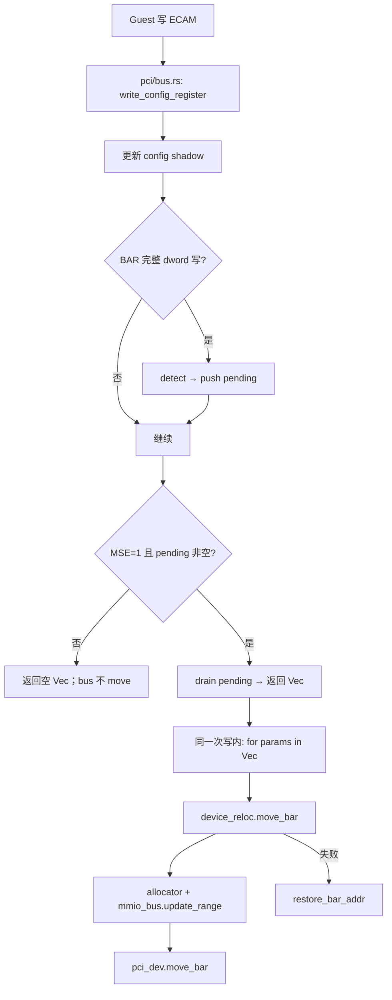

<!--
Copyright 2026 Amazon.com, Inc. or its affiliates. All Rights Reserved.
SPDX-License-Identifier: Apache-2.0
-->

# Cloud Hypervisor：PCI BAR 重编程实现摘要

本文档仅描述 **Cloud Hypervisor（CH）** 的 PCI BAR 重编程实现，供设计与评审参考。内容来自 CH `main` 分支源码及 PR [#7057](https://github.com/cloud-hypervisor/cloud-hypervisor/pull/7057)、[#7063](https://github.com/cloud-hypervisor/cloud-hypervisor/pull/7063)、[#7950](https://github.com/cloud-hypervisor/cloud-hypervisor/pull/7950)。

**相关 CH 链接**

| 资源 | 说明 |
|------|------|
| [PR #7057](https://github.com/cloud-hypervisor/cloud-hypervisor/pull/7057) | `detect_bar_reprogramming` 内化进 `PciConfiguration` |
| [PR #7063](https://github.com/cloud-hypervisor/cloud-hypervisor/pull/7063) | MSE 门控搬迁；VFIO pending 支持 |
| [PR #7064](https://github.com/cloud-hypervisor/cloud-hypervisor/pull/7064) | VFIO BAR 搬时同步 IOMMU mapping |
| [Issue #7938 / PR #7950](https://github.com/cloud-hypervisor/cloud-hypervisor/pull/7950) | `move_bar` 失败时 `restore_bar_addr` |

---

## 1. 问题与目标

Guest（内核 PCI 核心或驱动）会 **动态修改 PCI BAR 地址**。VMM 必须保持两处一致：

1. **Config shadow**：guest 读 BAR 寄存器得到的值
2. **MMIO 路由表**：guest 对 BAR 做 `readl`/`writel` 时，MMIO trap 路由到哪个设备

若 shadow 已更新而 MMIO 路由未搬迁 → guest 访问新地址时 `MissingAddressRange` 或访问旧映射 → 设备 probe / activate 失败。

CH 在 PR #7063 中统一所有 PCI 设备（virtio-pci、VFIO、vfio-user 等）的 BAR 搬迁语义，与 Linux/edk2 驱动的 **MSE（Memory Space Enable）** 习惯对齐。

---

## 2. MSE 与驱动侧惯例

PCI **Command 寄存器**（config offset `0x04`）**bit 1** = **MSE（Memory Space Enable）**。

| MSE | 行为 |
|-----|------|
| 0 | 设备不响应 BAR MMIO |
| 1 | 设备响应 BAR MMIO |

常见驱动流程：

```text
1. 清 MSE（disable MMIO）
2. 写 BAR 新地址（可写多个 BAR）
3. 置 MSE（enable）→ 从此刻起使用新 MMIO 地址
```

CH 约定：**仅在 MSE=1 时** 将 pending 队列交给 bus 层并执行 `move_bar`（更新 MMIO 路由）。

---

## 3. 核心机制：pending 队列

### 3.1 数据结构

`PciConfiguration` 内维护：

```rust
pending_bar_reprogram: Vec<BarReprogrammingParams>
```

`BarReprogrammingParams` 描述一次待搬迁：

| 字段 | 含义 |
|------|------|
| `old_base` | MMIO bus 上当前映射的 guest 地址 |
| `new_base` | guest shadow 中的新地址 |
| `len` | BAR 大小 |
| `region_type` | `Memory32` / `Memory64` / `Io` 等 |

### 3.2 push 与 drain

| 操作 | 时机 | 效果 |
|------|------|------|
| **push** | BAR **完整 4 字节（dword）** 写，且 `detect_bar_reprogramming` 判定地址变化 | 记入 `pending_bar_reprogram`；**不**改 MMIO bus |
| **drain 并返回** | 本次 `write_config_register` 末尾，**MSE=1** 且队列非空 | `drain(..)` 成 `Vec` 返回给 `pci/bus.rs` |
| **不返回** | MSE=0 | 队列保留，返回空 `Vec`；**不**触发 `move_bar` |

**要点**：「返回 pending」= 本次 ECAM 写处理中，bus 层 **需要立即执行** `move_bar`；不是异步任务。

---

## 4. 源码：调用链（`pci/src/bus.rs`）

Guest 通过 ECAM（`PciConfigMmio`）写 config 时，CH **不在 bus 层提前调 `detect`**，而是：

```text
write_config_register()  →  返回 bar_reprogram Vec  →  device_reloc.move_bar()
```

### 4.1 `PciConfigMmio::config_space_write`

源码位置：`pci/src/bus.rs`（`PciConfigMmio`）

```rust
let pci_bus = self.pci_bus.lock().unwrap();
if let Some(d) = pci_bus.devices.get(&(device as u8)) {
    let mut device = d.lock().unwrap();

    // ① 写 config；返回待搬迁列表（可能为空）
    let (bar_reprogram, _) = device.write_config_register(register, offset, data);

    // ② 若本次返回非空，在同一次 ECAM 写处理内立刻搬迁
    for params in &bar_reprogram {
        if let Err(e) = pci_bus.device_reloc.move_bar(
            params.old_base,
            params.new_base,
            params.len,
            device.deref_mut(),
            params.region_type,
        ) {
            warn!(
                "Failed moving device BAR: {}: 0x{:x}->0x{:x}(0x{:x}), keeping old BAR",
                e, params.old_base, params.new_base, params.len
            );
            device.restore_bar_addr(params);
        }
    }
}
```

说明：

- CH 中搬迁执行体是 **`pci_bus.device_reloc`**（类型为 `Arc<dyn DeviceRelocation>`，VMM 里由 **`AddressManager`** 实现），**不是**字面意义上的 `vm.move_bar`。
- `move_bar` 与 `write_config_register` 在 **同一次** guest config 写的事务里 **同步** 完成。
- `PciConfigIo`（port `0xcf8/0xcfc`）路径逻辑相同。

GitHub：[pci/src/bus.rs](https://github.com/cloud-hypervisor/cloud-hypervisor/blob/main/pci/src/bus.rs)

---

## 5. 源码：`write_config_register` 与 MSE 门控（`pci/src/configuration.rs`）

模拟设备（virtio-pci 等使用 `PciConfiguration`）的核心逻辑：

```rust
pub fn write_config_register(
    &mut self,
    reg_idx: usize,
    offset: u64,
    data: &[u8],
) -> Vec<BarReprogrammingParams> {
    // ① 更新 shadow（byte / word / dword）
    match data.len() {
        1 => self.write_byte(...),
        2 => self.write_word(...),
        4 => self.write_reg(reg_idx, LittleEndian::read_u32(data)),
        _ => (),
    }

    // ② BAR 完整 dword 写 → detect → push pending
    if let Some(param) = self.detect_bar_reprogramming(reg_idx, data) {
        self.pending_bar_reprogram.push(param);
    }

    // ③ MSE=1 才 drain 并返回；否则 pending 留着，返回空 Vec
    if !self.pending_bar_reprogram.is_empty() {
        if self.read_config_register(COMMAND_REG) & COMMAND_REG_MEMORY_SPACE_MASK
            == COMMAND_REG_MEMORY_SPACE_MASK
        {
            return self.pending_bar_reprogram.drain(..).collect();
        }
        // MSE=0：日志记录 pending，但不返回
    }

    Vec::new()
}
```

`detect_bar_reprogramming` 要点（同文件）：

- 仅 `data.len() == 4`（完整 dword 写）才检测
- 忽略 sizing 写 `0xffff_ffff`
- 64-bit BAR：通常在 **高 dword** 写齐后构成完整 `new_base` 才生成 `BarReprogrammingParams`
- detect 时会 **提前更新** `bars[].addr` / `registers[]`（因此 `move_bar` 失败时需要 `restore_bar_addr`）

GitHub：[pci/src/configuration.rs](https://github.com/cloud-hypervisor/cloud-hypervisor/blob/main/pci/src/configuration.rs)

---

## 6. `move_bar` 何时执行（时序表）

| Guest 动作 | `write_config_register` 行为 | 返回 `bar_reprogram` | `device_reloc.move_bar` |
|------------|------------------------------|----------------------|-------------------------|
| 写 BAR，MSE=0 | push pending | `[]` | **不执行** |
| 写 BAR，MSE=1（少见） | push + drain | 非空 | **本次写后立即执行** |
| 写 COMMAND，MSE 0→1 | 队列已有 pending，MSE 变 1 | 非空（多条可能） | **本次写后立即执行** |
| 写非 BAR 寄存器，MSE=0 | 无新 pending | `[]` | **不执行** |

### 6.1 典型 virtio 时序

```text
T1  Guest 写 BAR 新地址（MSE=0）
    → push pending，返回 []
    → bus 层：0 次 move_bar

T2  Guest 写 COMMAND，enabling device（MSE 0→1）
    → pending 非空 + MSE=1 → drain 返回 Vec
    → bus 层：对每条 params 调 device_reloc.move_bar()
```

### 6.2 多 BAR 一次 enable（edk2 等）

驱动可能对 **多个 BAR** 连续写 shadow，但 **只清/置一次 MSE**。pending 队列可累积多条；**最后一次** 使 MSE=1 的写，一次性 `drain` 全部并循环 `move_bar`。

### 6.3 attach 已注册的 BAR 在批量 move 时怎么处理？

**结论**：attach 时挂上的每一段 BAR，就是 pending 里的 **`old_base`**；批量 `move_bar` **不是删掉 attach 再另插**，而是对 **每一条 pending** 把 **同一段** 映射从 attach 址 **搬到** guest 终态址。

#### attach 阶段（设备加入时）

`PciBus::register_mapping` 对每个 BAR 调用 `mmio_bus.insert(dev, bar.addr(), bar.size())`，同时在 allocator 上 `allocate(attach_base)`。例如：

```text
mmio_bus:
  [attach_base_0, len_0] → Arc<device>
  [attach_base_1, len_1] → Arc<device>   // 多 BAR 设备有多段
allocator 账本: attach_base_0, attach_base_1, ...
```

#### pending 里记的是什么

`detect_bar_reprogramming` 生成：

```text
old_base = attach 时 bus 上的地址（搬迁前）
new_base = guest shadow 里的终态地址
len      = BAR 大小（不变）
```

MSE=0 期间 **mmio_bus 与 allocator 仍停在 attach**，只有 config shadow 在变。

#### 批量 move 时（`for params in bar_reprogram`）

对 **每一条** `BarReprogrammingParams`，`AddressManager::move_bar` 对该 BAR **独立** 做：

```text
1. allocator.free(old_base)           // 释放 attach 在账本里的那一段
2. allocator.allocate(new_base)       // 在 guest 指定的新址登记
3. mmio_bus.update_range(            // 同一段 trap 路由：旧区间 → 新区间
       old_base, len, new_base, len)
4. pci_dev.move_bar(old_base, new_base)  // 设备内部记账
```

要点：

| 问题 | CH 行为 |
|------|---------|
| attach 的 bus 条目去哪了？ | **`update_range` 把 `[old_base, len)` 改成 `[new_base, len)`**，仍是 **同一个** `Arc<device>` handler |
| 会同时挂 attach + 新址吗？ | **不会**（单 BAR 一次成功的 `update_range` 是替换，不是复制） |
| 批量多条 pending | **for 循环多次 `move_bar`**，每个 BAR 各搬各的 `old→new` |
| 某条 `move_bar` 失败 | `restore_bar_addr(params)`：shadow 回滚；**该 BAR 的 bus 仍在 `old_base`（attach）** |

#### virtio（单 BAR）示例

```text
attach:  mmio_bus [0x4001000000, 512KB] → virtio
T1 写 BAR: pending = { old:0x4001000000, new:0x4211000000, len:512KB }
T2 enable: move_bar 一次
     → update_range(0x4001000000 → 0x4211000000)
attach 址不再出现在 bus 上；仅新址有效。
```

#### 多 BAR 设备（如 VFIO）

pending 可有 **多条**（BAR0 / BAR2 / BAR4 各一条）。MSE=1 时 **按 Vec 顺序** 连续 `move_bar`：

```text
move #1: update_range(BAR0 attach → BAR0 新址)
move #2: update_range(BAR2 attach → BAR2 新址)
move #3: update_range(BAR4 attach → BAR4 新址)
```

每一段 attach 区间各自被自己的那次 `update_range` 替换。CH **没有**「先 `remove_by_device` 再批量 insert」的 VFIO 专用原子提交；依赖 guest 分配的 **终态布局互不 overlap**，且顺序搬迁在中间态可接受（若中间态 Overlap，`move_bar` 可能失败并 `restore_bar_addr`）。社区对 **设备间** Overlap 另有讨论（如 issue #8202）。

#### 与「整设备摘掉再挂」的区别

| 方式 | CH 做法 |
|------|---------|
| 单 BAR `update_range` | 默认路径：attach 段 **就地搬迁** 到 new |
| `remove` + `insert` | 非 MSE drain 的常规路径；失败回滚用 `restore_bar_addr`，不是恢复 attach 到 bus 的批量重挂 |

**一句话**：attach 注册的 BAR 空间 = 批量 move 时的 **`old_base`**；搬迁成功后 bus 上 **只保留 `new_base`**，attach 址在 bus 与 allocator 中 **被释放/替换**，不会与新区间长期并存。

---

## 7. 两层 `move_bar` 分工

| 层次 | 类型 | 实现者（CH） | 职责 |
|------|------|--------------|------|
| 外层 | `DeviceRelocation::move_bar` | `AddressManager`（`vmm/src/device_manager.rs`） | allocator、`mmio_bus.update_range`、device_tree、virtio ioevent 等 |
| 内层 | `PciDevice::move_bar` | 各 PCI 设备 | 设备内部记账（如 virtio `config_bar_addr`） |

`pci/bus.rs` **只调用外层**；外层在成功更新 bus 后 **最后调用** `pci_dev.move_bar(old_base, new_base)`。

### 7.1 `AddressManager::move_bar` 摘要（MMIO 路径）

```rust
impl DeviceRelocation for AddressManager {
    fn move_bar(
        &self,
        old_base: u64,
        new_base: u64,
        len: u64,
        pci_dev: &mut dyn PciDevice,
        region_type: PciBarRegionType,
    ) -> Result<(), io::Error> {
        match region_type {
            PciBarRegionType::Memory32BitRegion | PciBarRegionType::Memory64BitRegion => {
                // 1. 在对应 pci_mmio allocator 上 free(old) + allocate(new)
                // 2. 更新 MMIO 路由
                self.mmio_bus.update_range(old_base, len, new_base, len)?;
            }
            PciBarRegionType::IoRegion => {
                // io_bus.update_range(...)
            }
        }
        // 3. 更新 device_tree 中的 PciBar 资源
        // 4. virtio 特殊路径：ioeventfd / shm region 等
        // 5. 设备内部记账
        pci_dev.move_bar(old_base, new_base)
    }
}
```

GitHub：[vmm/src/device_manager.rs](https://github.com/cloud-hypervisor/cloud-hypervisor/blob/main/vmm/src/device_manager.rs)（`impl DeviceRelocation for AddressManager`）

---

## 8. 失败处理：`restore_bar_addr`（PR #7950）

### 8.1 问题

`detect_bar_reprogramming` 在 `move_bar` **之前** 已把 shadow 改成 `new_base`。若 `move_bar` 失败（如地址超出 allocator 范围），会出现：

- config shadow = `new_base`
- MMIO bus 仍在 `old_base`

Guest 按新地址配置队列，但 trap 仍落旧映射 → activate 失败，严重时 VMM 崩溃（Issue #7938）。

### 8.2 CH 处理

`pci/bus.rs` 在 `move_bar` 失败时：

```rust
device.restore_bar_addr(params);
```

`PciConfiguration::restore_bar_addr` 将 `bars[]` / `registers[]` 滚回 `old_base`，与 MMIO bus 保持一致。

GitHub：[pci/src/configuration.rs](https://github.com/cloud-hypervisor/cloud-hypervisor/blob/main/pci/src/configuration.rs)（`restore_bar_addr`）

**适用范围**：**硬失败**（非法地址、allocator 失败等）。**设备间瞬态 Overlap** 需另案（社区后续 issue，如 #8202）。

---

## 9. VFIO / vfio-user 的特殊性（PR #7063）

CH 对 VFIO 采用 **混合 config 模型**（PR #7063 说明）：

| 寄存器范围 | 处理方式 |
|------------|----------|
| **BAR**（reg 4–9） | **拦截** → shadow（`PciConfiguration` 或等价）+ pending |
| **其它**（含 **COMMAND**） | **透传** → 直写 VFIO 硬件（`region_write`） |

因此 VFIO 的 MSE 判断须能反映 **硬件 COMMAND 寄存器** 的状态；pending 的 drain 须在 **COMMAND 写路径**（或能读到硬件 MSE 的时机）触发，不能仅在 BAR 写路径假定 MSE。

上层 `pci/bus.rs` 对 VFIO 与 virtio **使用同一循环**：`write_config_register` → `device_reloc.move_bar`。

VFIO BAR 搬迁后还需更新 IOMMU MMIO mapping（PR #7064 / #7053），在 `AddressManager::move_bar` 或 VFIO 设备逻辑中完成。

---

## 10. 端到端流程图



---

## 11. PR 时间线

| PR | 内容 |
|----|------|
| **#7057** | `detect_bar_reprogramming` 从 bus 层移入 `PciConfiguration::write_config_register` |
| **#7063** | MSE 门控；多 BAR pending；VFIO / vfio-user pending 处理 |
| **#7064** | VFIO BAR 搬时更新 `VFIO_IOMMU_MAP_DMA` |
| **#7950** | `move_bar` 失败时 `restore_bar_addr`；allocator 边界加固 |

---

## 12. 一页 Executive Summary

Cloud Hypervisor 通过 PR #7063 将 PCI BAR 重编程统一为：**Guest 写 BAR 时只更新 config shadow 并 push 到 `pending_bar_reprogram`；当 Command 寄存器 MSE=1 时，`write_config_register` 将 pending drain 为 `Vec` 返回给 `pci/bus.rs`，并在同一次 ECAM 写处理中同步调用 `AddressManager::move_bar`（`mmio_bus.update_range` + `pci_dev.move_bar`）**。该模型覆盖 virtio-pci 与 VFIO，并与「先 disable、写 BAR、再 enable」的驱动习惯一致。PR #7950 在 `move_bar` 硬失败时通过 `restore_bar_addr` 回滚 shadow，避免 config 与 MMIO 路由不一致。

---

## 13. 关键源文件索引

| 文件 | 内容 |
|------|------|
| [pci/src/bus.rs](https://github.com/cloud-hypervisor/cloud-hypervisor/blob/main/pci/src/bus.rs) | ECAM 写入口；`device_reloc.move_bar` 循环；`restore_bar_addr` 调用 |
| [pci/src/configuration.rs](https://github.com/cloud-hypervisor/cloud-hypervisor/blob/main/pci/src/configuration.rs) | `pending_bar_reprogram`；MSE 门控；`detect_bar_reprogramming`；`restore_bar_addr` |
| [pci/src/device.rs](https://github.com/cloud-hypervisor/cloud-hypervisor/blob/main/pci/src/device.rs) | `PciDevice`、`DeviceRelocation`、`BarReprogrammingParams` trait 定义 |
| [vmm/src/device_manager.rs](https://github.com/cloud-hypervisor/cloud-hypervisor/blob/main/vmm/src/device_manager.rs) | `AddressManager` 实现 `DeviceRelocation::move_bar` |
