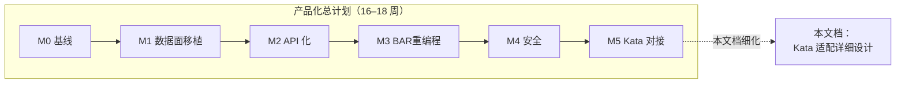
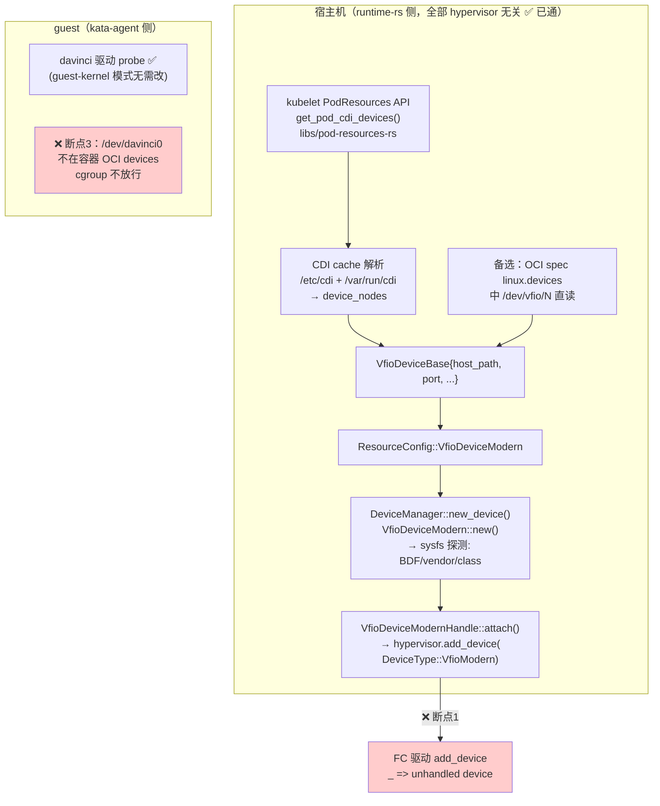
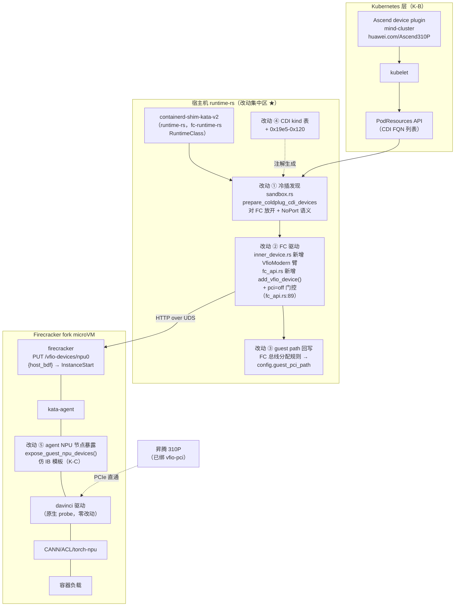
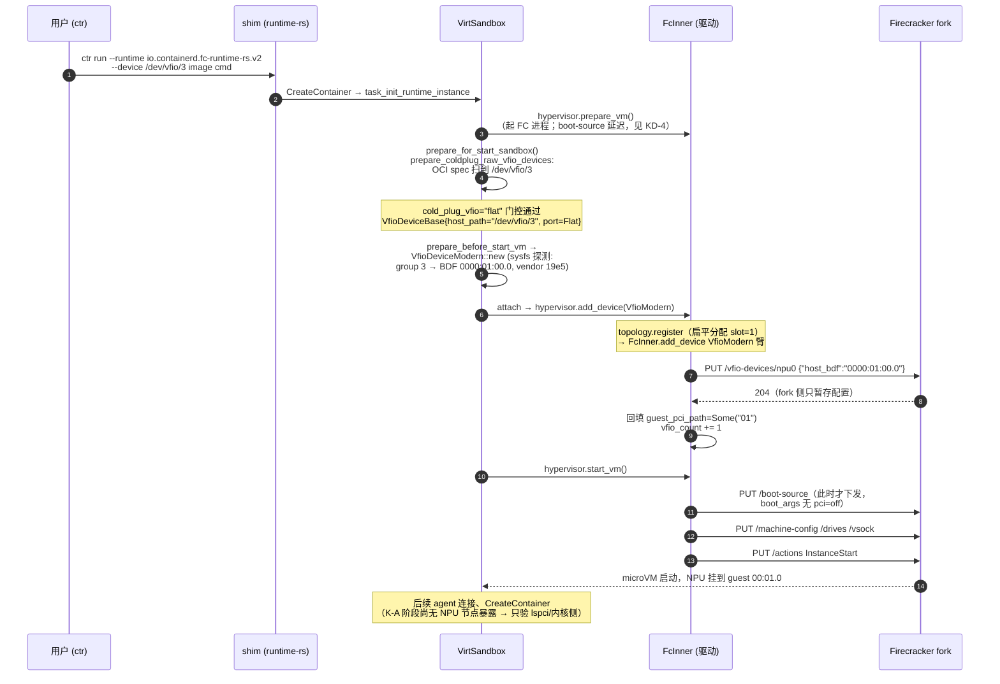
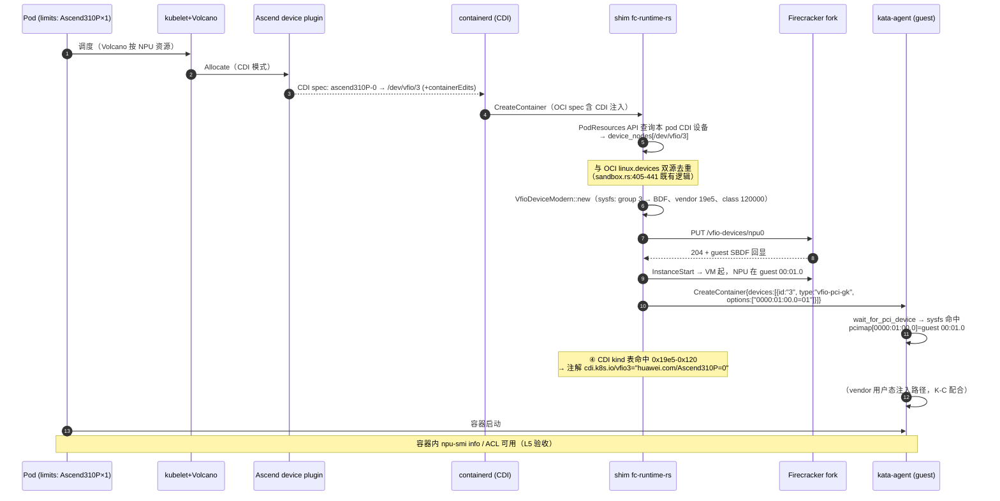
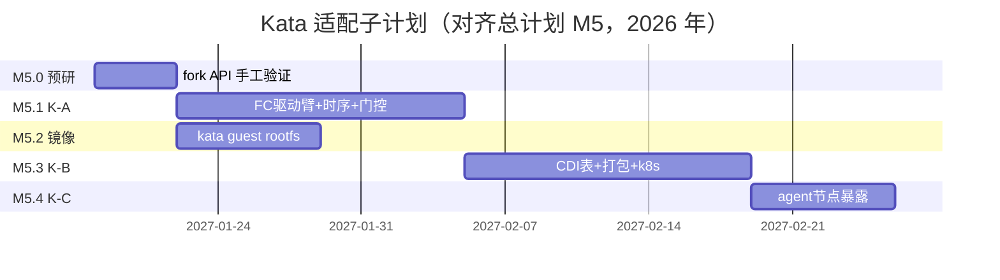

# Kata Containers 适配 Firecracker VFIO 直通 —— 概要设计与开发计划

| 项目 | 内容 |
|---|---|
| 文档版本 | v1.0（概要设计 / High-Level Design） |
| 日期 | 2026-09-30 |
| 状态 | 评审稿（组会汇报用，与《npu-vfio-productization-design-zh.md》§5 互补深化） |
| 关联代码库 | `./kata-containers`（Kata 4.2.0，主线 runtime-rs）、`./firecracker`（本项目 fork，含 `PUT /vfio-devices/{id}`） |
| 目标读者 | 负责沙箱编排/Kata 对接的开发者（yunfei）、评审组会成员 |

> **一句话总结**：Kata runtime-rs 的设备管线（CDI/PodResources → `ResourceConfig::VfioDeviceModern` → `hypervisor.add_device`）本身是 hypervisor 无关的，断点只在 Firecracker 驱动的最后一步——`DeviceType::VfioModern` 落到 `unhandled device`、guest 内核被强加 `pci=off iommu=off`、以及 `/dev/davinci0` 进不了容器。本文档给出把这三处断点接通的完整改动设计：**FC 驱动新增 VfioModern 冷插臂 + 内核参数门控 + Ascend CDI kind 表扩展 + agent 侧 NPU 设备节点暴露**，并附 K-A（静态直通）/K-B（k8s CDI 动态分配）/K-C（容器内体验）三阶段实施与测试计划。

---

## 0. 导读：本文在整体计划中的位置

主设计文档《npu-vfio-productization-design-zh.md》§5 给出了 Kata 对接的分层方案（K-A/K-B/K-C）与改动清单概要。本文档是其 **Kata 侧专题深化**：基于对 `kata-containers` 4.2.0 源码的逐行调研（本文所有 file:line 均已在源码中核实），把"要改什么、为什么这样改、怎么验证"落到代码级。



**阅读路线**（对应 20 分钟汇报中 Kata 部分 ≈5 分钟 + 深入讨论）：

| 时间 | 章节 | 讲什么 |
|---|---|---|
| 1 min | §1 | 调研结论：Kata 现状四张断点表 |
| 1.5 min | §2 | 总体方案：三层接通点架构图 + 关键决策 |
| 1 min | §3 | K-A 静态直通：最小可演示链路 |
| 1 min | §4 | K-B 动态分配：CDI/k8s 全链路 |
| 0.5 min | §5–7 | K-C 容器内体验、测试计划、里程碑 |

---

## 1. Kata 4.2.0 现状调研结论（差距分析）

### 1.1 调研范围与方法

对 `D:\code\vm_vfio\kata-containers`（v4.2.0，2026-09 调研）完成四路并行源码分析：① runtime-rs Firecracker 驱动（`crates/hypervisor/src/firecracker/`）；② runtime-rs 设备管线（`crates/resource/`、`crates/runtimes/virt_container/`、hypervisor device 模型）；③ kata-agent guest 侧设备处理（`src/agent/`）；④ 配置系统/打包/Go 运行时冷插参照（`src/libs/kata-types/`、`tools/packaging/`、`src/runtime/`）。以下所有结论均标注源码位置。

### 1.2 设备冷插管线现状：上游 vs 下游断点在哪

先看**已经通的部分**（不需要我们改的），以一个 k8s Pod 申请 NPU 为例：



**断点清单（本次 Kata 适配的全部代码工作就这三处 + 配置/打包）**：

| # | 断点 | 位置 | 现状代码 | 影响 |
|---|---|---|---|---|
| **D-1** | FC 驱动不认 VFIO 设备 | `crates/hypervisor/src/firecracker/inner_device.rs:44` | `DeviceType::VfioModern`/`Vfio` 落入 `_ => Err(anyhow!("unhandled device: {:?}", device))` | 设备根本挂不到 microVM |
| **D-2** | guest 内核参数硬编码 | `crates/hypervisor/src/firecracker/fc_api.rs:89-90` | `kernel_params.push(Param::new("pci", "off")); kernel_params.push(Param::new("iommu", "off"));` **无条件注入**，且用户 `kernel_params` 配置在其后 append（同 key 重复时前值优先） | guest 内核 PCI 子系统整个关闭，直通设备无法枚举 |
| **D-3** | NPU 设备节点不进容器 | `src/agent/src/device/mod.rs`（`add_devices` 全流程） | davinci 驱动在 guest 绑定后创建 `/dev/davinci0` 等节点，但 agent 无任何机制把 guest 内新出现的设备节点加进容器 OCI spec + cgroup 白名单（现有 IB 特例 `expose_guest_infiniband_devices` 只认 `/dev/infiniband/*`） | 容器内看不到 NPU |
| D-4 | CDI kind 表缺 Ascend | `crates/resource/src/cdi_devices/mod.rs:33-40` | `CDI_DEVICE_KIND_TABLE` 只有 nvidia/amd/mellanox；vendor `0x19e5` 查不到 → 无 `cdi.k8s.io/vfioN` 注解 → agent 侧 vendor 用户态注入失效 | K-B 阶段容器内 vendor 工具（npu-smi 用户态部分）注入不生效 |
| D-5 | FC 无 runtime-rs 打包 | `tools/packaging/kata-deploy/shim-components.json` | `fc` 条目只出 Go shim（`shim-v2-go`）；无 `fc-runtime-rs` | 部署层缺一块，研究期手工部署可绕过 |

**注意 D-2 的隐蔽性**：`TopologyConfigInfo::new`（`src/libs/kata-types/src/config/hypervisor/mod.rs:879-899`）注释说"Firecracker 不支持 PCIe 设备，直接 return None"——但实现上 FC 名字在 hypervisor_names 名单**里**，真正决定 topology 是否为 None 的是 `pcie_root_port`/`pcie_switch_port` 端口数（`crates/hypervisor/src/device/topology.rs:324-346`：(0,0)→`NoPort` 模式拓扑仍非 None 但 `reserve_bus_for_device` 返回 None）。这个过时注释与真实行为不一致，本文设计不依赖修改它（见 §2.2 决策 KD-3）。

### 1.3 关键源码事实（设计依据，全部已核实）

| # | 事实 | 位置 | 对设计的含义 |
|---|---|---|---|
| F-1 | FC API 客户端是**手写 hyper-over-UDS**（hyperlocal 0.9），无 swagger 生成、无类型化模型；通用入口 `request_with_retry(Method, uri, body)` 500 次重试（4xx 也重试） | `crates/hypervisor/src/firecracker/fc_api.rs:236-274` | 新增 `PUT /vfio-devices/{id}` 调用约 15 行，模式照抄 `add_net_device`（fc_api.rs:211-234）；**但 4xx 重试 500 次 = 语义错误会卡 5 秒**，VFIO 失败必须可辨识（见 §2.2 KD-5） |
| F-2 | FC 启动时序：`prepare_vm` 先起 FC 进程并 `prepare_vmm_resources`（boot-source/machine-config/drives）→ 冷插窗口 → `start_vm` 发 `PUT /actions InstanceStart` | `crates/hypervisor/src/firecracker/inner_hypervisor.rs:22-88` | VFIO PUT 必须落在 `VmmServerReady` 窗口内、`/actions` 之前 |
| F-3 | 冷插管线调用顺序（sandbox 生命周期）：`hypervisor.prepare_vm` → `prepare_for_start_sandbox`（CDI 发现）→ `prepare_before_start_vm` → `hypervisor.add_device`（逐设备）→ `hypervisor.start_vm` | `crates/runtimes/virt_container/src/sandbox.rs:1047-1091` | FC 驱动收到 `add_device(VfioModern)` 时状态是 `VmmServerReady`（**不会**走 pending 队列——那是 NotReady 才走的，且 FC 的 pending 队列从未被消费），可直接发 API |
| F-4 | `VfioDeviceModernHandle::attach` 对 PCI 设备**强制要求 PCIe topology 存在**（`ok_or_else("VFIO device requires a PCIe topology but none was provided")`），先 `register(topo)` 再 `h.add_device` | `crates/hypervisor/src/device/driver/vfio_device/device.rs:233-245` | FC 场景必须让 topology 走通：`reserve_bus_for_device(NoPort)` 返回 `Ok(None)` → `register` 报 "can not get bus port" 错误。**必须给 FC 定义自己的 bus/slot 分配**（KD-3） |
| F-5 | topology `reserve_bus_for_device`：`NoPort` → `Ok(None)`；`RootPort` → 从 slot-6 起保留的 rpX 上分配，bus_port_id=(`rpN`, rp.id+9, rp.id+2) | `crates/hypervisor/src/device/topology.rs:697-727` | QEMU 的 guest PCI path（如 `01/00`）来自 rp 总线号推导。FC 根总线扁平（设备直接挂 00:01.0、00:02.0…），需定义 FC 自己的 `bus_port_id`/`guest_pci_path` 推导规则 |
| F-6 | `TopologyConfigInfo::new` 对 FC **不**返回 None（名单含 FC），端口数 (0,0) 时 topology 为 `NoPort` 模式（非 None） | `kata-types/src/config/hypervisor/mod.rs:879-899` + `topology.rs:324-346` | FC 配置 `pcie_root_port=0` 时 topology 存在但 NoPort；VFIO attach 会在 register 处失败——**这是 D-1 之外的第二道门**，设计必须显式处理 |
| F-7 | agent `Device` 协议消息：`{id, type, vm_path, container_path, options[]}`；VFIO handler 解析 `options` 中 `"hostBDF=guestPciPath"`（如 `"0000:01:00.0=02/01"`） | `src/libs/protocols/protos/agent.proto:533-565`；`src/agent/src/device/vfio_device_handler.rs:59-122` | FC 必须在 `add_device` 返回前把 **guest PCI path 写回** `VfioDeviceModernHandle.config.guest_pci_path`，否则容器创建时 `context("VFIO device has no guest PCI path assigned")` 直接失败（`manager_inner.rs:741-745`） |
| F-8 | agent guest-kernel 模式（`vfio-pci-gk`）：只做 `wait_for_pci_device`（sysfs 已存在则立即返回）+ 记录 host→guest BDF 映射入 `pcimap`；**不做** driver_override、不要求 guest IOMMU group | `src/agent/src/device/vfio_device_handler.rs:60, 75-116` | davinci 驱动在 guest 原生 probe（我们已验证），agent 这条路**零改动即可用**——前提是 options 里给出正确的 guest PCI path（F-7） |
| F-9 | agent `PCIDEVICE_*` 环境变量翻译：`update_env_pci` 用 `pcimap` 把 host BDF 换成 guest BDF | `src/agent/src/device/mod.rs:601-700` | 昇腾 device plugin 若以 PCIDEVICE_ 环境变量方式暴露 BDF（SR-IOV 风格），agent 现有能力直接翻译——又依赖 pcimap 正确填充（F-7/F-8） |
| F-10 | agent aarch64 PCI 根总线 sysfs 路径：先试 ACPI（`/devices/pci0000:XX`），否则扫 `/devices/platform/*.pcie`，兜底 `/devices/platform/4010000000.pcie/pci0000:00` | `src/agent/src/linux_abi.rs:68-111` | FC 的 guest 是 FDT/ACPI 混合（FC aarch64 用 FDT），冷插设备 sysfs 已存在 → `wait_for_pci_device` 快速路径直接命中（F-8），无需等 uevent |
| F-11 | FC 驱动 capabilities 只设 `BlockDeviceSupport`；`CapabilityBits` 是 **u8 位掩码且 8 位已用满** | `crates/hypervisor/src/firecracker/inner.rs:53-55`；`src/libs/kata-types/src/capabilities.rs:9-28` | 若加 `ColdPlugVfioSupport` 位需扩到 u16（波及 kata-types 全 hypervisor）；本期用**配置门控**替代（KD-6），位扩展列为可选 |
| F-12 | kata 4.2.0 versions.yaml 锁 FC **v1.12.1**；FC 驱动只支持块设备由来已久 | `versions.yaml:85-88` | 我们的 fork 基线（v1.15/1.16 era）与 kata 官方锁定的版本不一致，需在打包层替换二进制并记录版本偏差（R-4 风险） |
| F-13 | kata-deploy 打包：FC 只出 Go shim；runtime-rs 产物走 `shim-v2-rust` tarball；FC 二进制来自 versions.yaml 静态 tarball | `tools/packaging/kata-deploy/shim-components.json`、`local-build/kata-deploy-binaries.sh:1464-1486` | 部署方案（§6）需新增 `fc-runtime-rs` shim 条目或手工部署 |
| F-14 | agent 加载 guest 内核模块：`CreateSandboxRequest.kernel_modules` → `modprobe`；配置项 `[agent] kernel_modules` | `src/agent/src/rpc.rs:1555-1557, 2578`；`configuration-rs-fc.toml.in:263-321` | davinci.ko 可通过现有配置预载（若 guest 镜像内置 ko 且未自动加载） |
| F-15 | `VfioDeviceModern::new` 的 sysfs 探测：group 模式扫 `/sys/kernel/iommu_groups/N/devices/`，过滤 bridge/audio（class 0x0600/0x0604/0x0403），按 GPU class 优先选 primary；读 vendor/device/class | `crates/hypervisor/src/device/driver/vfio_device/core.rs:260-304, 421-445` | NPU（class 0x120000 Processing accelerators）会被正常当作 group 内唯一设备选中；vendor=0x19e5、class=0x120000 → CDI kind 表需加 `"0x19e5-0x120"`（12 字符前缀匹配，D-4） |
| F-16 | FC 走 vsock 通道连接 agent（`PUT /vsock`，hvsock） | `crates/hypervisor/src/firecracker/inner_device.rs:67-103` | kata-agent 与 FC 通信通道现成，K-C 无需改 |

### 1.4 与主设计文档调研结论的对账

主文档 §5.1 的结论全部成立，本文补充修正两点：

1. **"FC 驱动给 guest 强加 `pci=off iommu=off`"** —— 精确位置是 `fc_api.rs:89-90`（`prepare_vmm_resources` 内、用户 kernel_params 之前），Go 运行时对应位置 `src/runtime/virtcontainers/fc.go:92-104` 同样硬编码；
2. **"CDI 设备 kind 表缺 19e5"** —— 精确机制是 `resolve_cdi_device_kind` 取 `{vendor}-{class}` 前 12 字符查表（`cdi_devices/mod.rs:56-62`），Ascend 需加 `"0x19e5-0x120"`（vendor 0x19e5 + class 0x120000 前 3 位）。

---

## 2. 总体方案

### 2.1 目标架构：三层接通点



**设计主线**：runtime-rs 的设备管线天然 hypervisor 无关，改动收敛为"**一个驱动臂 + 一处门控 + 一张表 + 一个 agent 函数**"；所有路径上都复用既有协议（`Device.options` 的 `hostBDF=guestPciPath` 契约不变），从而 agent 的 `vfio-pci-gk` 处理、`PCIDEVICE_*` 翻译、cgroup 机制全部白嫖。

### 2.2 关键设计决策（ADR）

| # | 决策 | 理由与代价 |
|---|---|---|
| **KD-1** | 主线 **runtime-rs**（4.2.0），Go 运行时不投入 | Kata 4.x runtime-rs 为默认（Go 只收 bugfix）；Go 侧 FC 走 fcConfig.json 静态文件路径虽与 fork 的 `--config-file` 兼容（备选保底，见 §7.3 R-3），但 CDI 冷插管线（pod-resources-rs + VfioModern）只在 runtime-rs 侧完整可用 |
| **KD-2** | 接入点选 **既有冷插管线**（CDI/PodResources → VfioDeviceModern），不新造静态 toml 设备表 | `prepare_coldplug_cdi_devices`（sandbox.rs:376-464）已实现双源发现（k8s PodResources + OCI linux.devices 兜底），K-A 阶段用 `ctr --device /dev/vfio/N` 或 Pod 注解即可触发，**无需先做 toml 静态配置**；toml 静态表（`[hypervisor.firecracker] vfio_devices=[...]`）降级为 K-A 期间的**可选便利项**（见 §3.4 决策点） |
| **KD-3** | FC 的 PCIe topology 语义：**配置 `pcie_root_port=0` 时给 FC 开"扁平根总线"模式** —— `reserve_bus_for_device` 对 FC+NoPort 返回确定的 `(root_bus, slot, port_id)`（slot 从 1 顺序分配，避开 0 号 host bridge）；或者（更小侵入）在 `VfioDeviceModernHandle::attach` 中允许 NoPort 拓扑直接 `h.add_device` 并由 FC 驱动回填 guest path | 两条路线取舍：前者改 topology.rs（一处 match 臂），让 FC 与 QEMU 走同一 register 流程，**guest path 语义统一**；后者只改 attach 一处但对 NoPort 语义特判。**推荐前者**：`NoPort + hypervisor=firecracker` → 扁平分配 `bus_port_id=("pci.0", 0, slot)`，PciPath 单 slot（`01`、`02`…）与 FC 实际 guest SBDF 一致（fork 侧 `next_device_sbdf` 顺序分配）。注意 PciPath 注释（pci_path.rs:89-91）明确"dragonball/firecracker/clh 单 slot"是既有约定 |
| **KD-4** | guest 内核参数：`pci=off iommu=off` 改为**条件注入** —— 触发条件 = 本 sandbox 无 VFIO 设备；实现上把两行硬编码改为：`if !self.has_vfio_devices() { push(pci=off); push(iommu=off) }`；有 VFIO 时不注入任何 PCI 相关参数（guest 内核默认开 PCI） | 关键时序问题：`prepare_vmm_resources`（fc_api.rs:87）在 `add_device`（冷插窗口）**之前**执行，而设备数量要到 `prepare_before_start_vm` 才确定 → **必须调整调用顺序**：把 `prepare_vmm_resources` 从 `prepare_vm` 内部（inner_hypervisor.rs:73）拆出，挪到 `prepare_before_start_vm` 之后、`start_vm` 之前（sandbox.rs:1083-1091 的窗口），或在 `FcInner` 增加设备计数器 + boot-source 延迟下发。**推荐后者**：`FcInner::prepare_vmm_resources` 拆成 `prepare_boot_source()`（依赖 vfio 计数）与 `prepare_machine_config()/drives`（不依赖），boot-source 延迟到首台 VFIO add_device 之后或 start_vm 前的 flush 点统一发 |
| **KD-5** | VFIO API 失败处理：fork 的 `PUT /vfio-devices` 返回 4xx/5xx 时 `request_with_retry` 会盲重试 500 次×10ms ≈ 5s 才报错——新增 `add_vfio_device` 使用**不重试**的 `send_request` 或对 4xx 短路 | 语义错误（BDF 不存在/未绑 vfio-pci）重试无意义且拖慢 sandbox 创建；实现上给 `request_with_retry` 加 `retry_on_client_error: bool` 参数或独立走 `send_request`（fc_api.rs:281-311），错误信息透传 FC fork 的 `VfioConfigError` 文本（fork 侧已设计"指明设备与修复动作"的错误，见主文档 §4.9） |
| **KD-6** | 门控方式：**配置驱动**（`cold_plug_vfio` 复用 + FC 驱动内部 vfio 使能标志），不新增 CapabilityBits | `CapabilityBits` u8 已满（F-11），扩位波及面大；`cold_plug_vfio="root-port"` 对 FC 重定义为"VFIO 冷插开启"（FC 无 root port 概念，语义映射见 KD-3/KD-7）；K-A 静态验证阶段用更简单的 `enable_vfio = true`（新配置项） |
| **KD-7** | `cold_plug_vfio` 对 FC 的取值语义：新增 `"flat"`（或复用 `"root-port"` 语义别名）表示"扁平根总线冷插" | `prepare_coldplug_cdi_devices`（sandbox.rs:386-394）只认 `"root-port"`，其他值报错——FC 需在此 match 增臂。**推荐新增 `"flat"`**：语义诚实（无端口拓扑），QEMU 路径零影响 |
| **KD-8** | agent NPU 节点暴露（D-3）：**仿 InfiniBand 模板**新增 `expose_guest_npu_devices()`，K-C 阶段实现；设备白名单表驱动（`/dev/davinci*`、`/dev/davinci_manager`、`/dev/hisi_hdc`、`/dev/tsdae*`、`/dev/davinci_connector` 等 guest 驱动节点） | IB 模板（`agent/src/device/mod.rs:951-1085`）已是现成范式：扫目录 → stat → 改写 spec.linux.devices + `insert_devices_cgroup_rule`（major/minor 转 guest 侧），且已被 `container_has_vfio_device` 门控——VFIO 设备进容器时自动触发。NPU 节点清单来自 worked 验证环境 `/dev/davinci0` 等实测（镜像组提供完整清单） |
| **KD-9** | `/dev/davinci` 节点的 cgroup 规则用 **设备节点白名单（表驱动）**，不做通配 `c *:* rwm` | 与 kata 安全模型一致（默认 deny-all 白名单）；表驱动便于未来扩展 vNPU/其他 NPU 型号 |
| KD-10 | guest 镜像沿用主文档 §5.5（openEuler 22.03 + NPU 驱动 25.3.rc1 + board_cfg 过渡），agent 用 kata 4.2.0 官方或自编（含 KD-8 patch） | kata-agent 需重打包进 rootfs；这是 M5.2 的镜像组交付物 |
| KD-11 | jailer 对 FC 场景先禁用（`jailer_path` 留空），jailer 模式下 `/dev/vfio/*` mknod 与 sysfs 可见性由 M4（fork 侧 jailer 工作）+ kata 打包共同解决 | 与主文档 D10 一致：研究期 `disable jailer`；生产化路径已规划 |
| KD-12 | 与 fork 的 API 契约：kata 只依赖 `PUT /vfio-devices/{id}` + `GET /vm/config`（校验回显），**不依赖** fork 内部行为（BAR 分配策略、quirk） | 保持 kata 补丁可独立 review；fork 的 guest SBDF 分配顺序（配置顺序 00:01.0 起）是 kata 推导 guest path 的**唯一契约**（KD-3），需在两侧文档互锁 |

### 2.3 改动全景（一页表）

| 层 | 文件 | 改动 | 阶段 | 规模 |
|---|---|---|---|---|
| ① 冷插发现 | `crates/runtimes/virt_container/src/sandbox.rs:386-394` | `cold_plug_vfio` match 增 `"flat"` 臂（FC 扁平模式） | K-A | ~10 行 |
| ② FC 驱动-设备 | `crates/hypervisor/src/firecracker/inner_device.rs:29-45` | match 增 `DeviceType::VfioModern(v)` 臂 → `add_vfio_device(v)`；同步 `DeviceType::Vfio`（legacy）映射处理 | K-A | ~50 行 |
| ② FC 驱动-API | `crates/hypervisor/src/firecracker/fc_api.rs`（新增方法） | `add_vfio_device(&VfioDeviceModern)`：取 `device.primary.addr`（host BDF）→ `PUT /vfio-devices/{device_id}`；成功后按 KD-3 规则回填 `config.guest_pci_path` | K-A | ~40 行 |
| ② FC 驱动-时序 | `fc_api.rs:87-100` + `inner_hypervisor.rs:73` + `inner.rs` | boot-source 拆分与延迟下发（KD-4）；`pci=off iommu=off` 条件化；`FcInner` 增 `vfio_enabled/vfio_count` | K-A | ~60 行 |
| ③ topology | `crates/hypervisor/src/device/topology.rs:697-727` | `reserve_bus_for_device` 增 FC 扁平分配臂（KD-3 推荐 A 案） | K-A | ~20 行 |
| ③ guest path 回写 | `inner_device.rs`（②的一部分） | FC 驱动 add_device 成功后写 `vfio_dev.lock().config.guest_pci_path = Some(...)` | K-A | （含②） |
| ④ CDI kind 表 | `crates/resource/src/cdi_devices/mod.rs:33-40` | 增 `m.insert("0x19e5-0x120", "huawei.com/Ascend310P")` | K-B | 1 行 |
| ④ 注解语义 | `cdi_devices/container_device.rs:37-99` | 无需改（表驱动自动生效） | K-B | 0 |
| ⑤ agent NPU 暴露 | `src/agent/src/device/mod.rs` | 新增 `expose_guest_npu_devices()` + 节点表 + 在 `add_devices` 中挂接（仿 IB 的 `mod.rs:262-264` 位置） | K-C | ~150 行 |
| ⑥ 打包 | `tools/packaging/kata-deploy/shim-components.json` + `local-build/Makefile` | 新增 `fc-runtime-rs` shim 条目（`shim-v2-rust` + fc 二进制 + fc 配置模板）；FC 二进制替换为 fork 构建 | K-B | ~30 行 |
| ⑥ 配置模板 | `src/runtime-rs/config/configuration-rs-fc.toml.in` | 增 `cold_plug_vfio = "no-port"`（默认关，开 `"flat"` 启用）、`pcie_root_port` 注释、示例注释段 | K-A | ~15 行 |
| ⑦（可选）静态表 | `kata-types/src/config/hypervisor/firecracker.rs`（空结构体） | K-A 便利项：`FirecrackerConfig` 增 `vfio_devices: Vec<{id, host_bdf}>`，在 `prepare_vm` 后注入管线 | K-A 可选 | ~60 行 |
| ⑧ 测试 | `crates/hypervisor/src/firecracker/` + `crates/resource/` + agent 单测 | 见 §6 | 全程 | — |

**侵入面自检**（对齐主文档目标二精神）：改动集中在 ①–④ runtime-rs 的 4 个文件 + ⑤ agent 1 个文件 + ⑥ 打包；不触碰 QEMU/CH/Dragonball 路径（`cold_plug_vfio="flat"` 只有 FC 配置会出现）；Go 运行时零改动。

---

## 3. K-A：静态直通（无 k8s，最小演示）

### 3.1 目标与入口

**目标**：单机（无 k8s）用 containerd/ctr 直接创建 kata sandbox，`--device /dev/vfio/N`（或 toml 静态表），microVM 启动即带 NPU，guest 内 `lspci` 可见。这是 M5.1 的验收内容。

**链路**（`ctr` 路径，走 `prepare_coldplug_raw_vfio_devices` 兜底管线，sandbox.rs:471-557）：



### 3.2 K-A 各改动的详细设计

#### 改动②：FC 驱动 VfioModern 臂（inner_device.rs + fc_api.rs）

```rust
// crates/hypervisor/src/firecracker/inner_device.rs — add_device match 增臂
DeviceType::VfioModern(vfio_mod) => {
    let mut vfio = vfio_mod.lock().await;
    self.add_vfio_device(&mut vfio).await.context("add vfio device")
}
DeviceType::Vfio(legacy) => {
    // legacy 组路径模型：取 devices.first() 的 BDF，转 VfioDeviceBase 后同路径
    // （K-A 可只返回 Err 并注明用 VfioModern；完整性在 K-B 收尾）
    ...
}

// crates/hypervisor/src/firecracker/fc_api.rs — 新方法（模式照抄 add_net_device:211-234）
pub(crate) async fn add_vfio_device(&mut self, vfio: &mut VfioDeviceModern) -> Result<()> {
    // host BDF：sysfs 探测结果（VfioDeviceModern::new 已填 device.primary.addr）
    let host_bdf = vfio.device.primary.addr.to_string();   // "0000:01:00.0"
    let device_id = vfio.device_id.clone();                // DeviceManager 分配的随机 id
    let body = json!({ "id": device_id, "host_bdf": host_bdf }).to_string();
    // 冷插窗口（state == VmmServerReady）校验：
    if self.state != VmmState::VmmServerReady {
        return Err(anyhow!("vfio device can only be added before InstanceStart"));
    }
    // KD-5：不盲重试 —— 4xx 是语义错误
    self.send_request_no_retry(Method::PUT, &format!("/vfio-devices/{device_id}"), body).await?;
    // guest SBDF：KD-3 契约 —— fork 按 add 顺序从 00:01.0 分配
    let guest_slot = self.next_guest_slot();               // FcInner 新计数器（1 起，0 号为 host bridge）
    vfio.config.guest_pci_path = Some(PciPath::try_from(guest_slot)?);  // "01" → guest 00:01.0
    self.vfio_count += 1;
    Ok(())
}
```

**关键点**：

- `send_request_no_retry` 是对现有 `send_request`（fc_api.rs:281-311）的薄封装：同样 hyper-over-UDS，但失败立即返回**带 FC 响应体**的错误（fork 侧错误信息含设备与修复动作，透传给 sandbox 日志）；
- `guest_pci_path` 回写是 agent 侧 `wait_for_pci_device` 能找到设备的**唯一依据**（F-7/F-8）：agent 拿 `"0000:01:00.0=01"` → guest sysfs `/sys/devices/pci0000:00/0000:00:01.0`；
- **契约互锁**：fork 的 `next_device_sbdf`（主文档 §4.8：配置顺序分配 00:01.0、00:02.0…）必须与 kata 侧 `next_guest_slot` 一致。两侧各持一个计数器有漂移风险（例如 kata 侧其他设备占了 slot）→ **更稳做法**：fork 在 `PUT /vfio-devices` 的 **204 响应体或 `GET /vm/config`** 中回显分配的 guest SBDF，kata 解析回填（fork 侧 API 设计已含 GET /vm/config 的 `vfio-devices` 数组，主文档 §3.2.1）。**推荐 v1 就做响应体回显**（fork 改动极小），避免对账逻辑。

#### 改动②-时序：boot-source 延迟下发（KD-4 详设）

问题回顾：`pci=off` 在 `prepare_vmm_resources`（fc_api.rs:87）无条件注入，而它从 `prepare_vm`（inner_hypervisor.rs:73）调起——早于任何 `add_device`。等知道有没有 VFIO 设备时，boot-source 已发出去，FC API 不允许二次 PUT boot-source（pre-boot 单值语义）。

**方案**（`FcInner` 状态机调整，改动 ~60 行）：

```text
现状：prepare_vm ──> prepare_vmm_resources（boot-source+machine-config+drives+vsock 全发）──> [add_device ...] ──> start_vm（PUT /actions）

目标：prepare_vm ──> prepare_static_resources（machine-config+drives+vsock）──> [add_device ...
        每个 vfio add 时: vfio_count += 1（API 照发）
        flush_boot_source() 在 start_vm 内、PUT /actions 之前调用：
            kernel_params = base + rootfs + user
            if vfio_count == 0 { + pci=off + iommu=off }    // KD-4：无直通才关闭
            PUT /boot-source（一次性、终值）
        ] ──> start_vm ──> PUT /boot-source → PUT /actions InstanceStart
```

- `prepare_vm` 只起进程 + 发 machine-config/drives/vsock（这些与 VFIO 无关）；
- 新私有方法 `FcInner::flush_boot_source()`：按 vfio 计数决定 `pci=off iommu=off` 是否注入，在 `start_vm`（inner_hypervisor.rs:78-88）发 `/actions` 前调用；
- **同时**校验配置一致性：若用户 `kernel_params` 显式写了 `pci=off` 但配了 vfio 设备 → 启动报错（配置矛盾，fail-fast，错误信息指明二选一）；
- `prepare_vm` 的返回时序变化对 sandbox.rs 调用方透明（`prepare_vm` 仍是"VMM 就绪"语义）。

#### 改动③：topology 扁平分配臂（KD-3 A 案）

```rust
// crates/hypervisor/src/device/topology.rs — reserve_bus_for_device 增臂
let bus_port_id = match mode {
    PCIePort::NoPort => {
        // FC/Dragonball 等扁平根总线 hypervisor：设备直接挂根总线，
        // slot 从 1 顺序分配（0 号为 host bridge）。bus_port_id 语义：
        // (bus_name, bus_slot, port_id) — 扁平模式下后两者同值。
        if self.hypervisor_name == HYPERVISOR_NAME_FIRECRACKER {
            let slot = self.flat_next_slot;      // topology 新字段，u8，从 1 起
            self.flat_next_slot += 1;
            (DEFAULT_PCIE_ROOT_BUS.to_string(), slot as u32, slot as u32)
        } else {
            return Ok(None);   // 原语义（其他 NoPort hypervisor 不分配）
        }
    }
    ...  // RootPort / SwitchPort 原样
};
```

配套：`PCIeTopology` 增 `flat_next_slot: u8` 字段（Default=1）；`insert_device`（topology.rs:376-403）的 slot 查找逻辑对扁平模式直接用 `flat_next_slot`（保证 topology 记录与 kata 侧一致）。**guest path 推导链**：`reserve_bus_for_device` → `config.bus_port_id.1`（slot）→ FC 驱动 `guest_pci_path = PciPath::try_from(slot)`（单 slot，"01"）→ agent `wait_for_pci_device(root_complex="00", path)` → `/sys/devices/pci0000:00/0000:00:01.0`（aarch64 走 linux_abi.rs:68-111 的 ACPI 快速路径，F-10）。

#### 改动①+配置模板：门控

```toml
# configuration-rs-fc.toml.in — [hypervisor.firecracker] 段新增
# VFIO 设备冷插模式。FC 为扁平根总线（无 PCIe 端口拓扑）：
#   "no-port"（默认）：关闭 VFIO 冷插
#   "flat"           ：启用；设备按配置顺序挂到 guest 根总线 00:01.0 起
# 依赖：host 侧设备已绑定 vfio-pci；guest 内核需 PCI 支持（自动满足）。
cold_plug_vfio = "no-port"
```

```rust
// sandbox.rs:386-394 — match 增臂
let port = match cold_plug_vfio.as_str() {
    "root-port" => PCIePort::RootPort,
    "flat" => PCIePort::NoPort,      // FC：扁平模式（端口语义由 topology 扁平臂实现）
    other => return Err(...)
};
```

`prepare_coldplug_cdi_devices` / `prepare_coldplug_raw_vfio_devices` 两处的 match 都要加臂（sandbox.rs:386 与 :481）。

### 3.3 K-A 验收标准

| # | 验收项 | 命令/方法 |
|---|---|---|
| KA-1 | sandbox 创建成功，FC 日志可见 `PUT /vfio-devices/npu0` 204 | `kata-runtime` 日志 / FC `api_server` 日志 |
| KA-2 | guest 内核参数无 `pci=off` | guest dmesg / `/proc/cmdline` |
| KA-3 | guest `lspci` 可见 `00:01.0 Processing accelerators: Huawei 19e5:d500` | guest 内执行 |
| KA-4 | guest dmesg davinci probe 无 NISV 风暴（fork 侧 mmap/quirk 生效） | `dmesg | grep -i davinci` |
| KA-5 | 未配置 VFIO 的 sandbox **回归不变**：boot_args 仍含 `pci=off iommu=off`，全部既有 FC 功能正常 | 对照测试（§6.2 回归门禁） |
| KA-6 | `GET /vm/config` 回显 `vfio-devices`（含 guest SBDF），kata 日志可见 guest_pci_path 回填 | FC API + shim 日志 |

### 3.4 决策点：K-A 要不要 toml 静态设备表（改动⑦）

**建议：先不做。** 理由：`ctr --device /dev/vfio/3` 已能走通 K-A 全链路（raw 兜底管线现成）；静态表的价值只是"少打一个参数"，却要动 `kata-types` 的 `FirecrackerConfig` 空结构体 + 配置解析 + `prepare_vm` 注入逻辑（~60 行）。若 M5.1 期间发现 raw 兜底路径有坑（例如 `oci_spec_vfio_device_paths` 对 bundle 的依赖在某种部署形态下取不到），再启用改动⑦作为替代入口。**汇报口径：静态表为 K-A 备选项，默认走 OCI spec 兜底管线。**

---

## 4. K-B：k8s + CDI 动态分配

### 4.1 目标链路

Pod 声明 `resources.limits: huawei.com/Ascend310P: 1` → device plugin 分配 → CDI 注入 → kata 冷插。这是 M5.3 的验收内容（主文档 L5）。



### 4.2 K-B 各改动的详细设计

#### 改动④：CDI kind 表扩展（1 行 + 注解链验证）

```rust
// crates/resource/src/cdi_devices/mod.rs — CDI_DEVICE_KIND_TABLE 增
m.insert("0x19e5-0x120", "huawei.com/Ascend310P");
```

生效链路验证点（无需改代码，但必须测试覆盖）：

1. `handler_devices` 的 VfioModern 分支（manager_inner.rs:774-786）产出 `DeviceInfo{vendor_id:"0x19e5", class_id:"0x01200000"}` → 注意 `format!("{:#08x}", class_code)` 产出 `0x01200000`，前 12 字符 = `0x19e5-0x012` ⚠️ **不是** `0x19e5-0x120`！

   **勘误与对策**：class code 是 `u32`（如 0x120000），`{:#08x}` 格式化为 8 位十六进制 `0x01200000`（`0x` 前缀 + 8 位）。拼成 `0x19e5-0x01200000` 后取前 12 字符 = `0x19e5-0x012`。因此 **Ascend 的表键应为 `"0x19e5-0x012"`**（与 nvidia `"0x10de-0x030"` 同构：`0x` + vendor 4 位 + `-0x` + class 前 3 位）。nvidia GPU class 0x030000 → `0x10de-0x030`；Ascend 加速卡 class 0x120000 → `0x19e5-0x012`。**实现时以实际 `class_code` 值写单测锁定**（见 §6.1 UT-4），避免位数想当然。
2. 注解 `cdi.k8s.io/vfio3 → "huawei.com/Ascend310P=0"` 由 `annotate_container_devices`（container_device.rs:37-99）自动产出；
3. agent 侧 `handle_cdi_devices` 若 guest 内存在 `/var/run/cdi/huawei-ascend.yaml`（镜像组预置或 vendor CDI spec），其 containerEdits（设备节点、挂载、env）会被应用——**这是容器内 npu-smi 用户态工具可用性的推荐解法**（与 KD-8 的 agent 暴露互补，见 §5.1 两条路线对比）。

#### 改动⑥：打包（fc-runtime-rs）

```jsonc
// tools/packaging/kata-deploy/shim-components.json 增条目（对齐既有 fc/qemu-runtime-rs 形态）
"fc-runtime-rs": {
  "shim": "shim-v2-rust",
  "shim_v3": "shim-v2-rust",
  "hypervisor": "firecracker",       // 指向替换后的 fork 二进制
  "kernel": "fc",                    // 沿用 fc 内核产物
  "image": "fc",
  "static_tarball": "firecracker"    // kata-deploy-binaries.sh 的 firecracker 组件（fork 构建）
}
```

配套：`local-build/Makefile` 增 `fc-runtime-rs-tarball` 目标（组合 `shim-v2-rust` + `firecracker` 组件 + `configuration-fc-runtime-rs.toml`，模板从 `configuration-rs-fc.toml.in` 衍生）；Helm `values.yaml` 的 `shims` 增 `fc-runtime-rs` 条目（含 `snapshotter: "devmapper"`，FC 无 virtio-fs 的既有约束）。

**fork 二进制替换**：kata-deploy 的 firecracker 静态 tarball 来自 versions.yaml（v1.12.1）→ 替换策略：本地构建脚本产出 fork tarball 覆盖 cache 路径（`kata-deploy-binaries.sh:1464-1486` 的 cache 机制支持本地路径），并在 README/部署文档记录版本偏差（fork 基于 v1.15/1.16 era 基线 + VFIO 扩展）。研究期（K-B）优先**手工部署**（§6.4），打包自动化放 K-B 尾部。

### 4.3 K-B 验收标准

| # | 验收项 |
|---|---|
| KB-1 | Pod（`huawei.com/Ascend310P: 1`，RuntimeClass `kata-fc-runtime-rs`）正常 Running，无 device plugin/CDI 报错 |
| KB-2 | `cdi.k8s.io/vfioN` 注解出现且值为 `huawei.com/Ascend310P=0`（kubectl get pod -o json 或 shim 日志） |
| KB-3 | 容器内 `npu-smi info` 出卡（L5，主文档里程碑口径） |
| KB-4 | Pod 删除 → sandbox 销毁 → host 侧 `/dev/vfio/3` 释放、设备可被下一 Pod 复用（device plugin 回收链） |
| KB-5 | 多 Pod 隔离：两个 Pod 各拿一张卡，guest SBDF 各自独立，无串扰 |
| KB-6 | 未开 `cold_plug_vfio` 的 fc-runtime-rs Pod（纯 CPU 负载）行为与改造前完全一致（回归） |

---

## 5. K-C：容器内体验（agent 侧）

### 5.1 /dev/davinci 暴露的两条路线对比与推荐

| 路线 | 机制 | 优点 | 缺点 |
|---|---|---|---|
| **A. agent 扫描注入**（KD-8，推荐 v1） | 仿 `expose_guest_infiniband_devices`（agent/device/mod.rs:951-1085）：`add_devices` 末尾若 `container_has_vfio_device` → 扫 `/dev/davinci*` 等节点表 → stat 取 major/minor → 追加 `spec.linux.devices` + `insert_devices_cgroup_rule` | 零外部依赖，IB 范式已验证；节点表集中可维护；对任意 vendor CDI 缺失场景兜底 | 需要维护 Ascend 节点清单（guest 驱动版本变化时更新表）；kata-agent 需重编 |
| B. guest 内 CDI spec | 镜像预置 `/var/run/cdi/huawei-ascend.yaml`（containerEdits 列全 davinci 节点 + env + 挂载），走 agent 现有 `handle_cdi_devices`（mod.rs:431-520）+ host 侧 kind 表注解 | agent **零改动**；CDI 语义标准，vendor 升级改 yaml 即可 | 依赖 host 侧 kind 表（改动④）+ guest 内 CDI 文件同步维护；CDI yaml 的设备节点 major/minor 在 guest 动态分配，CDI spec 用 path 引用（可行）但调试链路更长 |

**推荐**：v1 用 A（确定性高、集中控制、K-C 验收快），同时把 B 的 CDI yaml 作为镜像组交付物验证（两者不互斥，B 成熟后可替代 A 的表）。**A 的节点清单**（初版，镜像组在 M5.2 校订）：

```
/dev/davinci0            # 主设备节点（每卡一个，字符设备）
/dev/davinci_manager     # 管理通道
/dev/hisi_hdc            # HDC 守护进程通信
/dev/davinci_connector   # 连接器
```

### 5.2 expose_guest_npu_devices 设计（改动⑤）

```rust
// src/agent/src/device/mod.rs — 仿 IB 模板（951-1085 行范式）
const NPU_DEV_GLOBS: &[&str] = &[
    "/dev/davinci[0-9]*",
    "/dev/davinci_manager",
    "/dev/hisi_hdc",
    "/dev/davinci_connector",
];

fn expose_guest_npu_devices(logger: &Logger, spec: &mut Spec) -> Result<()> {
    // 1. 逐 glob 展开；目录/节点不存在 → info 日志跳过（驱动未加载场景）
    // 2. 只收字符设备；stat 取 major/minor（IB 模板 IbDev 结构复用）
    // 3. spec.linux.devices 追加 LinuxDevice{path, typ:c, major, minor, ...}
    //    ——注意与 IB 的差异：davinci 节点由 guest 驱动创建，host 侧 OCI spec
    //    中不存在同名项，走"直接追加"而非"按 container_path 改写"
    // 4. insert_devices_cgroup_rule(logger, spec, &info, true, "rwm")（mod.rs:551-595）
    // 挂接点：add_devices() 中 container_has_vfio_device 分支（mod.rs:262-264 同位置）
}
```

与 IB 模板的两点差异（在实现 PR 中注释说明）：① IB 是"改写既有 spec 项 + 补 cgroup"，NPU 是"纯追加"（host spec 无对应项）；② 节点用 glob 表而非整目录扫（davinci 节点名带编号且集合有限，避免误扫 driver 升级引入的临时节点）。

### 5.3 驱动加载与 PCIDEVICE 翻译（零改动验证项）

- **davinci 驱动加载**：guest 镜像若内置 `davinci.ko` 且 rootfs 启动脚本自动 modprobe（worked 环境即如此）→ 零改动；若需 agent 显式加载 → `[agent] kernel_modules = ["davinci"]`（F-14，配置即得）；
- **PCIDEVICE_* 翻译**：昇腾 device plugin 当前主要走 CDI（device id + /dev/vfio 节点），PCIDEVICE 路径是 SR-IOV 风格的备选；agent `update_env_pci`（mod.rs:601-700）依赖 pcimap（F-8/F-9），我们的链路已正确填充 → **测试覆盖项**而非改动项。

### 5.4 K-C 验收标准

| # | 验收项 |
|---|---|
| KC-1 | 容器内 `ls /dev/davinci0` 存在且权限正确；`ls /dev/vfio/` **不存在**（guest-kernel 模式，设备非容器内 vfio 用户态持有） |
| KC-2 | 容器内 `npu-smi info` 出卡（与 KB-3 同项，K-C 深化为非 root 容器场景） |
| KC-3 | 容器内 ACL h2d/d2h 数据搬运（复用 worked 的 `/root/acl_test` 用例容器化） |
| KC-4 | `PCIDEVICE_*` 环境变量（若 device plugin 输出）值为 guest BDF（host BDF 不泄漏） |
| KC-5 | stretch：torch-npu 小 CNN（对接 chenke 工作项，主文档 L6） |

---

## 6. 测试计划

### 6.1 单元测试（无硬件，Win/Linux 均可跑 `cargo test`）

| # | 用例 | 位置 | 覆盖 |
|---|---|---|---|
| UT-1 | FC 驱动 `add_vfio_device`：请求体 JSON 组装、BDF 提取、状态机（非 VmmServerReady 拒绝）、guest path 回填、计数器 | `crates/hypervisor/src/firecracker/` 新增 `#[cfg(test)]` | D-1、KD-3 契约 |
| UT-2 | boot-source 延迟逻辑：vfio_count=0 → 含 `pci=off iommu=off`；>0 → 不含；用户显式 `pci=off` + vfio>0 → Err（配置矛盾） | 同上 | KD-4 |
| UT-3 | topology 扁平分配：连续两次 reserve → slot 1、2；非 FC hypervisor NoPort 仍返回 None | `crates/hypervisor/src/device/topology.rs` 测试模块 | KD-3 |
| UT-4 | CDI kind：`resolve_cdi_device_kind("0x19e5", "0x01200000")` → `Some("huawei.com/Ascend310P")`（**锁定 12 字符切窗口径**）；nvidia/amd 回归 | `crates/resource/src/cdi_devices/mod.rs` 测试模块 | D-4、§4.2 勘误 |
| UT-5 | `expose_guest_npu_devices`：glob 展开、字符设备过滤、spec 追加、cgroup 规则生成（tempdir 造节点） | `src/agent/src/device/` 测试模块 | KD-8 |
| UT-6 | `cold_plug_vfio="flat"` 解析与门控（sandbox 配置层） | `sandbox.rs` / kata-types 测试 | KD-7 |

### 6.2 集成测试（Linux + NPU 服务器）

| # | 场景 | 阶段 |
|---|---|---|
| IT-1 | K-A 全链路（§3.3 验收表 KA-1..6） | M5.1 |
| IT-2 | **回归门禁**：`cold_plug_vfio="no-port"` 时全部既有 FC runtime-rs 行为不变（重点：boot_args 恢复 `pci=off`、无 VFIO 请求、块设备/网络/快照路径） | M5.1 |
| IT-3 | 负向：设备未绑 vfio-pci（错误信息含解绑命令）、坏 BDF、group 含多设备、`pci=off` 显式冲突 | M5.1 |
| IT-4 | K-B 全链路（§4.3 KB-1..6）：需 k8s + Volcano + mind-cluster + CDI | M5.3 |
| IT-5 | 稳定性：连续 20 次 Pod 创建/销毁，fd/内存无泄漏，设备回收无残留 | M5.3/M6 |

### 6.3 端到端验收阶梯对齐

与主文档 §6 验收阶梯对齐：K-A 对应 **L4.5**（新增中间档：kata 管的 VM 内 lspci/npu-smi 通，容器内未验）、K-B 对应 **L5**（容器内 npu-smi）、K-C 对应 L5 强化 + **L6**（ACL/torch-npu）。

### 6.4 测试环境

- **宿主机**：Atlas 200I A2（aarch64，SMMU 开启），openEuler 宿主 + k8s 单节点 + Volcano + mind-cluster device plugin；
- **手工部署形态**（K-A/开发期）：`/opt/kata` 手工目录 + containerd config 指向 fc-runtime-rs shim 二进制 + fork firecracker 二进制 + `configuration.toml`（跳过 kata-deploy 自动化）；
- **CDI 环境**：containerd ≥ 1.7（CDI 支持），`/etc/cdi` 或 `/var/run/cdi` 放昇腾 CDI spec；
- guest 镜像：主文档 §5.5（openEuler 22.03 + davinci 25.3.rc1 + board_cfg + kata-agent 4.2.0+patches + CANN）。

---

## 7. 实施计划与风险

### 7.1 里程碑（对齐主文档 §7.1 的 M5 展开）

| 子阶段 | 内容 | 周期 | 前置 | 验收 |
|---|---|---|---|---|
| **M5.0 预研验证** | 在 NPU 服务器上手工直连验证 fork API（不经 kata）：起 FC → PUT vfio → InstanceStart，确认 kata 要对接的 API 行为（含 guest SBDF 回显）与 fork 文档一致 | 0.5 周 | M2（fork API 化完成） | 手工 curl 走通 + API 行为纪要 |
| **M5.1 K-A 静态直通** | 改动①②③ + boot-source 延迟 + 配置模板；UT-1..3、6；IT-1..3 | 2 周 | M5.0、M3（多设备/BAR 重编程稳定） | KA-1..6 |
| **M5.2 guest 镜像** | kata-agent 4.2.0 打入 rootfs（先不含改动⑤）；davinci 驱动/固件/board_cfg/CANN 集成 | 1 周（与 M5.1 并行） | 镜像组 | guest 内 lspci + kata sandbox 可创建 |
| **M5.3 K-B CDI/k8s** | 改动④+⑥打包；IT-4；mind-cluster 对接 | 2 周 | M5.1、M5.2 | KB-1..6（L5） |
| **M5.4 K-C agent 体验** | 改动⑤ expose_guest_npu_devices（+可选 CDI yaml 路线）；UT-5；IT-5 | 1 周 | M5.3 | KC-1..5（L6 stretch） |



> 注：上图日期按总计划 M5 起点排（M0–M4 完成后）；M5.2 与 M5.1 并行，关键路径 5.5 周。

### 7.2 PR 组织（kata 仓库独立 series）

```
kata-fc-vfio/series
 ├── KP-1  FC 驱动：VfioModern 臂 + add_vfio_device + guest path 回填（改动②，含 UT-1）
 ├── KP-2  FC 驱动：boot-source 延迟 + pci=off 条件化（KD-4，含 UT-2）
 ├── KP-3  topology：FC 扁平分配臂（改动③，含 UT-3）
 ├── KP-4  冷插管线：cold_plug_vfio="flat" 门控（改动①，含 UT-6）
 ├── KP-5  CDI kind 表 + Ascend（改动④，含 UT-4）
 ├── KP-6  agent：expose_guest_npu_devices（改动⑤，含 UT-5）
 └── KP-7  打包：fc-runtime-rs shim + 配置模板（改动⑥）
```

每个 PR 独立可编译可测、不动 QEMU/CH/Dragonball 路径；KP-1/2 有依赖顺序（KP-1 先），其余可并行。

### 7.3 风险与应对

| # | 风险 | 等级 | 应对 |
|---|---|---|---|
| R-1 | **fork 与 kata 锁定 FC 版本不一致**（kata 4.2.0 锁 v1.12.1，fork 基线 v1.15/1.16 era）：v1.12 → v1.15 间 API 差异（如 vsock、drives 参数）可能使 kata 现有 FC 驱动调用与新 fork 行为不匹配 | 高 | M5.0 预研专项验证：逐端点 diff（boot-source/machine-config/drives/vsock/actions）v1.12 vs fork 基线 swagger；发现不兼容点在 fork 侧做兼容 shim 或在 kata 驱动内适配 |
| R-2 | guest SBDF 契约漂移（KD-3/KD-12）：fork 分配顺序与 kata 推导不一致（如 kata 侧其他设备占 slot） | 中 | **v1 即做响应体回显**（§3.2）；两侧加契约测试（fork 集成测试断言 SBDF；kata UT-1 断言解析） |
| R-3 | runtime-rs FC 驱动基础缺陷多于预期（F-1 的 4xx 盲重试、pending 死代码、`get_hypervisor_metrics` todo!() 等） | 中 | M5.1 首日 go/no-go 评估；若 blocking 则切 Go 路径（fcConfig.json + `--config-file` 与 fork 天然兼容，主文档 §5.3 备选）；已识别的坑（KD-5 重试语义）在 KP-1 一并修 |
| R-4 | aarch64 guest PCI 枚举路径差异（FDT vs ACPI，F-10 的 platform 扫描在 FC guest 是否命中） | 中 | M5.1 早期人工验证 `wait_for_pci_device` 快速路径（sysfs 已存在则直接返回——冷插设备必然已存在，风险实际很低，但需实测 linux_abi 路径解析） |
| R-5 | CDI kind 键位数口径（§4.2 勘误）实现时再错 | 低 | UT-4 单测锁定 `0x19e5-0x012`；PR 描述中写明推导过程 |
| R-6 | davinci 节点清单不全/版本变化（KD-8 表） | 中 | 镜像组 M5.2 交付"guest 内 `ls -l /dev/davinci* /dev/hisi*` 全量清单"作为表输入；节点缺失不阻塞（glob 不命中则跳过并日志） |
| R-7 | kata 4.x 演进（4.3+ 可能重构 FC 驱动/设备管线） | 低 | 锁 4.2.x；补丁 PR 粒度小便于 rebase；关注上游 firecracker 驱动动态 |
| R-8 | devmapper snapshotter 部署复杂度（FC 无 virtio-fs） | 低 | 部署文档明示 thin-pool 预置（主文档 R-11 同项） |

---

## 8. 附录

### 8.1 本文档与主设计文档的分工

| 内容 | 主文档（npu-vfio-productization-design-zh.md） | 本文档 |
|---|---|---|
| Kata 调研结论 | §5.1（概要） | §1.3（16 条源码级事实，file:line 核实） |
| 分层方案 K-A/B/C | §5.2（框架） | §3/§4/§5（代码级详设 + 验收标准） |
| Kata 改动清单 | §5.3（10 项概览） | §2.3（改动全景表，含规模与 PR 映射） |
| 端到端时序 | §5.6（概念级） | §3.1/§4.1（代码路径级，含具体函数） |
| 里程碑 | §7.1 M5（4–5 周） | §7.1 M5.0–M5.4 展开（含并行关系） |
| 风险 | §8 | §7.3（Kata 专项 8 项，含 R-1 版本差异新发现） |

### 8.2 Kata 侧改动文件总清单（速查）

**新增代码**（均在既有文件内新增方法/臂/表项，无新文件）：
- `fc_api.rs`：`add_vfio_device()`、`flush_boot_source()`、`send_request_no_retry()`
- `topology.rs`：扁平分配臂 + `flat_next_slot` 字段
- `agent/device/mod.rs`：`expose_guest_npu_devices()` + NPU 节点 glob 表

**修改**：
- `inner_device.rs`（VfioModern/Vfio 臂）、`inner.rs`（vfio 计数器）、`inner_hypervisor.rs`（prepare_vm 拆分 + start_vm 顺序）
- `sandbox.rs`（两处 `"flat"` match 臂）
- `cdi_devices/mod.rs`（1 行表项）
- `configuration-rs-fc.toml.in`（cold_plug_vfio 注释段）
- `shim-components.json` / `local-build/Makefile` / `values.yaml`（fc-runtime-rs）

**零改动（白嫖清单）**：CDI 双源发现管线（sandbox.rs:376-464）、`VfioDeviceModern` sysfs 探测（core.rs）、agent `vfio-pci-gk` handler、`PCIDEVICE_*` 翻译、cgroup 白名单机制、vsock agent 通道、QEMU/CH/Dragonball 全部路径。

### 8.3 参考代码索引（本次调研核实过的关键位置）

| 主题 | 位置 |
|---|---|
| FC API 客户端模式 | `kata-containers/src/runtime-rs/crates/hypervisor/src/firecracker/fc_api.rs:211-274`（add_net_device / request_with_retry / send_request） |
| `pci=off` 硬编码 | 同上 `:87-100`（prepare_vmm_resources） |
| FC 设备 match（断点 D-1） | `firecracker/inner_device.rs:29-45` |
| FC 启动时序 | `firecracker/inner_hypervisor.rs:22-88` |
| VfioModern attach（topology 强制） | `hypervisor/src/device/driver/vfio_device/device.rs:200-253` |
| topology 分配规则 | `hypervisor/src/device/topology.rs:322-403, 697-727` |
| 冷插发现（CDI+raw 双源） | `runtimes/virt_container/src/sandbox.rs:242-346, 376-464, 471-557` |
| 设备→agent Device 构建 | `resource/src/manager_inner.rs:513-941`（guest path 回填消费点 :741-745） |
| CDI kind 表（断点 D-4） | `resource/src/cdi_devices/mod.rs:26-62` |
| agent vfio handler（guest-kernel 模式） | `src/agent/src/device/vfio_device_handler.rs:51-123` |
| agent IB 暴露模板（KD-8 范式） | `src/agent/src/device/mod.rs:951-1085` |
| agent aarch64 PCI 根路径 | `src/agent/src/linux_abi.rs:68-111` |
| FC 配置模板 | `src/runtime-rs/config/configuration-rs-fc.toml.in:14-261` |
| kata-deploy 打包 | `tools/packaging/kata-deploy/shim-components.json`、`local-build/kata-deploy-binaries.sh:1464-1486` |
| Go 冷插语义参照 | `src/runtime/virtcontainers/sandbox.go:805-850`、`pkg/containerd-shim-v2/device_cold_plug.go` |
