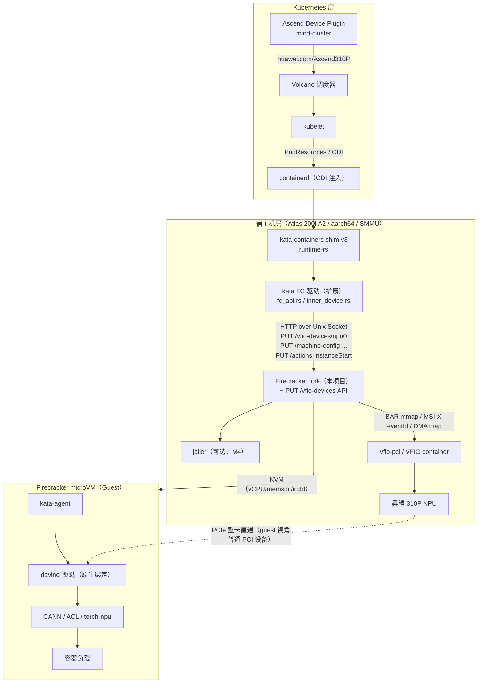
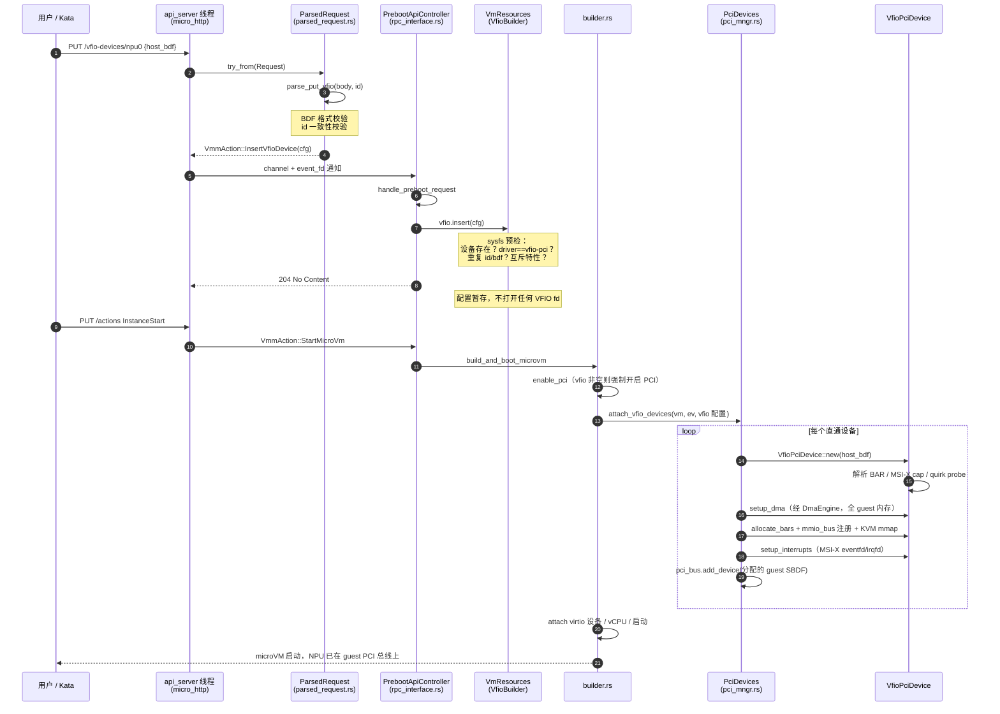
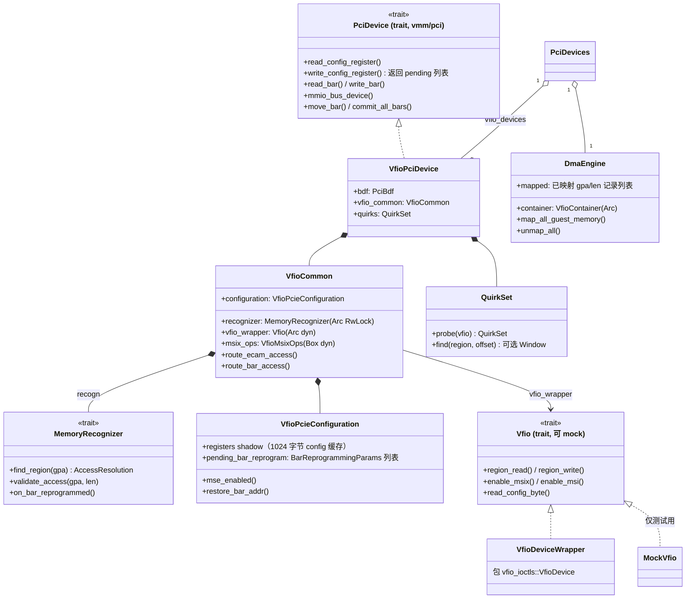
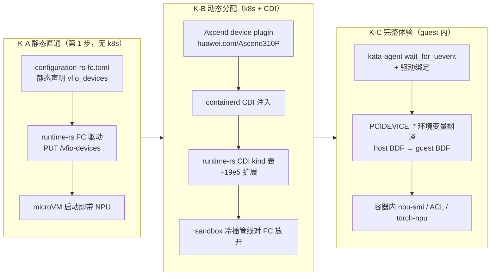
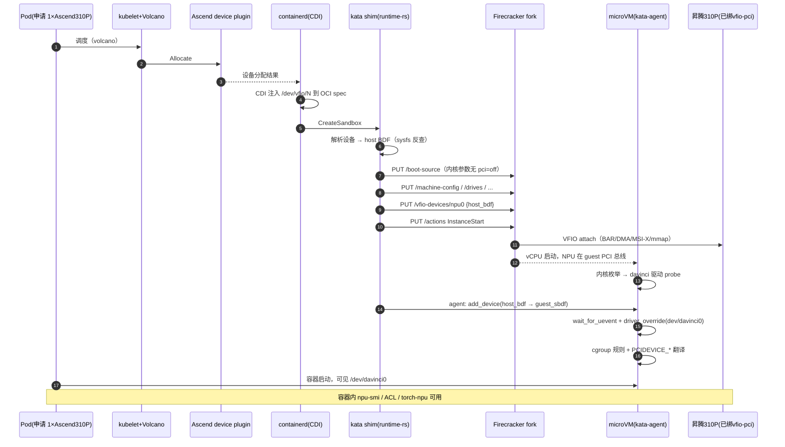
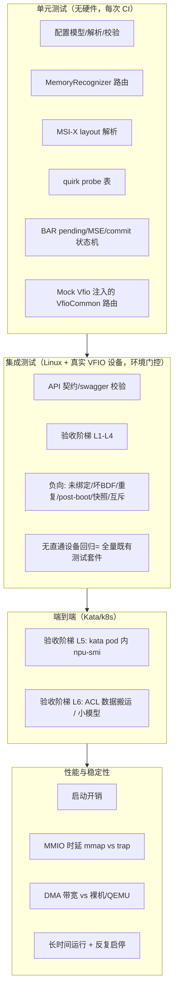
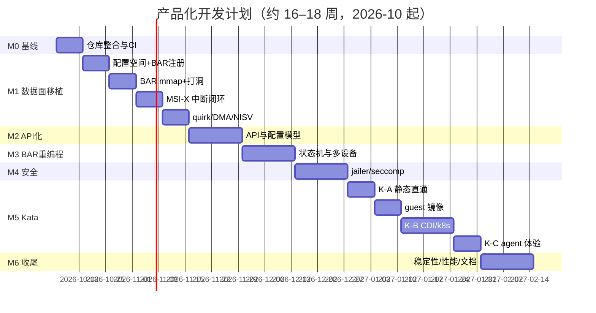

# Firecracker 昇腾 NPU VFIO 直通产品化 —— 概要设计与开发计划

| 项目 | 内容 |
|---|---|
| 文档版本 | v1.0（概要设计 / High-Level Design） |
| 日期 | 2026-09-30 |
| 状态 | 评审稿（供组会汇报与开发排期使用） |
| 关联代码库 | `./firecracker_vfio_worked`（已跑通）、`./firecracker`（模块化重构中） |
| 涉及外部项目 | Firecracker（fork）、Kata Containers（runtime-rs / kata-agent）、Ascend mind-cluster 设备插件 |

---

## 0. 导读：20 分钟汇报路线

| 时间 | 章节 | 讲什么 | 核心一页 |
|---|---|---|---|
| 0–2 min | §1 背景 | 已打通到哪一步（lspci → npu-smi → ACL），还差什么 | §1.1 成果阶梯表 |
| 2–5 min | §2 总体设计 | 一张端到端架构图 + 代码基线决策 + 模块划分 | §2.1 架构图、§2.5 决策表 |
| 5–10 min | §3 目标一 | 去硬编码：新增 `PUT /vfio-devices/{id}` API，请求驱动直通 | §3.2 API 定义、§3.3 时序图 |
| 10–14 min | §4 目标二 | 模块内聚：直通代码全部收进 `devices/vfio/pcie/`，侵入面清单 | §4.2 类图、§4.3 侵入面表 |
| 14–18 min | §5 目标三 | Kata 对接：分层方案 + runtime-rs 改动 + 端到端时序 | §5.2 分层图、§5.6 时序图 |
| 18–20 min | §6–§8 | 测试计划、里程碑（约 16–18 周）、风险 | §7.1 甘特图、§8 风险表 |

> **一句话总结**：以 `firecracker`（模块化 fork）为基线，把 `firecracker_vfio_worked` 中已验证的直通数据面移植进来；新增 Firecracker API `PUT /vfio-devices/{id}` 让用户/编排层通过 Unix Socket 请求硬件直通；再扩展 Kata runtime-rs 的 Firecracker 驱动，打通 "K8s Pod 申请 NPU → microVM 整卡直通" 的完整链路。

---

## 1. 背景与现状

### 1.1 已达成成果（我们的起点）

在 `firecracker_vfio_worked` 中，已经完成了 **Firecracker microVM + 昇腾 310P（Atlas 200I A2，`19e5:d500`）VFIO 整卡直通** 的端到端调通，关键里程碑（详见《firecracker基于vfio的npu_pcie直通调通记录.md》）：

| 阶段 | 问题 | 解决方式 | 结果 |
|---|---|---|---|
| Checkpoint-0 | `KVM failed to emulate / -ENOSYS` | 打开 `KVM_CAP_ARM_NISV_TO_USER`（cap 177） | 拿到 `KVM_EXIT_ARM_NISV` + fault_ipa |
| 注入兜底 | NISV 直接杀 VM | 对齐 QEMU：`KVM_SET_VCPU_EVENTS` 注入 ext_dabt（cap 178） | VM 不再退出，但 STP 写仍触发 guest 内核 panic |
| 根因 | 驱动用 **STP**（ISV=0）写 BAR2 doorbell，KVM 给不出 `KVM_EXIT_MMIO` | **方案 3**：VFIO BAR mmap + KVM memslot + 页级打洞（对齐 QEMU MemoryRegion 行为） | STP 直达设备，不再 trap |
| 出卡 | `npu-smi` 报 `-9005`（DCMI 不知板型） | rootfs 写 board_cfg 绕过 SMBIOS 枚举 | `npu-smi info` 正常显示 310P3 |
| 稳定性 | NPU 大 BAR 与 virtio 设备地址冲突、BAR 重编程撕裂 | MSE 门控 + pending 队列 + `commit_all_bars` + 跨设备 Overlap 摘除/重试 | virtio 与 NPU 共存，可稳定启动 |

**当前验收状态**：Guest（openEuler 22.03 + NPU 驱动 25.3.rc1）内 `lspci` 可见设备、`npu-smi info` 出卡、ACL 库完成 Host 内存 ↔ NPU 显存数据搬运。

### 1.2 两个代码库的现状与差距

| 维度 | `firecracker_vfio_worked`（能跑） | `firecracker`（设计好） |
|---|---|---|
| 基线 | 较老 Firecracker 基线 | 更新基线（v1.15/1.16 era，含 virtio-mem、vhost-user 等） |
| 设备接入方式 | **环境变量** `FC_VFIO_PCI_BDF` + 启动脚本默认值 | **硬编码** `/sys/bus/pci/devices/0000:ba:02.0` + `"test_vfio"`（`builder.rs`） |
| 设备数 | 单设备（`Option<Arc<Mutex<FixedVfioPciDevice>>>`） | 多设备（`HashMap<u32, Arc<Mutex<VfioPciDevice>>>`） |
| 模块结构 | 单体 `FixedVfioPciDevice`（device.rs 1186 行） | `devices/vfio/pcie/` 9 文件：VfioPciDevice / VfioCommon / MemoryRecognizer / DmaEngine / VfioInterruptEngine / VfioPcieConfiguration / mmio_utils |
| 配置空间 | VFIO fd 动态读写 + BAR shadow（**已验证**） | MemoryRecognizer 路由框架完成，`VfioPcieConfiguration` 方法体为空 |
| BAR 分配/注册 | NPU 专属 ExactMatch pinning + 通用 FirstMatch（**已验证**） | `init_bar_region` 为 stub，**BAR 未上 mmio_bus（数据面断裂）** |
| BAR mmap+打洞 | `bar_mmap.rs` 完整（BAR0/BAR2 mmap，MSI-X/quirk 页打洞；BAR4 8GiB 暂缓） | `mmio_utils.rs` 已实现 mmap→KVM memslot，但未接线 |
| MSI-X/MSI | 完整闭环（512 向量，VFIO eventfd ↔ KVM irqfd） | `VfioInterruptEngine` 全部 stub |
| Ascend quirk | `ascend_quirks.rs`（xloader 寄存器读透传/写丢弃，对齐官方 QEMU patch） | 无 |
| BAR 重编程 | pending + MSE drain + `commit_all_bars` + Overlap 摘除/重试（**已验证**） | `Vm::move_bar` 返回 `NotSupported`（有完整 TODO 注释规划） |
| NISV（aarch64） | cap177/178 + inject ext_dabt + `enosys_log` 诊断 | 无 |
| DMA | attach 时全量 map（IOVA=GPA），Drop 时 unmap | builder.rs 内联 map + `DmaEngine`（stub，无回滚） |
| 错误处理 / 测试 / API / jailer / seccomp | 部分 unwrap；无测试；无 API；无 jailer/seccomp 支持 | 大量 unwrap/panic；无测试；无 API；无 jailer/seccomp 支持 |

**结论**：两库高度互补 —— fork 有**骨架**（模块边界、多设备、新基线、可 mock 的 `Vfio` trait），worked 有**肌肉**（全部已验证的数据面/中断/quirk/NISV/BAR 迁移逻辑）。任何一个单独演进都要重做对方已有的工作。

### 1.3 目标（对应 TODO.md 三项）

1. **目标一（去硬编码 / API 化）**：消除 BDF 与 NPU BAR 基址等全部硬编码；用户通过 Firecracker 的 Unix Socket API 发送**硬件直通配置请求**，与配置内存、CPU、磁盘等现有请求同构；Firecracker 解析请求并在启动时执行直通。
2. **目标二（模块内聚 / 低侵入）**：直通代码收敛到独立模块树，与原有 Firecracker 代码的接缝最小化、权责清晰，可独立测试，virtio 路径零改动。
3. **目标三（Kata 对接）**：Kata Containers（runtime-rs）能够把 Pod 申请的 NPU 以冷插方式直通进 Firecracker microVM，Guest 内 kata-agent 完成设备识别与驱动绑定，容器内可使用 NPU。

### 1.4 非目标（本期明确不做）

- VFIO 设备**热插拔**（post-boot 动态增删）—— 只做冷插（pre-boot 配置 + InstanceStart 挂载）；
- VFIO 设备的快照/恢复（挂载 VFIO 设备时显式拒绝 snapshot）；
- guest 内存热插拔（virtio-mem）、balloon 与 VFIO 的共存（v1 互斥拒绝）；
- vNPU（算力切分）直通 —— 架构上与整卡一致，留待验证；
- 上游化（向 firecracker-microvm 提 PR）—— 保持 fork，但按可上游的结构组织代码。

---

## 2. 总体设计

### 2.1 目标架构：一张图



**设计主线**：NPU 对 Guest 而言就是一个**普通 PCI 设备**（guest-kernel 模式，Guest 内跑原生 davinci 驱动），Firecracker 负责"把它放进 microVM"（VFIO 透传），Kata 负责"把 Pod 的设备请求翻译成 Firecracker API 调用"。

### 2.2 代码基线决策（D1）

| 方案 | 内容 | 评估 |
|---|---|---|
| **A（推荐）** | 以 `firecracker` fork 为基线，把 worked 的已验证实现**移植**进其模块结构 | 模块边界现成、多设备天然支持、基线新（virtio PCI/热插等上游能力可复用）、`Vfio` trait 可 mock（可测试性）；风险是移植引入回归 → 用验收阶梯 + worked 作为 golden 参照对冲 |
| B | 在 worked 上原地重构 + 加 API | 短期风险小，但要补做模块分解（等于重做 fork 的骨架），且基线旧、单设备假设渗透到 `Vm`/诊断等多处 |
| C | 重挂上游最新 Firecracker 再全部重写 | 工作量最大，且上游无任何 VFIO 设施，没有收益 |

**决策：方案 A**。worked 仓库冻结为"黄金参考实现"（验收基准 + 日志对照），不再演进。

### 2.3 目标模块结构与权责

```text
src/vmm/src/
├── devices/vfio/pcie/            ★ 直通实现 100% 收敛于此（目标二核心）
│   ├── mod.rs
│   ├── vfio_device.rs            # VfioPciDevice：PciDevice trait 实现，顶层编排
│   ├── vfio_common.rs            # VfioCommon：ECAM/BAR 访问路由协调中心
│   ├── vfio.rs                   # Vfio trait + VfioDeviceWrapper（可 mock，单测关键）
│   ├── memory_recognizer.rs      # GPA→访问类型 路由（fork 已完成：8 类 IovaType）
│   ├── configuration.rs          # VfioPcieConfiguration：config shadow + BAR pending 队列
│   ├── bars.rs                   # 【新】BAR 解析/分配/mmio_bus 注册（自 worked device.rs 拆出）
│   ├── bar_mmap.rs               # 【移植】VFIO BAR mmap + KVM memslot + 页级打洞
│   ├── msix.rs                   # 【移植】MSI-X 拦截 + eventfd/irqfd（worked irq.rs/msix_table.rs）
│   ├── msi.rs                    # 【移植】MSI 回退
│   ├── event_handler.rs          # 【移植】VfioInterruptSubscriber（epoll drain）
│   ├── dma_engine.rs             # DmaEngine：DMA map/unmap 生命周期（stub → 完整）
│   └── quirks/                   # 【新目录】设备 quirk 注册表（表驱动）
│       ├── mod.rs
│       └── ascend.rs             # 【移植】Ascend 310P xloader quirk
├── vmm_config/vfio.rs            # 【新】VfioConfig（API 配置模型，对齐 PmemConfig 风格）
├── device_manager/pci_mngr.rs    # PciDevices：vfio_devices 表 + attach 入口 + DmaEngine 挂载
├── builder.rs                    # 一处调用：attach_vfio_devices(vm_resources.vfio, ...)
├── vstate/vm.rs                  # DeviceRelocation::move_bar 实现 + VFIO 注册表（迁移重试用）
├── vstate/bus.rs                 # 【改】update_range / remove_by_device（通用基础设施）
├── pci/mod.rs                    # 【改】PciDevice trait 扩展（默认实现，向后兼容）
└── arch/aarch64/{kvm,vcpu}.rs    # 【改】NISV cap177/178 + inject ext_dabt（aarch64 限定）
    + arch/aarch64/enosys_log.rs  # 【新】NISV/ENOSYS 诊断（hint 数据化）
```

**模块权责表**（单一职责，接口即契约）：

| 模块 | 唯一职责 | 不做什么 |
|---|---|---|
| `VfioConfig`（vmm_config） | API 配置模型、格式/互斥校验 | 不碰 fd、不做 IO |
| `VfioBuilder`（resources） | 持有配置列表、供 GET /vm/config 序列化 | 不 attach |
| `builder::attach_vfio_devices` | 读配置 → 逐设备调 PciDevices | 不含设备逻辑 |
| `PciDevices` | 客户 SBDF 分配、设备表、DmaEngine 持有、attach 编排 | 不实现 PciDevice |
| `VfioPciDevice` | 实现 `PciDevice` trait；组合各子模块；设备级生命周期 | 不直接持有裸 fd |
| `VfioCommon` | 所有 ECAM/BAR 访问的**唯一路由点**（经 MemoryRecognizer） | 不做设备特异逻辑 |
| `MemoryRecognizer` | GPA/偏移 → 访问类型（Ecam/BarReg/MsixTable/Pba/BarMem/…）+ 跨段检测 | 不执行 IO |
| `VfioPcieConfiguration` | config shadow、BAR 寄存器写捕获、pending 队列 | 不操作 mmio_bus |
| `bars.rs` | BAR 解析、guest 地址分配（allocator）、mmio_bus 注册 | 不解释访问语义 |
| `bar_mmap.rs` | 可 mmap 区 → KVM memslot；MSI-X/quirk 页打洞；BAR 搬迁时重建 slot | 不做 trap 转发 |
| `msix.rs / msi.rs` | MSI-X/MSI 拦截、本地表镜像、KVM 路由同步、VFIO eventfd 绑定 | 不管其他 BAR 区间 |
| `DmaEngine` | 全部 guest 内存的 IOMMU map/unmap（IOVA=GPA）、回滚 | 不感知 BAR |
| `quirks/*` | 设备特异寄存器行为（读透传/写丢弃），vendor/device 探测，表驱动 | 不含通用逻辑 |
| `Vm`（DeviceRelocation） | BAR 搬迁总协调：move_bar、Overlap 摘除、pending 重试 | 不懂设备内部 |

**依赖方向规则**：`api_server → vmm_config → resources → builder → device_manager → devices/vfio → (pci trait, vstate, vfio-ioctls)`，禁止反向依赖；`devices/vfio` 不得 import virtio 任何模块（worked 中对 virtio transport 的 `0x4400_0000_00` 侵入**彻底删除**）。

### 2.4 worked → fork 移植映射

| worked 中位置 | 去向 | 动作 |
|---|---|---|
| `vfio/device.rs`（1186 行） | 拆分 → `vfio_common.rs` / `configuration.rs` / `bars.rs` / `vfio_device.rs` | 解构重组，逻辑保持 |
| `vfio/bar_mmap.rs`（415 行） | `pcie/bar_mmap.rs` | 近乎原样移植 |
| `vfio/msix_table.rs` + `irq.rs` | `pcie/msix.rs`（实现 VfioInterruptEngine） | 合并 |
| `vfio/msi.rs` | `pcie/msi.rs` | 原样移植 |
| `vfio/event_handler.rs` | `pcie/event_handler.rs` | 原样移植 |
| `vfio/ascend_quirks.rs` | `pcie/quirks/ascend.rs` | 原样移植 + 注册表化 |
| `vfio/dma.rs` | `pcie/dma_engine.rs`（补回滚/unmap） | 增强 |
| `vfio/npu_layout.rs` | **删除** | 常量由分配器 + 重编程机制取代（§3.1） |
| `pci_mngr.rs::attach_fixed_vfio_device` | `pci_mngr.rs::attach_pci_vfio_device`（fork 已有签名） | 参数化：BDF 来自 API 配置 |
| `vstate/vm.rs` 摘除/重试逻辑 | `vstate/vm.rs`（fork 已有 TODO 规划） | 多设备化 |
| `arch/aarch64/{kvm,vcpu,enosys_log}.rs` | 同路径 | 移植，hint 数据化 |
| `virtio/transport/pci/device.rs`（0x4400 常量） | **不移植** | 由顺序分配 + Overlap 机制替代 |
| `docs/*-zh.md` 系列设计文档 | fork `docs/` | 拷贝归档（重要知识资产） |

### 2.5 关键设计决策汇总（ADR 摘要）

| # | 决策 | 理由 |
|---|---|---|
| D1 | 以 fork 为基线移植 worked 实现 | §2.2 |
| D2 | **冷插模型**：pre-boot PUT 配置，InstanceStart 时挂载 | 与 Firecracker 全部设备配置同构；Kata CDI 冷插管线天然匹配；VFIO 热插复杂度极高（IOMMU group 管理 + guest PCI 热插控制器），非本期 |
| D3 | API 形态：独立资源 `PUT /vfio-devices/{id}`，**纯增量** | 不动既有端点；kata 现有 client（v1.12 swagger 生成）不受影响 |
| D4 | BAR 放置：通用 FirstMatch 分配 + guest 重编程迁移机制；**删除 NPU ExactMatch pinning** | §4.4；0x4000/0x4200/0x4210 本质是"预置到 guest Linux 最终会选的地址以减少搬迁"，通用化后由机制兜底 |
| D5 | 单 `VfioContainer` / VM，多设备共享；DMA 统一走 DmaEngine | 一份 IOMMU 映射服务多设备；对齐 fork 设计文档的资源持有规则 |
| D6 | Kata 主线选 **runtime-rs**（Go runtime 已进弃用期只收 bugfix） | 面向 Kata 4.x 默认架构；Go 路径作备选（其 fcConfig.json 流程与我们 config-file 支持天然兼容） |
| D7 | guest 侧 **guest-kernel 模式**（设备由 Guest 原生驱动绑定） | 即 kata `vfio_mode` 默认值；Guest 无需 vfio 用户态；davinci 驱动直接 probe |
| D8 | VFIO 与 balloon / 内存热插 / 快照 **互斥，fail-fast** | 直通设备 DMA 映射的内存被回收/迁移/快照回滚都会导致 DMA 错乱，v1 明确拒绝 |
| D9 | quirk 表驱动，行为严格对齐昇腾官方 QEMU patch | quirk 常量（0x100430 等）是**设备行为数据**而非配置，保持硬编码于表中最安全 |
| D10 | jailer/seccomp 后置到 M4；研究期可关 jailer 运行 | 不阻塞主线；Kata 侧可先 `disable jailer` |
| D11 | aarch64 为主平台（NISV 相关仅 aarch64）；x86_64 路径保持可编译 | NPU 服务器为 aarch64；PCI trait/数据面逻辑本身架构无关 |

---

## 3. 目标一：直通配置 API 化（去硬编码）

### 3.1 硬编码审计与处置表

对两个代码库的完整硬编码审计结果及**每一项的处置**：

| # | 硬编码项 | 现位置 | 现值 | 处置方案 |
|---|---|---|---|---|
| 1 | 直通设备 BDF | worked：环境变量 `FC_VFIO_PCI_BDF`（`pci_mngr.rs:78`）+ `start_fc_socket.sh` 默认 `0000:01:00.0`；fork：`builder.rs` 字面量 | `0000:01:00.0` / `0000:ba:02.0` | **API 请求驱动**：`PUT /vfio-devices/{id}`，body 中 `host_bdf` 字段（§3.2） |
| 2 | NPU BAR 尺寸 | worked `npu_layout.rs` | 16MiB / 256MiB / 8GiB | 运行时从 `VFIO_DEVICE_GET_REGION_INFO` 读取（`parse_bars` 已如此，npu_layout 常量删除） |
| 3 | **NPU guest BAR 基址** | worked `npu_layout.rs` ExactMatch pinning | `0x4000_0000_00` / `0x4200_0000_00` / `0x4210_0000_00` | **删除 pinning**：attach 时 FirstMatch 分配器通用放置 + guest 重编程由 BAR 迁移机制接管（§4.4） |
| 4 | virtio 共存基址 | worked `virtio/transport/pci/device.rs:222` | `0x4400_0000_00` | **删除**：VFIO 先于 virtio attach（顺序分配天然无初始重叠）+ Overlap 摘除/重试机制兜底；virtio 代码零改动 |
| 5 | NISV 诊断 hint 常量 | worked `enosys_log.rs` | NPU BAR 区间常量 | 动态查询：向 device_manager 查询"该 GPA 落在哪个已注册 BAR"（多设备亦正确） |
| 6 | MSI-X 向量上限 | worked `irq.rs:17` | `MAX_VFIO_MSIX_VECTORS = 512` | `min(capability 上报, VFIO irq_info.count)`，默认安全上限仅防资源失控；API 可选字段覆盖（v2） |
| 7 | mmap BAR 尺寸上限 | worked `bar_mmap.rs:25` | 8GiB | 保留为**全局安全上限**（KVM memslot/页表预算保护），可配置；BAR4 8GiB 暂不 mmap 的取舍在文档中显式声明（§4.5） |
| 8 | Ascend quirk 常量 | worked `ascend_quirks.rs` | vendor `19e5`、device `d500`、BAR2 `0x100430` 等 | **保留**（D9），移入 `quirks/ascend.rs` 表驱动，probe 按 vendor/device/subsystem 自动命中 |
| 9 | `"test_vfio"` 设备名、`unwrap()/panic!()` | fork `builder.rs` | — | 删除；错误全部类型化传播（§4.9） |
| 10 | DMA/KVM VFIO device fd 无条件创建 | fork `builder.rs` | 总是执行 | 由 `vm_resources.vfio` 是否非空驱动；容器创建策略统一（§4.7） |
| 11 | PCI 使能仅靠 `--enable-pci` CLI | 两侧 `main.rs` | bool | `pci_enabled = cli_flag \|\| !vfio_configs.is_empty()`（配置了直通设备却忘开 PCI 是必现坑，自动兜底） |

### 3.2 API 设计

#### 3.2.1 Swagger 定义（新增，模式对齐 `/pmem/{id}`）

```yaml
  /vfio-devices/{id}:
    put:
      summary: Creates a VFIO passthrough device. Pre-boot only.
      description:
        Creates a new VFIO device with ID specified by the id parameter.
        The device must be bound to the vfio-pci driver on the host.
        The device is attached when the microVM is started (InstanceStart).
      operationId: putVfioDeviceByID
      parameters:
        - name: id
          in: path
          description: The id of the VFIO device
          required: true
          type: string
        - name: body
          in: body
          required: true
          schema:
            $ref: "#/definitions/VfioDevice"
      responses:
        204: { description: VFIO device is created }
        400: { description: Invalid input, schema: { $ref: "#/definitions/Error" } }
        default: { description: Internal server error, schema: { $ref: "#/definitions/Error" } }

definitions:
  VfioDevice:
    type: object
    required: [id, host_bdf]
    properties:
      id:
        type: string
        description: Unique identifier of the VFIO device.
      host_bdf:
        type: string
        description: >
          Host PCI address (BDF) of the device to pass through,
          e.g. "0000:01:00.0". The device must already be bound
          to the vfio-pci driver.
```

`FullVmConfiguration`（GET `/vm/config`）增加 `vfio-devices: []` 数组字段。

#### 3.2.2 请求示例（这就是"用户通过 Socket 发送硬件直通请求"）

```bash
# Firecracker 已在监听 Unix socket（如 /run/firecracker.socket）
curl --unix-socket /run/firecracker.socket \
     -X PUT "http://localhost/vfio-devices/npu0" \
     -H "Content-Type: application/json" \
     -d '{ "id": "npu0", "host_bdf": "0000:01:00.0" }'

# 然后照常启动（attach 发生在此时）
curl --unix-socket /run/firecracker.socket \
     -X PUT "http://localhost/actions" \
     -d '{ "action_type": "InstanceStart" }'
```

#### 3.2.3 配置文件方式（`--config-file`，Kata Go runtime 与脚本化场景依赖此路径）

```json
{
  "boot-source": { "kernel_image_path": "...", "boot_args": "..." },
  "machine-config": { "vcpu_count": 8, "mem_size_mib": 16384 },
  "drives": [ ... ],
  "vfio-devices": [
    { "id": "npu0", "host_bdf": "0000:01:00.0" }
  ]
}
```

#### 3.2.4 内部模型（Rust，对齐 `PmemConfig` 模式）

```rust
// src/vmm/src/vmm_config/vfio.rs
#[derive(Debug, Clone, PartialEq, Eq, Serialize, Deserialize)]
#[serde(deny_unknown_fields)]
pub struct VfioConfig {
    /// Unique identifier of the device.
    pub id: String,
    /// Host PCI address (BDF) of the passthrough device, e.g. "0000:01:00.0".
    pub host_bdf: String,
}

#[derive(Debug, thiserror::Error, displaydoc::Display)]
pub enum VfioConfigError {
    /// Invalid BDF format: {0} (expected dddd:bb:dd.f)
    InvalidBdf(String),
    /// Another VFIO device with id {0} already exists
    DuplicateId(String),
    /// Another VFIO device with BDF {0} already exists
    DuplicateBdf(String),
    /// Device {0} not found on host
    DeviceNotFound(String),
    /// Device {0} is not bound to vfio-pci (current: {1})
    NotBoundToVfio(String, String),
    /// VFIO passthrough cannot be combined with: {0}
    IncompatibleFeature(String),
    /// Attach failed: {0}
    Attach(#[from] VfioPciDeviceError),
}
```

调用链各层改动（全部为**增量模式**，模式照抄 pmem 端到端模板）：

| 层 | 文件 | 改动 |
|---|---|---|
| Swagger | `src/firecracker/swagger/firecracker.yaml` | §3.2.1 |
| 路由 | `src/firecracker/src/api_server/parsed_request.rs` | 新 arm：`(Method::Put, "vfio-devices", Some(body)) => parse_put_vfio(body, path_tokens.next())` |
| 解析器 | `src/firecracker/src/api_server/request/vfio.rs`（新文件） | `parse_put_vfio`：校验 id 匹配 + 反序列化 + metrics |
| 动作 | `src/vmm/src/rpc_interface.rs` | `VmmAction::InsertVfioDevice(VfioConfig)`；`VmmActionError::VfioConfig(#[from] VfioConfigError)`；**pre-boot allow 名单 + post-boot deny 名单**各加一臂；单测 `test_preboot_disallowed` / `test_runtime_disallowed` 同步 |
| 配置 | `src/vmm/src/vmm_config/vfio.rs`（新文件） | `VfioConfig` + 校验 |
| 资源 | `src/vmm/src/resources.rs` | `VmResources.vfio: VfioBuilder`；`VmmConfig.vfio_devices`（serde `vfio-devices`）；`from_json` / `From<&VmResources>` 双向；`boot_path = true`（阻止 LoadSnapshot） |
| 构建 | `src/vmm/src/builder.rs` | 删除硬编码 `attach_vfio_pcie_device`，新增 `attach_vfio_devices(vm, event_manager, &vm_resources.vfio)` 循环 |
| 指标 | `src/vmm/src/logger/metrics.rs` 等 | `put_api_requests.vfio_count / vfio_fails`；运行时指标见 §3.6 |

### 3.3 请求处理链路（时序图）



### 3.4 与 Firecracker 生命周期的集成

| 生命周期点 | 行为 |
|---|---|
| PUT `/vfio-devices/{id}`（pre-boot） | 只校验 + 暂存配置；sysfs 只读预检（不持 fd）；幂等：同 id 重新 PUT = 覆盖配置 |
| PUT `/actions` InstanceStart | fail-fast attach：任何一步失败 → `InstanceStart` 返回明确错误（哪台设备、哪一步、修什么），VM 不启动 |
| 启动后（post-boot） | `PUT /vfio-devices` → `OperationNotSupportedPostBoot`（冷插语义） |
| Pause/Resume | 不涉及 VFIO 状态，天然支持 |
| `PUT /snapshot/create` | 挂有 VFIO 设备 → **拒绝**（`SnapshotWithVfioDevice` 错误） |
| VM 停止 | `Drop`：VFIO SET_IRQS 解绑 → irqfd 解绑 → DMA unmap → mmio_bus 摘除 → fd 关闭 |

### 3.5 校验与预检规则

**PUT 时（快速失败，错误信息可指导修复）**：

| 规则 | 错误 |
|---|---|
| `id` 通过 `checked_id`（字母数字+下划线） | `EmptyID` / `InvalidID` |
| `host_bdf` 匹配 `dddd:bb:dd.f` | `InvalidBdf` |
| id / bdf 不与已配置设备重复 | `DuplicateId` / `DuplicateBdf` |
| `/sys/bus/pci/devices/<bdf>/` 存在 | `DeviceNotFound` |
| `/sys/bus/pci/devices/<bdf>/driver` → `vfio-pci` | `NotBoundToVfio`（错误信息给出当前 driver 与解绑命令提示） |
| 未同时配置 balloon / memory-hotplug | `IncompatibleFeature` |

**InstanceStart 时（真正的资源检查，全部 fail-fast）**：

| 检查 | 失败错误 |
|---|---|
| IOMMU group 存在且 viable（`VFIO_GROUP_GET_STATUS`） | attach 错误 |
| `VFIO_SET_IOMMU` 成功（host SMMU/vSMMU 已启用） | attach 错误 |
| region info 全部可读、BAR 尺寸可解析 | attach 错误 |
| MSI-X 或 MSI 至少其一可用 | `NoInterruptSupport` |
| guest mmio 窗口可容纳全部 BAR（多设备叠加时） | `BarAllocation` |

### 3.6 可观测性

| 类别 | 内容 |
|---|---|
| API 指标 | `put_api_requests.vfio_count` / `vfio_fails` |
| attach 日志 | `vfio: device attached id= host_bdf= guest_sbdf= vendor= device= subsystem= quirks= msix_vectors=` |
| 运行时指标 | `vfio_mmio_exits_total`（trap 计数，验证 mmap 生效应趋近 0）、`vfio_bar_reprogram_total`、`vfio_nisv_injected_total`（aarch64）、`vfio_irq_events_total` |
| 诊断 | NISV fault_ipa → 动态匹配已注册 BAR（替换常量 hint）；quirk 命中/丢弃日志（沿用 worked 的 `fixed-vfio:` 前缀风格，改为 `vfio:`） |

---

## 4. 目标二：直通代码模块化与低侵入

### 4.1 设计原则

1. **内聚**：所有直通逻辑位于 `devices/vfio/pcie/` + `vmm_config/vfio.rs`，可整目录 review/删除。
2. **低侵入**：对既有代码的修改必须是以下三类之一——(a) trait **默认实现**扩展（向后兼容）；(b) 单一调用点插入；(c) 平台限定的小函数。凡"为 VFIO 改 virtio"一律不允许。
3. **可测试**：`Vfio` trait（fork 已有）是唯一 IO 边界，单测注入 `MockVfio`；worked 的实现逻辑拆到纯函数（解析、路由、状态机）后全部可离线测试。
4. **行为对齐**：移植保持 worked 已验证语义（日志关键字、quirk 行为、MSE 门控时序），便于对照排障。

### 4.2 模块类图



（`VfioMsixOps` 的实现即移植自 worked 的 `VfioMsixManager`；`bars.rs` 负责 BAR 分配与 mmio_bus/KVM 注册，供 attach 与 `commit_all_bars` 复用。）

### 4.3 侵入面清单（改了哪些既有文件）

| 文件 | 改动性质 | 内容 |
|---|---|---|
| `vmm/src/builder.rs` | 替换 | 硬编码 attach → 配置驱动 `attach_vfio_devices()`（删除 ~90 行硬编码，新增 ~40 行循环） |
| `vmm/src/device_manager/pci_mngr.rs` | 扩展 | `PciDevices` 增 `vfio_devices` 表（fork 已有）+ `DmaEngine` 字段（fork 已有 TODO）+ attach 编排 |
| `vmm/src/vstate/vm.rs` | 扩展 | `DeviceRelocation::move_bar` 真实现（当前 `NotSupported`；fork 已有中文 TODO 规划，照做）+ VFIO 设备注册表（供 Overlap 摘除/重试） |
| `vmm/src/vstate/bus.rs` | 增量 | `update_range` / `remove_by_device`（通用总线原语，virtio 亦受益） |
| `vmm/src/pci/mod.rs` | trait 扩展 | `PciDevice` 增默认方法：`mmio_bus_device()`（默认 None）、`commit_all_bars()`（默认 Ok）；`write_config_register` 返回值加 pending 列表（详见《pci-bar-move-implementation-zh.md》PR-1a，该改动同样使 virtio 设备获得正确 BAR 迁移能力） |
| `vmm/src/arch/aarch64/{kvm,vcpu}.rs` | 平台限定增量 | NISV cap enable + `handle_arm_nisv_exit`（对齐 QEMU，各 ~30 行） |
| `vmm/src/resources.rs` | 增量字段 | `VmResources.vfio` / `VmmConfig.vfio_devices` / pci 自动开启逻辑 |
| `vmm/src/rpc_interface.rs` | 增量臂 | pre-boot allow / post-boot deny 各一臂 |
| `firecracker/src/api_server/*` | 新文件+一臂 | `request/vfio.rs` + `parsed_request.rs` 一臂 |
| `firecracker/swagger/firecracker.yaml` | 增量 | §3.2.1 |
| `jailer/src/env.rs` | 增量（M4） | `/dev/vfio/*` mknod + sysfs 可见性，flag 门控 |
| `resources/seccomp/*.json` | 增量（M4） | VFIO ioctl 白名单 + pread64/pwrite64 审计 |
| **其余全部文件** | **零改动** | virtio、devices 其他、acpi/fdt、persist… |

对比 worked 的侵入点：worked 额外改了 `virtio/transport/pci/device.rs`（共存基址常量）、`enosys_log.rs`（NPU 常量）——两者在新设计中均消除。

### 4.4 BAR 放置与 guest 重编程（去硬编码的核心机制）

**为什么 worked 要 pin 0x4000/0x4200/0x4210**：guest Linux 枚举时会**重写全部 BAR**（npu_coredump 日志实证），worked 把 attach 初值预置到 guest 最终选择的地址，让 NPU 的 BAR"不用搬家"、只剩 virtio 搬。这是针对单台设备的经验性捷径。

**新设计（通用机制替代经验捷径）**：

1. **attach 放置**：逐 BAR 从 VFIO region info 读取 size/flags；Mem64 → `mmio64` 分配器 FirstMatch、Mem32 → `mmio32`；对齐 = max(size, PAGE_SIZE)；写入 config shadow；注册 mmio_bus；可 mmap 区挂 KVM memslot（含打洞）。VFIO 设备先于 virtio attach → 初始布局天然无重叠（分配器顺序分配）。
2. **guest 重编程接管**：完整移植 worked 的状态机（MSE 门控 + pending + 批量提交 + Overlap 处理），对任意 guest 分配结果都成立。

```mermaid
stateDiagram-v2
    [*] --> Attached: attach 时 FirstMatch 分配<br/>shadow 写入 + mmio_bus 注册
    Attached --> PendingBarWrite: guest 写 BAR 寄存器<br/>（MSE=0，只记 shadow + pending）
    PendingBarWrite --> PendingBarWrite: 继续写其他 BAR
    PendingBarWrite --> Draining: guest 写 COMMAND 置 MSE=1<br/>（或写 BAR 时已 MSE=1）
    Draining --> Committing: write_config 返回 pending 列表<br/>Vm::relocate_bars 统一搬迁
    Committing --> Committed: 单 BAR update_range（virtio）<br/>或 commit_all_bars 批量（VFIO 多 BAR 原子）
    Committing --> Peeled: Overlap（如撞上其他设备区间）<br/>摘除 VFIO bus 映射 / VFIO 置 pending
    Peeled --> Committing: 任一设备搬迁成功后<br/>retry_all_pending_devices
    Committed --> [*]: 终态布局生效<br/>（KVM mmap slot 同步重建）
    note right of Draining
        硬失败（非法地址）:
        restore_bar_addr 回滚 shadow
    end note
```

关键语义（全部沿用已验证实现，详见《pci-bar-move-implementation-zh.md》v2.3）：

- **MSE 延迟**：BAR 写只进 pending，COMMAND 置 MSE=1 才 drain（edk2/部分驱动一次性 enable 的场景也覆盖）；
- **VFIO 多 BAR 原子提交**：`commit_all_bars` = 先 `remove_by_device` 再批量 insert，避免中间态自相重叠；失败不回滚到 attach 态（避免永久挡住 virtio）；
- **Overlap 仲裁**：当前拓扑（大 BAR VFIO + 小 BAR virtio）固定为"摘 VFIO、让 virtio 落位、再重试 VFIO"；多 VFIO 大 BAR 互相遮挡的场景留通用 blocker 解析（v2）；
- **迁移基础设施复用**：`Vm::move_bar` / bus `update_range` 是通用能力，virtio-pci 设备同样受益（这正是 fork 上游已规划的方向）。

### 4.5 BAR mmap 与打洞（aarch64 STP 问题的解）

沿用 worked `bar_mmap.rs`（对齐 QEMU `hw/vfio/region.c`）：

- attach 时 probe 每个 region 的 `VFIO_REGION_INFO_FLAG_MMAP`（含 sparse mmap cap）；
- 可 mmap 子区间 `mmap(MAP_SHARED)` VFIO device fd → `KVM_SET_USER_MEMORY_REGION` 以 GPA=BAR base+offset 挂入 guest：**STP/LDP 等不可 syndromize 指令直达设备，零 VM exit**；
- **页级打洞**：MSI-X table 所在页、quirk 窗口所在页不挂 memslot → 继续走 trap → `read_bar/write_bar` 拦截；
- BAR 搬迁（commit_all_bars）时先删旧 KVM slot 再按新 GPA 重建；
- **显式取舍**：BAR4（8GiB）暂不 mmap（KVM memslot/页表预算），该区间访问仍走 trap 转发（功能正确，性能较低）；观察实际负载后决定是否放开（上限常量可配置，见 §3.1#7）。

### 4.6 中断设计（MSI-X 闭环）

完整移植 worked 实现（《vfio-msix-implementation-zh.md》）：拦截 BAR 内 MSI-X table（写 → 本地表项 + KVM 路由 + 转发硬件；读 → 本地副本）、config capability control 字（Enable/Mask → `sync_all_vectors`/`disable_all_vectors`）、attach 时 `VFIO_DEVICE_SET_IRQS` 绑 N 个 trigger eventfd、KVM `register_irqfd` + `KVM_IRQ_ROUTING_MSI`、`VfioInterruptSubscriber` epoll drain。MSI（非 X）作回退。向量数取 `min(cap, vfio_irq.count)`。

### 4.7 DMA 生命周期（DmaEngine）

| 阶段 | 动作 |
|---|---|
| attach | 首个设备 attach 时创建唯一 `VfioContainer`（沿用 worked 已验证的 `/dev/vfio/vfio` 路径；fork builder 中 KVM device fd 方式未验证，列为备选）；后续设备仅 `VFIO_GROUP_SET_CONTAINER` 加入同一 container |
| map | 全部 guest RAM 区域一次 map，**IOVA = GPA**（一对一，无转换）；每区域记录 (gpa, len) 便于回滚/unmap |
| 运行时 | 无 map/unmap（balloon/热插内存已在配置层拒绝） |
| teardown | `Drop` 中逐区域 unmap + unset container + 关 fd（best-effort，进程退出兜底） |

### 4.8 多设备与 IOMMU group

- `PciDevices.vfio_devices: HashMap<guest_bdf, Arc<Mutex<VfioPciDevice>>>`（fork 已有）；
- attach 顺序 = 配置顺序，`next_device_sbdf` 逐个分配（guest 00:01.0、00:02.0…）；
- 同一 IOMMU group 的多设备共享 container（VFIO 语义本就要求整 group）；
- BAR 放置由分配器自动堆叠；Overlap 仲裁见 §4.4；
- quirk / MSI-X / mmap 全部 per-device 实例，无全局状态。

### 4.9 错误处理规范

- `builder.rs` 移除全部 `unwrap()/panic!()`，错误经 `StartMicrovmError::VfioAttach(VfioConfigError)` 传到 API 400/500 响应；
- attach 失败必须**指明设备与修复动作**（例：`vfio device npu0 (0000:01:00.0): device is bound to 'davinci' — run 'echo vfio-pci | sudo tee .../driver_override' and unbind first`）；
- 部分失败即整体失败（fail-fast，不留半挂载状态）。

### 4.10 aarch64 特有：NISV 处理

移植 worked 已对齐 QEMU 的实现：VM 创建时 enable cap 177/178；`run_emulation` 识别 `KVM_EXIT_ARM_NISV`（kvm-ioctls 0.24 落在 `Unsupported(28)`）；`KVM_SET_VCPU_EVENTS` 注入 ext_dabt 后继续运行（mmap 空洞页的兜底）；`enosys_log` 诊断 hint 改为动态查询已注册 BAR。x86_64 编译保持通过（cfg 门控），无 NISV 需求。

---

## 5. 目标三：Kata Containers 对接

> **深化文档**：本章为概要框架；Kata 侧代码级详设（基于 kata-containers 4.2.0 源码逐行调研的三处断点分析、改动详设、验收标准与 M5.0–M5.4 子计划）见《kata-fc-vfio-integration-design-zh.md》。

### 5.1 生态调研结论（2026-09）

| 结论 | 依据 |
|---|---|
| Firecracker 仍是 Kata 支持的 hypervisor，但功能面极窄：**仅块设备**；VFIO 冷/热插对 FC 完全关闭 | runtime-rs `inner.rs` 只设 `BlockDeviceSupport`；Go runtime `checkPCIeConfig` 明示忽略 FC 的 hot/cold_plug_vfio |
| Kata 4.x（2026-07 起）**runtime-rs 为默认**，Go runtime 弃用（只收 bugfix）；4.2.0 为当前最新 | 官方 release notes |
| kata 官方栈锁 FC v1.12.1，且 FC 驱动给 guest 内核强加 `pci=off iommu=off` | `versions.yaml`、`fc_api.rs` |
| Kata 的 **CDI 设备冷插管线已存在**（device plugin → PodResources/CDI → sandbox 创建前 AddDevice），QEMU/CLH 走通，FC 被门控 | `device_cold_plug.go`（Go）、runtime-rs `cdi_devices` crate |
| `vfio_mode` 默认 **guest-kernel**：设备在 guest 由原生驱动绑定——与我们的整卡直通模型完全一致 | `config-settings.go.in`、agent `vfio_device_handler.rs` |
| Ascend 生态（mind-cluster 设备插件 `huawei.com/Ascend310P` + Volcano + ascend-docker-runtime）**无任何 VM/Kata 感知**；CDI 设备 kind 表只有 nvidia/amd/mellanox，**缺 `19e5`** | gitee ascend 仓库、runtime-rs `CDI_DEVICE_KIND_TABLE` |
| **可行性先例**：AWS EKS Fargate GPU（2025-06）即 "Firecracker + NVIDIA Kata runtime" 内部定制；上游 Firecracker 至今（v1.17/unreleased）无任何直通能力，fork 必须长期自维护 | AWS 官宣、FC CHANGELOG |

### 5.2 总体方案与分阶段



三层递进：**K-A** 证明 FC fork ↔ Kata 基本链路（1 个里程碑即可拿到演示）；**K-B** 接入 k8s 动态分配；**K-C** 补齐容器内体验。

### 5.3 Kata 侧改动清单（runtime-rs 主线，D6）

| # | 位置 | 改动 | 阶段 |
|---|---|---|---|
| 1 | `crates/hypervisor/src/firecracker/fc_api.rs` | 新增 `put_vfio_device(id, host_bdf)`（hyper over UDS，`InstanceStart` 前调用） | K-A |
| 2 | `crates/hypervisor/src/firecracker/inner_device.rs` | `add_device` 增 `VfioDevice` 分臂（当前报 `unhandled device`） | K-A |
| 3 | `crates/hypervisor/src/firecracker/inner.rs` | capabilities 增 VFIO 冷插位 | K-A |
| 4 | `fc_api.rs` / 配置模板 `configuration-rs-fc.toml.in` | guest 内核参数去掉 `pci=off iommu=off`（改为可配置；设备直通场景必须开 PCI） | K-A |
| 5 | 配置 schema | `[hypervisor.firecracker] vfio_devices = [{id, host_bdf}]` 静态声明（研究期单机形态） | K-A |
| 6 | `crates/resource/src/cdi_devices/` | `CDI_DEVICE_KIND_TABLE` 增 `huawei.com/Ascend310P → vendor 0x19e5` | K-B |
| 7 | 设备冷插管线 | 对 FC 放开 `cold_plug_vfio` 门控（对齐 Go 侧 `device_cold_plug.go` 语义：sandbox 创建前收集 → AddDevice → start_vm 前下发） | K-B |
| 8 | hypervisor 接口 | `resolve_vfio_device_pci_path`（当前默认 Err）为 FC 返回分配的 guest SBDF，供 agent 做 host→guest BDF 映射 | K-B |
| 9 | `tools/packaging/kata-deploy/` | 新增 runtime-rs + FC 的 RuntimeClass 打包（当前 fc 只出 Go shim）；替换 fc 二进制为我们的 fork | K-B |
| 10 | kata-agent | **复用为主**：guest-kernel 模式的 `vfio_device_handler`（wait_for_uevent + driver_override）即是我们需要的路径；验证 davinci 驱动自动 probe + `/dev/davinci*` 节点 + cgroup 规则 + PCIDEVICE_* 翻译 | K-C |

**备选路径（Go runtime）**：其 fcConfig.json 流程与我们的 `--config-file` 支持天然对接，`pkg/firecracker/client` 增模型 + `fc.go` 在 `AppendDevice` 处理 `VfioDev` 即可复用整套 CDI 管线；若 runtime-rs FC 驱动基础缺陷过多则切换（决策点在 M5.1 结束时评估）。

### 5.4 Firecracker 侧的配套要求

- **API 兼容性**：新增端点纯增量，kata v1.12 client 不受影响（D3）；
- config-file 支持（§3.2.3）覆盖 Kata Go 路径与手工测试；
- jailer 可先禁用（Kata 配置 `disable jailer`），M4 完成后启用（§7 M4）。

### 5.5 Guest 镜像（关键交付物）

| 组件 | 内容 | 来源 |
|---|---|---|
| guest 内核 | kata linux 内核 + PCI/virtio 所需配置；**与 NPU 驱动版本匹配**（out-of-tree `davinci.ko` 针对该内核编译） | 镜像组 |
| rootfs 镜像（非 initrd） | openEuler 22.03 基底 + kata-agent + NPU 驱动 25.3.rc1 + 固件 + board_cfg（SMBIOS 未就绪前的过渡，另见 zoujiajun 工作项）+ CANN/ACL（e2e 需要） | 镜像组（沿用 worked 已验证版本组合） |
| 注意事项 | FC 在 Kata 下强制 devmapper snapshotter（无 virtio-fs）→ 需预置 thin-pool；rootfs 必须 image 模式 | 调研结论 |

### 5.6 端到端时序（K-B/K-C 完成态）



### 5.7 部署形态

- **研究期（K-A/K-B）**：单节点 k8s（或 kata 单机 `kata-runtime` 直跑），Volcano + mind-cluster 设备插件 + 自定义 RuntimeClass `fc-npu`；FC 二进制与 kata 组件打在同一镜像/节点目录；
- 生产化（远期）：jailer 启用、seccomp 完备、节点 daemonset 管理 vfio-pci 绑定（设备进入"Kata NPU 池"时自动从 host 驱动解绑）。

---

## 6. 测试计划

### 6.1 测试策略总览



### 6.2 单元测试（细节）

| 组 | 用例 | 备注 |
|---|---|---|
| VfioConfig | BDF 格式正反例、`deny_unknown_fields`、重复 id/bdf、互斥特性、API parser（照抄 pmem 测试形态） | 新写 |
| preboot/postboot 名单 | `InsertVfioDevice` 出现在两侧枚举测试 | 扩展既有测试 |
| MemoryRecognizer | region 构建、二分查找、跨段访问报错、BAR 重编程后区域更新 | fork 设计文档"推荐测试"未做，补上 |
| MSI-X layout | cap 链遍历、table_bir≠pba_bir、非默认 offset、next 指针环保护 | 《vfio-msix-position-validation-report.md》"下一步"清单 |
| quirk | 310P 1P/2P subsystem → 窗口数、未知 subsystem → 空、find 命中/未命中 | worked 设计 §7.1 清单 |
| BAR 状态机 | MSE=0 不 drain、COMMAND 置 MSE 后 drain、单次写只 push 一次 pending、commit 中间失败无撕裂、Overlap 摘除后重试成功、非法地址 restore | 《pci-bar-move-implementation-zh.md》§8.1 清单 |
| VfioCommon 路由 | `MockVfio`（fork `Vfio` trait 的价值）：MsixTable/Pba/quirk/透传 各分派、BAR0-fallback 删除后的 region 映射 | 新写 |

### 6.3 集成测试（Firecracker 独立）

- 框架：复用 `tests/`（Python）；新增 `integration_tests/functional/test_vfio.py`，以环境变量门控（无硬件自动 skip）：`FC_TEST_VFIO_BDF`；
- **验收阶梯**（沿用 worked 的实操路径）：
  - **L1** guest `lspci` 可见 `19e5:d500`；
  - **L2** guest dmesg：davinci probe 无 NISV 风暴/panic；
  - **L3** `npu-smi info` 出卡（board_cfg 已入 rootfs）；
  - **L4** ACL host↔device 内存搬运（rootfs 内置 `/root/acl_test` 同款用例）；
- 负向：坏 BDF / 未绑 vfio-pci / 重复配置 / post-boot PUT / snapshot 拒绝 / balloon+vfio 拒绝；
- **回归门禁**：不配置任何 vfio 设备时，既有全量测试套件必须 100% 通过（证明"零干扰"）。

### 6.4 端到端（Kata）

- **L5**：k8s pod（`huawei.com/Ascend310P: 1`，RuntimeClass `fc-npu`）内 `npu-smi info` 正常；
- **L6**：pod 内 ACL 数据搬运 / （stretch）torch-npu 跑通一个小 CNN（对接 chenke 的工作项）；
- 多 pod 隔离性（不同 pod 拿不同卡）、pod 删除后 microVM 销毁与设备回收（host 侧 vfio-pci 绑定恢复）。

### 6.5 性能测试（基准对比）

| 项 | 指标 | 基线 |
|---|---|---|
| 启动开销 | InstanceStart 增量时延（0 vs 1 vs N 台直通设备） | 无直通时 |
| MMIO 时延 | trap 转发 vs mmap 直达（microbench 往返延迟） | QEMU 同设备 |
| DMA 带宽 | ACL h2d/d2h 带宽 | 裸机 + QEMU 直通 |
| 中断 | `vfio_irq_events_total` 处理延迟（可选） | — |
| 稳定性 | 连续 100 次 启动/销毁 无泄漏（fd/内存/总线区间） | — |

---

## 7. 实施计划

### 7.1 里程碑总览

| 里程碑 | 内容 | 周期 | 验收标准 |
|---|---|---|---|
| **M0 基线整合** | 确立 fork 为基线；worked 文档迁入 fork `docs/`；Linux CI（build + cargo test）；分支策略 | 1 周 | CI 绿；两库归档策略明确 |
| **M1 数据面移植**（目标二的主体） | M1.1 配置空间转发 + bars.rs（解析/分配/mmio_bus 注册）→ M1.2 bar_mmap+打洞 → M1.3 MSI-X/MSI 闭环 → M1.4 quirks + DmaEngine + NISV | 4 周 | 验收阶梯 **L1–L3** 达成（与 worked golden 对照）；临时仍用环境变量驱动以便开发 |
| **M2 API 化**（目标一） | swagger/parser/VmmAction/VfioConfig/resources/config-file/校验/指标；删除全部环境变量与字面量（§3.1 处置表逐项销号） | 2 周 | **纯 API 驱动**（无环境变量）跑通 L1–L4；GET /vm/config 可见；负向用例全过 |
| **M3 BAR 重编程 + 多设备** | trait 扩展（PR-1a）、Vm::move_bar、commit_all_bars、Overlap 摘除/重试、多设备 attach | 2 周 | npu_coredump 场景回归（无 `Device relocation not supported` / `MissingAddressRange`）；两台设备同 VM |
| **M4 安全工程化** | jailer（/dev/vfio mknod + sysfs）、seccomp 白名单、错误信息打磨、快照/互斥拒绝 | 1–2 周 | jailer 模式下 L4 通过；seccomp 下运行时无 EPERM |
| **M5 Kata 对接**（目标三） | M5.1 K-A 静态直通（runtime-rs 驱动扩展 + 内核参数 + toml）→ M5.2 guest 镜像（内核+驱动+agent+board_cfg）→ M5.3 K-B CDI/k8s → M5.4 K-C agent 体验 | 4–5 周 | **L5**（pod 内 npu-smi）；stretch **L6** |
| **M6 收尾** | 稳定性/性能测试、文档（使用手册+设计文档定稿）、汇报材料 | 1–2 周 | 全部验收项过；文档齐 |



> 注：M5 的 guest 镜像（M5.2）与 K-B（M5.3）可与镜像组并行推进，关键路径总长约 16 周（串行上限 18 周）。

### 7.2 PR / 分支组织（对齐 Firecracker 上游习惯）

```
main（跟踪上游，保持可 rebase）
 └── vfio/series（特性分支，按 PR 粒度推进）
      ├── PR-0   基线：文档迁入 + CI（M0）
      ├── PR-1a  总线/PCI 基础设施：bus update_range/remove_by_device、
      │          PciDevice trait 扩展、write_config pending 化
      ├── PR-1b  devices/vfio/pcie 模块树 + 配置空间转发 + bars.rs
      ├── PR-1c  bar_mmap + 打洞
      ├── PR-1d  MSI-X/MSI + event_handler
      ├── PR-1e  quirks + DmaEngine + NISV
      ├── PR-2   API 全链路（swagger→rpc→resources→builder）+ 去硬编码销号
      ├── PR-3   BAR 重编程状态机 + Vm::move_bar + 多设备
      ├── PR-4   jailer + seccomp + 错误打磨
      └── （kata 仓库独立 series：K-A/K-B/K-C 对应 PR）
```

每个 PR 独立可编译、带单测、不动无关文件——这也是目标二"低侵入"的可执行证明。

### 7.3 分工建议（对齐组会分工）

| 工作流 | 内容 |
|---|---|
| VMM/直通 | M0–M4（Firecracker fork 全部） |
| 镜像 | M1 起并行：guest 内核/驱动/CANN 镜像；M5.2 kata guest 镜像；torch-npu（L6） |
| 沙箱编排 | M5（kata 仓库改动 + k8s 部署）；M2 起提前介入 API 契约评审 |
| 安全分析（zoujiajun 兼） | M4 评审；SMBIOS 替代 board_cfg 的独立工作项（本设计保留 board_cfg 依赖并显式声明） |

---

## 8. 风险与应对

| # | 风险 | 等级 | 应对 |
|---|---|---|---|
| R1 | **移植回归**：worked→fork 移植引入行为差异（尤其 BAR 迁移时序） | 高 | worked 冻结为 golden 参照；验收阶梯逐级对照；日志关键字保持一致便于 diff |
| R2 | guest 内核版本差异导致 BAR 分配策略不同 | 中 | 机制化（MSE/commit/retry）而非经验地址；npu_coredump 回归用例进 CI 门控集 |
| R3 | runtime-rs FC 驱动基础薄弱（长期仅块设备维护） | 中 | M5.1 首周做 go/no-go 评估；备选 Go runtime 路径（§5.3 备选）改动面小 |
| R4 | kata 版本演进（4.x 活跃期） | 中 | 锁定 4.2.x；FC 侧 API 纯增量保持向后兼容；kata 补丁保持最小集 |
| R5 | guest 内核 + NPU 驱动版本矩阵（out-of-tree ko 与内核强耦合） | 高 | 镜像组早期固定"内核版本×驱动 25.3.rc1"组合（worked 已验证）；升级走独立工作项 |
| R6 | 上游 Firecracker 演进导致 fork 偏离 | 中 | 目标二的低侵入设计即为此服务：diff 面最小化 + 定期 rebase main |
| R7 | 多 VFIO 大 BAR 互相遮挡（>1 台 NPU 时） | 中 | v1 固定仲裁规则（摘 VFIO）；通用 blocker 解析列入 v2 |
| R8 | BAR4 8GiB 不 mmap 的性能影响（若负载重访问 BAR4） | 低 | 显式声明 + 性能测试量化；`MAX_MMAP_BAR_SIZE` 可配置放开 |
| R9 | jailer+seccomp 缺口阻塞 Kata 部署 | 低 | M4 补齐；期间 `disable jailer` 运行 |
| R10 | SMBIOS 缺失依赖 board_cfg（Kata guest 镜像同样要带） | 中 | 已列为镜像交付物；SMBIOS 构造是独立工作项（zoujiajun） |
| R11 | Kata FC 场景强制 devmapper snapshotter 的部署复杂度 | 低 | 部署文档明示 thin-pool 预置步骤 |

---

## 9. 附录

### 9.1 术语表

| 术语 | 含义 |
|---|---|
| BDF / SBDF | PCI 总线-设备-功能地址（host 侧 / guest 侧） |
| VFIO | Linux 设备直通用户态框架（container/group/device 三级 fd） |
| IOMMU/SMMU | DMA 地址隔离与翻译（IOVA→HPA）；ARM 称 SMMU |
| BAR | PCI Base Address Register，设备的 MMIO 寄存器窗口 |
| MSE | PCI Command 寄存器 bit1（Memory Space Enable），设备响应 BAR MMIO 的总开关 |
| MSI-X | 基于 MEM write 的中断；向量表位于 BAR 内，需 VMM 拦截同步 KVM 路由 |
| NISV / ext_dabt | ARM ISV=0 的 Data Abort（KVM 无法 decode）→ 注入外部 Data Abort 给 guest |
| ECAM | PCI Express 配置空间 MMIO 访问机制 |
| CDI | Container Device Interface，容器设备描述规范（containerd/k8s 设备注入通道） |
| guest-kernel 模式 | kata vfio_mode 默认值：直通设备由 guest 原生驱动绑定（非 guest 内 vfio 用户态） |
| 冷插 / 热插 | VM 启动前配置并挂载 / 运行中动态挂载 |

### 9.2 Firecracker fork 变更文件总清单

**新增**：`vmm/src/vmm_config/vfio.rs`、`vmm/src/devices/vfio/pcie/{bars.rs, bar_mmap.rs, msix.rs, msi.rs, event_handler.rs, quirks/}`、`vmm/src/arch/aarch64/enosys_log.rs`、`firecracker/src/api_server/request/vfio.rs`
**修改**：`builder.rs`、`device_manager/pci_mngr.rs`、`vstate/vm.rs`、`vstate/bus.rs`、`pci/mod.rs`、`resources.rs`、`rpc_interface.rs`、`arch/aarch64/{kvm,vcpu}.rs`、`api_server/parsed_request.rs`、`swagger/firecracker.yaml`、`jailer/src/env.rs`（M4）、`resources/seccomp/*.json`（M4）
**删除**：fork `builder.rs` 硬编码 attach 块；worked 侧 `npu_layout.rs`、virtio transport 共存常量（移植时不带入）

### 9.3 参考资料索引

**仓库内设计文档（worked，全部迁入 fork docs/）**：《vfio-pci-demo-design-zh.md》（枚举打通）、《vfio-pci-initial-support.md》（bring-up 设计）、《vfio-msix-implementation-zh.md》（MSI-X 闭环）、《pci-bar-move-implementation-zh.md》（BAR 重编程 v2.3）、《ascend-vfio-quirks-design-zh.md》（quirk）、《ascend-vfio-nisv-qemu-fc-alignment-zh.md》（NISV/mmap 对齐 QEMU）；fork 侧：《vfio-npu-passthrough-report.md》《docs/TODO/*》（模块化设计演进系列）。

**外部**：Firecracker 上游（PCI transport v1.13、PCI 热插 preview v1.16、无 VFIO）；Kata Containers（4.x runtime-rs、`crates/hypervisor/src/firecracker/*`、CDI 冷插管线、agent `vfio_device_handler`）；cloud-hypervisor（VFIO 实现与 BAR 迁移参考）；昇腾（mind-cluster 设备插件、configureg_0010 QEMU patch）；AWS EKS Fargate GPU（"Firecracker+NVIDIA Kata" 可行性先例，2025-06）。

### 9.4 与 TODO.md 的对应关系（自检）

| TODO 要求 | 本文档章节 |
|---|---|
| BDF 参数化、Socket 请求驱动直通、新增"硬件直通配置请求" | §3.2–§3.4（API 定义、请求链路时序、生命周期集成） |
| BAR 基址等硬编码清除 | §3.1（处置表 #2–#5）、§4.4（通用机制替代） |
| 侵入度收敛、模块内聚、权责清晰 | §2.3（结构与权责表）、§4.1–§4.3（原则/类图/侵入面清单） |
| Kata 对接 | §5（调研结论、分层方案、改动清单、端到端时序） |
| 设计图 | §2.1/§2.3/§3.3/§4.2/§4.4/§5.2/§5.6/§6.1/§7.1（架构/结构/时序×2/类图/状态机/分层/测试金字塔/甘特 共 9 图） |
| 测试计划 | §6 |
| 实现步骤 | §7（里程碑/甘特/PR 组织） |
