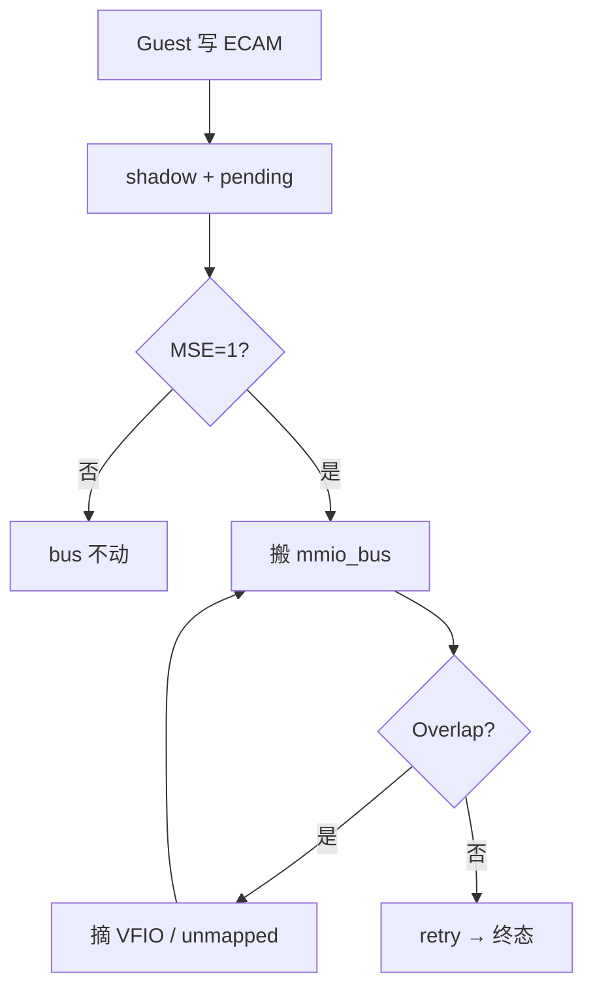
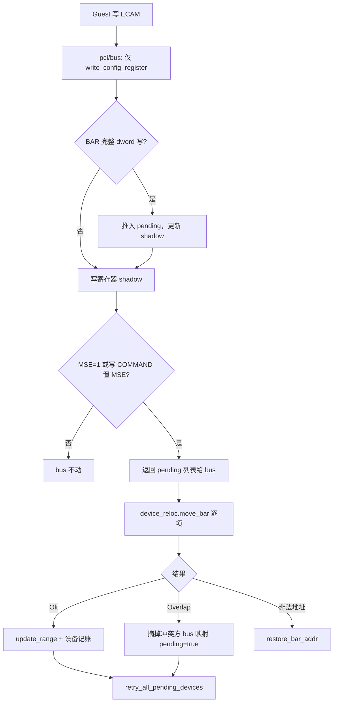

<!--
Copyright 2026 Amazon.com, Inc. or its affiliates. All Rights Reserved.
SPDX-License-Identifier: Apache-2.0
-->

## PCI BAR 重编程与 MMIO 总线同步 — 设计文档（v2.3）

本文基于 `npu_coredump.txt` 复现日志，参考 [Cloud Hypervisor](https://github.com/cloud-hypervisor/cloud-hypervisor)（[PR #7063](https://github.com/cloud-hypervisor/cloud-hypervisor/pull/7063)、[#7950](https://github.com/cloud-hypervisor/cloud-hypervisor/issues/7938)），并经过 **Firecracker 现有代码审查（v2.1）** 修订，给出 VFIO + virtio-pci 共存场景的可落地设计。

**变更说明（v2.2 → v2.3）**

- 补充 **PCI bus 与 MMIO bus 分层**（§2.6）；明确 `self_arc` **仅服务 MMIO bus**
- **修正**：VFIO 多 BAR drain 须 **`commit_all_bars` 批量提交**，不能逐项 `update_range`（§5.6.4）
- **修正**：`fixed_vfio_device` 接线落点、`relocate_bar_with_retry` 应放在 `Vm`（§5.5.3）
- 明确 **PR-1a+1b+1c 与 PR-2 的分阶段目标**（§7.1）
- 新增 **§11 文档审查结论**（遗留项清单）

**变更说明（v2.1 → v2.2）**

- **拍板** `mmio_bus_device()` 为 MMIO handler 获取方案（§5.2.1）
- 补充 **三设备拓扑**下「只摘 VFIO」为何足够（§5.5.1）
- 补充 `on_move_bar_overlap` **完整伪代码**（§5.5.2）
- 补充 VFIO `push_pending_from_bar_write` 与 virtio `detect` 对照（§5.6.7）
- 补充 **COMMAND/MSE 验证清单**（§10）

**变更说明（v2 → v2.1）**

- 修正 VFIO **无 `PciConfiguration`** 的表述，改为 `bar_reg` + 自有 pending 队列
- 补充 **`PciDevice` trait 签名**、**删除 bus 层双重 detect** 等实现约束
- 明确 **MSE 延迟 alone 不够**：virtio `pci_enable` 时仍需跨设备冲突处理
- 拆分 PR 为 **PR-1a / 1b / 1c / 2 / 3**，标注代码审查发现的缺口

**相关文档**

| 文档 | 内容 |
|------|------|
| [vfio-msix-implementation-zh.md](./vfio-msix-implementation-zh.md) | MSI-X table 依赖 BAR 基址 |
| [../../backup_docs_vfio_usb/vfio-usb-controller-stage-bc-code-summary-zh.md](../../backup_docs_vfio_usb/vfio-usb-controller-stage-bc-code-summary-zh.md) | VFIO attach / DMA / 中断现状（已归档） |

---

## 1. 问题与后果

### 1.1 Guest 终态布局（无冲突）

```text
NPU  BAR4:  0x4000000000 – 0x41ffffffff  (8GB)
NPU  BAR2:  0x4200000000 – 0x420fffffff  (256MB)
NPU  BAR0:  0x4210000000 – 0x4210ffffff  (16MB)
blk  BAR0:  0x4211000000 – 0x421107ffff  (512KB)
net  BAR0:  0x4211080000 – 0x42110fffff  (512KB)
```

### 1.2 VMM 日志（两类错误）

**A. virtio-pci — `Vm::move_bar` 未实现（P0）**

```text
Failed moving device BAR: Device relocation not supported.: 0x4001000000->0x4211000000(0x80000)
Invalid MMIO read @ 0x4211000014:0x1: bus_error: MissingAddressRange
```

**B. VFIO — eager `sync_mmio_maps`（P1）**

```text
fixed-vfio: BAR reprogram failed ... bus_error: Overlap
fixed-vfio: BAR reprogram failed ... bus_error: MissingAddressRange
```

### 1.3 attach 时 MMIO 布局

| 设备 | attach `mmio_bus` 区间 |
|------|-------------------------|
| NPU BAR0 / BAR2 / BAR4 | `0x4000000000` / `0x4010000000` / `0x4200000000` |
| virtio-blk / net | `0x4001000000` / `0x4001080000` |

**注意**：virtio 终态 `0x4211000000` 落在 NPU **attach** BAR4（`0x4200000000` 8GB）内——跨设备冲突是真实存在的，不是假设。

---

## 2. 根因（代码审查确认）

### 2.1 两条断裂路径

| 设备 | 当前代码路径 | 问题 |
|------|-------------|------|
| **virtio-pci** | `pci/bus.rs`：`detect` → `vm.move_bar`（`NotSupported`）→ `write_config` | bus 不搬迁 |
| **VFIO** | `detect` 返回 `None`；`write_config` 内 `write_bar_dword` → `sync_mmio_maps` | 绕过 bus；逐 BAR 撕裂 |

Firecracker `pci/bus.rs`（`PciConfigMmio` L366–385）：

```text
detect_bar_reprogramming()  →  vm.move_bar()  →  write_config_register()
```

Cloud Hypervisor：

```text
write_config_register()  →  返回 pending  →  move_bar()  →  失败则 restore_bar_addr()
```

### 2.2 跨设备瞬态 Overlap（两个方向）

**方向 A**：NPU 新 BAR4 ⊃ virtio **旧**址（`0x4001000000` 等在 `0x4000000000` 8GB 内）

**方向 B**：NPU **attach** BAR4 ⊃ virtio **新**址（`0x4211000000` 在 `0x4200000000` 8GB 内）

禁止在 VFIO commit 失败时 **restore attach 到 bus**（方向 B 会永久挡住 virtio）。

### 2.3 MSE 延迟能解决什么、不能解决什么

| 能解决 | 不能单独解决 |
|--------|-------------|
| VFIO 多 BAR 不要每次 `write_bar_dword` 就改 bus | virtio `pci_enable`（MSE=1）时，NPU 仍在 attach BAR4，virtio `move_bar` 仍 **Overlap** |
| 枚举写 BAR 阶段 bus 可保持不动（MSE=0） | 无 MSE 门控时 virtio 立即搬迁的竞态 |

**结论**：MSE 延迟 + 跨设备 unmapped/retry **缺一不可**。

### 2.4 `bus.insert` vs `mmap.registered`

- **`mmio_bus`**：全局 trap 路由，需 `Arc<dyn BusDeviceSync>`
- **`mmap.registered`**：VFIO 设备内部记账，用于 `read_bar` 选 region；已在 `self` 上，不需再传 device

### 2.5 两层 MMIO

| 层 | attach | guest 重编程 |
|----|--------|--------------|
| `ResourceAllocator` | `allocate()` | 默认**不参与**（PR-3 可选 `free` + `ExactMatch`） |
| `mmio_bus` | `insert` | `update_range` / `remove_by_device` |

### 2.6 PCI bus 与 MMIO bus（职责分离）

二者 **不互相干扰**，但必须 **同步账本**：

| | PCI bus（`PciBus`） | MMIO bus（`vm.common.mmio_bus`） |
|--|---------------------|----------------------------------|
| 职责 | PCI 设备登记 + ECAM config 路由 | Guest 物理地址 → MMIO trap 路由 |
| Guest 访问 | 写 BAR / Command 寄存器 | 驱动 `readl`/`writel` 设备 MMIO |
| 存储 | `device_id → Arc<Mutex<dyn PciDevice>>` | `地址区间 → Weak<dyn BusDeviceSync>` |
| 会 Overlap 吗 | 否（各设备独立 config 空间） | **是**（全局一张表） |
| 本次 bug | config shadow 已更新 | **未搬迁** / 被 VFIO 大块盖住 / 被 eager sync 撕裂 |

`self_arc` / `mmio_bus_device()` **只为 MMIO bus 的 remove/insert/update 服务**；PCI bus 在 attach 时已在 `PciBus.devices` 里持有 Arc，config 路径不依赖 `self_arc`。

---

## 3. 代码审查：现状与文档差距

以下条目来自对 `firecracker/src/vmm` 的审查，**实现前必须在设计中体现**。

| # | 审查发现 | 现状 | v2.1 要求 |
|---|----------|------|-----------|
| 1 | VFIO 无 `PciConfiguration` | 仅 `bar_reg[]` + `mmio_maps` | VFIO 自建 `pending_bar_reprogram`，勿写「走 configuration」 |
| 2 | `PciDevice::write_config_register` 返回 `Option<Barrier>` | 无法返回 pending 列表 | 改为 `(Vec<BarReprogrammingParams>, Option<Barrier>)` 或等价方案 |
| 3 | bus 层 **双重 detect** | 外部 `detect` + `write_config` 内写寄存器 | **删除** bus 外部 `detect`；detect 仅 inside `write_config` |
| 4 | `BarReprogrammingParams` 无 `region_type` | 仅 old/new/len | 增加 `PciBarRegionType`（VFIO 有 Mem32/Mem64） |
| 5 | `Bus` 无 `update_range` / `remove_by_device` | 仅 insert/remove | PR-1a 必须新增 |
| 6 | `Arc<Mutex<dyn PciDevice>>` 不能 `insert` | attach 用 `Arc<Mutex<VirtioPciDevice>>` | **`PciDevice::mmio_bus_device()`（已定案，§5.2.1）** |
| 7 | VFIO 未实现 `move_bar` | trait 默认空操作 | PR-2 实现 |
| 8 | `fixed_vfio_device` 在 `PciDevices` | `PciBus` 无引用 | 接线供 `retry_all_pending` |
| 9 | 全仓库无 `allocator.free()` | attach 用 `FirstMatch` | PR-1 最小路径可**仅改 bus**；PR-3 再 free/`ExactMatch` |
| 10 | `detect` 仅 `data.len()==4` | 子字节写 BAR 不触发 | 文档注明；与内核行为一致 |
| 11 | VFIO COMMAND 写走 `region_write` | MSE 不在 `bar_reg` | drain pending 须在 **reg 1（COMMAND）写后**检查 MSE |
| 12 | `detect` 在 `write_config` **之前**调用时预改 `bars[].addr` | 与 CH 顺序不一致 | 合并进 `write_config` 后由 `restore_bar_addr` 统一回滚 |

---

## 4. Cloud Hypervisor 参考摘要

### 4.1 MSE（Memory Space Enable）

PCI Command（config `0x04`）**bit 1**。MSE=1 设备才响应 BAR MMIO。

```text
写 BAR  →  pending（shadow 更新，bus 不动）
MSE=1   →  drain pending → move_bar → update_range
```

日志：`virtio-pci enabling device (0000 -> 0002)` 即置 MSE。

virtio `PciConfiguration` 已允许写 Command（`writable_bits[1]` 含低 16 位）。

### 4.2 统一 `move_bar` + `restore_bar_addr`

- 成功：`allocator`（可选）+ `update_range` + `pci_dev.move_bar`
- **硬失败**（非法地址）：`restore_bar_addr`（CH #7950）
- **瞬态 Overlap**：Firecracker **扩展**为 unmapped + pending（CH 的 restore 对本拓扑不够）

### 4.3 CH 与 Firecracker VFIO 结构差异

| | Cloud Hypervisor | Firecracker |
|--|------------------|-------------|
| VFIO BAR shadow | `PciConfiguration` + pending | **`bar_reg[]` 独立 shadow** |
| VFIO bus 更新 | `pci/bus` + `move_bar` | **`sync_mmio_maps` eager**（待废弃） |

移植 CH 思路时**不能**假设 VFIO 有 `PciConfiguration`，需在 `FixedVfioPciDevice` 上复刻 pending 语义。

---

## 5. Firecracker 方案

### 5.1 总流程

**一页 PPT 简图**（推荐）：



简图注释（口述用）：

| 节点 | 含义 |
|------|------|
| shadow + pending | BAR dword 写记入队列；枚举期不改 bus |
| 搬 mmio_bus | virtio：`update_range`；VFIO：`commit_all_bars` |
| 摘 VFIO / unmapped | virtio 撞 NPU 旧址 → 摘 VFIO；NPU 撞 peer → unmapped + pending |
| retry → 终态 | 任一方搬成功后 `retry_all_pending_devices` |

**详图**（实现对照用）：



### 5.2 Trait 与类型变更（PR-1a 前置）

加 BarReprogrammingParams 到返回值，是为了让 write_config_register 告诉上层：这次 config 写完之后，需要在 mmio_bus 上执行哪些 BAR 搬迁；设备只负责检测和记账，真正搬迁仍由 Vm::move_bar 统一做。

#### `PciDevice::write_config_register`

```rust
// 建议签名（对齐 CH）
fn write_config_register(
    &mut self,
    reg_idx: u16,
    offset: u8,
    data: &[u8],
) -> (Vec<BarReprogrammingParams>, Option<Arc<Barrier>>);
```

影响：`VirtioPciDevice`、`FixedVfioPciDevice`、`PciRoot`、`pci/bus.rs`、全部 mock 测试。

#### `BarReprogrammingParams`

```rust
pub struct BarReprogrammingParams {
    pub old_base: u64,
    pub new_base: u64,
    pub len: u64,
    pub region_type: PciBarRegionType,  // Mem32 / Mem64 / Io
}
```

#### `DeviceRelocation::move_bar`

```rust
fn move_bar(
    &self,
    old_base: u64,
    new_base: u64,
    len: u64,
    pci_dev: &mut dyn PciDevice,
    region_type: PciBarRegionType,
) -> Result<(), DeviceRelocationError>;
```

扩展 `DeviceRelocationError`：`NotSupported` → 增加 `MmioBus(BusError)`、`Overlap` 等。

#### MMIO bus handler 获取（§5.2.1 已定案）

`pci/bus.rs` 持有 `Arc<Mutex<dyn PciDevice>>`，`mmio_bus.insert` 需要 `Arc<dyn BusDeviceSync>`。

**问题**：`remove_by_device` / `update_range` 必须拿到 **与 attach 时 `insert` 完全相同的那份 `Arc`**，才能从 `mmio_bus` 的 `BTreeMap` 里正确摘除区间。`pci/bus.rs` 里的 `Arc<Mutex<dyn PciDevice>>` 与 `mmio_bus` 里的 `Arc<dyn BusDeviceSync>` 是 **不同 trait object 类型**，不能假设 `Arc::ptr_eq` 一定相等。

**方案 A — `PciDevice::mmio_bus_device()`（v2.2 选定）**

```rust
fn mmio_bus_device(&self) -> Option<Arc<dyn BusDeviceSync>>;
```

- virtio：attach 时 `pci_mngr.rs` 用 `virtio_device.clone()` 做 `insert`；`VirtioPciDevice` 保存同一份 `bus_handler: Option<Arc<Mutex<Self>>>`（或复用现有构造路径里的 Arc），`mmio_bus_device()` 返回其 clone。
- VFIO：已有 `self_arc`（`device.rs` L118/L448），`mmio_bus_device()` 返回 `self_arc.clone()`。**仅用于 MMIO bus，与 PCI bus 无关**（PCI bus 已在 `add_device` 时持有同一份 `vfio_device` Arc）。

**方案 B — `Arc::downcast`（不采用）**

在 `pci/bus.rs` 里对 `Arc<Mutex<dyn PciDevice>>` 依次 `downcast::<VirtioPciDevice>()` / `downcast::<FixedVfioPciDevice>()`，再转成 `Arc<dyn BusDeviceSync>`。

不采用原因：

| | `mmio_bus_device()` | `downcast` |
|--|---------------------|------------|
| 与 VFIO 现有 `self_arc` 一致 | 是 | 需额外转换 |
| bus 层与具体类型解耦 | 是 | 每加一种 PCI 设备要改 bus |
| attach 时 Arc 一致性 | 设备自己保证 | 依赖 downcast 成功 |
| 实现量 | trait 默认 `None` + 2 个 impl | bus 里类型分支 |

**结论**：PR-1a 按 **方案 A** 实现；`PciRoot` 等无 MMIO BAR 的设备保持默认 `None`。

### 5.3 PR-1a：Bus 与 PCI 配置基础设施

| 文件 | 改动 |
|------|------|
| `vstate/bus.rs` | **`update_range`**、**`remove_by_device`**（按 `Arc` 指针或 device 身份摘全部区间） |
| `pci/configuration.rs` | `pending_bar_reprogram`、`COMMAND_REG`、`mse_enabled()`、`restore_bar_addr`；`write_config_register` **末尾** detect + pending + 条件 drain |
| `pci/mod.rs` | `BarReprogrammingParams.region_type`、`DeviceRelocation` / `DeviceRelocationError` 扩展 |
| `pci/bus.rs` | **删除** L226/L366 的外部 `detect`；改为 `let (pending, barrier) = device.write_config_register(...)` 后循环 `move_bar` |

`PciConfiguration::detect_bar_reprogramming` 仍在 **4 字节写 BAR 寄存器**时触发（与现实现一致）。

### 5.4 PR-1b：virtio `move_bar`（最小路径：仅 bus）

#### `DeviceRelocation` 实现（`vstate/vm.rs` 或 `AddressManager`）

**PR-1b 最小实现**（推荐先合）：

```rust
fn move_bar(...) -> Result<(), DeviceRelocationError> {
    let handler = pci_dev.mmio_bus_device().ok_or(...)?;
    self.common.mmio_bus
        .update_range(old_base, len, new_base, len)?;
    pci_dev.move_bar(old_base, new_base)?;
    Ok(())
}
```

**暂不**调用 `allocator.free` / `ExactMatch`（PR-3）。guest 重编程场景下 **bus 正确即可启动**。

#### virtio `move_bar`

继续更新 `bar_address`（`virtio/.../pci/device.rs` L776）。

#### `VirtioPciDevice::write_config_register`

非 cap 路径委托 `self.configuration.write_config_register`，返回 pending 列表。

### 5.5 PR-1c：跨设备冲突处理（与 PR-1b 同 PR，不可拆）

仅 MSE 延迟时，**virtio enable 仍会失败**：

```text
T2: 枚举写 BAR，MSE=0，bus 仍 attach（NPU BAR4 @ 0x4200000000）
T3: virtio enable，MSE=1，move_bar(0x4211000000)
    → Overlap NPU attach BAR4
```

#### 5.5.1 三设备拓扑：为何「只摘 VFIO」就够

当前 `npu_coredump` 场景 **确实已有 3 个 PCI 设备**：

| 设备 | BAR 规模 | attach 地址 | guest 终态 |
|------|----------|-------------|------------|
| VFIO NPU | BAR4 **8GB** + BAR2 256MB + BAR0 16MB | `0x4200000000` 等 | `0x4000000000` 等 |
| virtio-blk | 512KB | `0x4001000000` | `0x4211000000` |
| virtio-net | 512KB | `0x4001080000` | `0x4211080000` |

文档 §3 里「3 个以上设备摘谁的规则」指 **通用 Overlap 解析**，不是说你现在只有 2 个设备。对你这个拓扑，规则可以 **写死为 VFIO 优先摘除**，原因如下：

**1. 冲突只发生在「大块 VFIO」与「小块 virtio」之间**

```text
方向 A（VFIO 搬新址）：NPU 新 BAR4 [0x4000000000, 8GB) ⊃ virtio-blk/net attach 址
方向 B（virtio enable）：NPU attach BAR4 [0x4200000000, 8GB) ⊃ virtio-blk/net 新址
```

virtio-blk 与 virtio-net 终态相邻（`0x4211000000` / `0x4211080000`），guest PCI 枚举保证 **互不 overlap**。两者 move 时 **不会互相挡住**。

**2. 两种 Overlap 下，摘 VFIO 都是正确动作**

| 谁在搬 | Overlap 原因 | 动作 | 为何不摘 virtio |
|--------|-------------|------|----------------|
| virtio `move_bar` | attach 态 NPU BAR4 盖住 virtio 新址 | 摘 VFIO bus 映射 → 重试 virtio | virtio 是要落位的目标，摘掉它无法 boot |
| VFIO `commit_all_bars` | 新 BAR4 盖住 virtio **仍挂在 bus 上的 attach 址** | VFIO 保持 unmapped + `pending_mmio_remap` | virtio 尚未搬完，不能摘 |

**3. blk / net 先后 enable 不需要「摘 virtio」**

- blk enable → 可能 Overlap VFIO → 摘 VFIO → blk 落位 @ `0x4211…`
- net enable → 若 VFIO 已 unmapped，直接落位；若 VFIO attach 仍在，再走同一套「摘 VFIO」
- 任意一方 `move_bar` 成功后调用 `retry_all_pending_devices`，VFIO 在 virtio 旧址腾出后再 `commit`

**4. 何时需要比「只摘 VFIO」更复杂的规则**

仅当将来出现 **两个大块 BAR 互相遮挡**（例如两个 VFIO 各 8GB、或 VFIO + 其他大 MMIO 设备）时，才需要按 overlap 区间反查 blocker 的通用算法。当前 Firecracker 固定拓扑 **VFIO + 若干小 virtio**，PR-1c 实现为：

```text
if Overlap && fixed_vfio_device.is_some() → remove_by_device(vfio)
else → 返回硬错误（或日志 + restore_bar_addr，视 mover 类型）
```

#### 5.5.2 `move_bar` 遇到 `BusError::Overlap` 时的策略（伪代码）

`PciConfigMmio` 只持有 `Arc<Mutex<PciBus>>`，**没有** `mmio_bus` 引用；`PciBus` 现有字段仅 `devices` + `vm: Arc<dyn DeviceRelocation>`。Overlap 处理需要 `mmio_bus` + `fixed_vfio_device`，因此 **搬迁循环与 retry 放在 `Vm::relocate_bars`（实现 `DeviceRelocation`）**，`pci/bus.rs` 只调用：

```rust
// pci/bus.rs — write_config 之后
let (pending, barrier) = device.write_config_register(register, offset, data);
pci_bus.vm.relocate_bars(&pending, device.deref_mut())?;
```

`Vm::relocate_bars` 核心逻辑：

```rust
fn relocate_bars(&self, pending: &[BarReprogrammingParams], mover: &mut dyn PciDevice) -> ... {
    for params in pending {
        self.relocate_one_bar_with_retry(mover, params)?;
    }
}

fn relocate_one_bar_with_retry(&self, mover: &mut dyn PciDevice, params: &BarReprogrammingParams) -> ... {
    match self.move_bar(...) {
        Ok(()) => { self.retry_all_pending_devices(); Ok(()) }
        Err(MmioBus(Overlap)) => {
            if let Some(vfio) = self.fixed_vfio_device.as_ref() {
                let handler = vfio.lock().mmio_bus_device()?;
                self.common.mmio_bus.remove_by_device(&handler)?;
                vfio.lock().clear_mmio_bus_registrations();
                vfio.lock().set_pending_mmio_remap(true);
            }
            self.move_bar(...)?;  // 重试 mover
            self.retry_all_pending_devices();
            Ok(())
        }
        Err(e) => Err(e),
    }
}
```

VFIO 侧 `commit_all_bars` 遇 Overlap：**不摘 peer**，仅 `registered=None` + `pending_mmio_remap=true`，等 `retry_all_pending_devices`。

#### 5.5.3 `fixed_vfio_device` 接线（定案）

| 字段 | 放在哪 | 谁写入 | 谁读取 |
|------|--------|--------|--------|
| `fixed_vfio_device` | **`Vm` 或 `PciBus`**（二选一，推荐 **`Vm`**） | `pci_mngr::attach_fixed_vfio_device` | `Vm::relocate_bars` / `retry_all_pending_devices` |

不推荐只放在 `PciDevices`——`pci/bus.rs` / `PciConfigMmio` 拿不到 `PciDevices`，会迫使 bus 层反向依赖 device_manager。

若放 `Vm`：`attach_fixed_vfio_device` 末尾 `vm.set_fixed_vfio_device(vfio_device.clone())`。

**调用关系**：

- virtio `move_bar` Overlap → 摘掉 VFIO bus 映射 → 重试 virtio
- VFIO `commit_all_bars` Overlap（virtio 旧址）→ 保持 VFIO unmapped + pending → 等 virtio 搬完 → `retry_all_pending`

#### `retry_all_pending_devices`

```rust
// Vm 上实现；PR-2 之前可为 no-op stub
fn retry_all_pending_devices(&self) {
    if let Some(vfio) = self.fixed_vfio_device.as_ref() {
        let _ = vfio.lock().commit_all_bars();
    }
}
```

每次任意设备 `move_bar` / `commit_all_bars` **成功**后调用。`commit_all_bars` 在 **PR-2** 才实现；PR-1c 合入时允许 stub，VFIO 被摘掉后保持 unmapped 直到 PR-2。

### 5.6 PR-2：VFIO 统一到 pci/bus 路径

#### 5.6.1 废弃 eager `sync_mmio_maps`

**删除** `write_bar_dword` → `sync_mmio_maps` 在 BAR 写路径上的调用。

BAR 写（`reg_idx` 4..9）改为：

```rust
// 1. 更新 bar_reg shadow（现有逻辑，但不 sync bus）
// 2. 若完整 4 字节写且构成 64-bit BAR 搬迁 → 构造 BarReprogrammingParams 推入 pending_bar_reprogram
// 3. 不调用 sync_mmio_maps
```

子字节写（`write_bar_subword`）仅合并 `bar_reg`，不 pending。

#### 5.6.2 COMMAND / MSE 触发 drain

非 BAR 写（含 **reg 1 COMMAND**）在 `region_write` 硬件后：

```rust
if self.mse_enabled() {
    return std::mem::take(&mut self.pending_bar_reprogram);
}
```

MSE 判断：读 hardware config reg 1，或维护 COMMAND shadow（与 CH 一致可读 `read_config_register(1)`）。

**勿**仅在 BAR 写路径检查 MSE——NPU 可能在写完所有 BAR 后通过 COMMAND 一次性 enable（edk2/部分驱动行为，CH PR #7063 明确支持）。

#### 5.6.3 `FixedVfioPciDevice` 新增字段

```rust
pending_bar_reprogram: Vec<BarReprogrammingParams>,
pending_mmio_remap: bool,
```

#### 5.6.4 `move_bar` 与 `commit_all_bars`（VFIO 必须批量）

**审查发现（v2.3）**：VFIO 有 3 个 MMIO BAR，guest 终态区间互不 overlap，但 **从 attach 态逐项 `update_range` 会在中间态互相 overlap**。例如 BAR4 先搬到 `0x4000000000`（8GB）时，仍挂在 bus 上的 BAR0（`0x4000000000` 16MB）与 virtio attach 址会被盖住。

因此：

| 设备 | drain pending 时 bus 更新方式 |
|------|------------------------------|
| **virtio**（单 BAR） | 逐项 `move_bar` → `update_range` |
| **VFIO**（多 BAR） | **`commit_all_bars` 原子批量**：先 `remove_by_device`，再按 `bar_reg[]` 一次性 insert 全部 |

`pci/bus.rs` / `Vm::relocate_bars` 在处理 pending 时区分设备类型：

```rust
if mover.is_vfio() {  // 或 `commit_all_bars()` 默认 Err 则走 trait 方法
    vfio.commit_all_bars()?;  // 内部 remove_by_device + 批量 insert
} else {
    for params in pending { move_bar + update_range per item }
}
```

单 BAR `PciDevice::move_bar`（virtio 或 VFIO 内部记账）：

```rust
fn move_bar(&mut self, old, new) -> Result<(), DeviceRelocationError> {
    // virtio: 更新 bar_address
    // VFIO: 仅更新 mmap.registered 记账（真正 bus 操作在 commit_all_bars）
}
```

`commit_all_bars`（VFIO **唯一** bus 搬迁入口，供 MSE drain 与 retry）：

```text
1. desired = f(bar_reg[])
2. remove_by_device(self_arc)
3. 逐项 insert；任一失败 → 全部 registered=None, pending_mmio_remap=true，不 restore attach
4. 全成功 → refresh_msix_table_region
```

实现 `PciDevice::mmio_bus_device()` → 返回 `self_arc`。

#### 5.6.5 与 `pci/bus.rs` 集成

VFIO 的 `write_config_register` 返回 pending 后，bus 层与普通 PCI 设备**同一套** `move_bar` / Overlap / retry 逻辑。

#### 5.6.7 VFIO `push_pending_from_bar_write` 与 virtio `detect` 对照

VFIO 无 `PciConfiguration`，须在 `write_bar_dword`（完整 4 字节写）路径自建 pending，语义对齐 `pci/configuration.rs` `detect_bar_reprogramming`（L390–455）。

| 条件 | virtio `PciConfiguration` | VFIO `push_pending_from_bar_write` |
|------|---------------------------|-------------------------------------|
| 触发写长 | `data.len() == 4` | `offset == 0 && data.len() == 4`（`write_bar_dword`） |
| 寄存器范围 | BAR0..BAR5（`reg_idx` 4..9） | `reg_idx` 4..9，且对应 `parsed_bars` slot |
| 忽略 sizing | `value == 0xffff_ffff` | 同左 |
| 64-bit 触发时机 | **高 dword**（`bar_idx != 0`）写齐才 push | Mem64：**slot+1** 写齐；Mem32：单 slot 写齐 |
| old_base | shadow 中 `(bars[hi]<<32)\|bars[lo]` | `(bar_reg[hi]<<32)\|bar_reg[lo]`（写前） |
| new_base | 写后 shadow 组合 | 写后 `bar_reg` 组合 |
| len | `decode_64_bits_bar_size` | `mmap.pci_size` / `ParsedBar::pci_size` |
| region_type | 隐含 Mem64 | `Mem32` / `Mem64` 显式填入 `BarReprogrammingParams` |
| 子字节写 | 不 push pending | `write_bar_subword` 只合并 `bar_reg`，不 push |

伪代码（Mem64，写在 slot+1 上）：

```rust
fn push_pending_from_bar_write(&mut self, reg_idx: u16, value: u32) {
    if value == 0xffff_ffff { return; }
    let slot = (reg_idx - BAR0_REG_IDX) as usize;
    if !self.is_bar_high_dword_complete(slot) { return; } // 与 CH 一致：等高 dword

    let old_base = self.bar_guest_base_before_write(slot);
    let new_base = self.bar_guest_base_from_reg(slot);
    if old_base == new_base { return; }

    self.pending_bar_reprogram.push(BarReprogrammingParams {
        old_base,
        new_base,
        len: self.bar_len_for_slot(slot),
        region_type: self.bar_region_type(slot),
    });
    // 仅更新 bar_reg shadow，不 sync_mmio_maps
}
```

MSE drain 在 **COMMAND（reg 1）写路径** 末尾（`region_write` 之后），不在 BAR 写路径里单独 drain——与 §5.6.2 一致。

### 5.7 PR-3（可选）

| 项 | 说明 |
|----|------|
| allocator `free` + `AllocPolicy::ExactMatch(addr)` | `vm-allocator 0.1.3` 已支持；Firecracker 尚未调用 `free` |
| 保存/恢复 pending | 迁移场景（CH #7945） |
| VFIO IOMMU MMIO map 随 BAR 搬 | CH #7053 |

---

## 6. 修正后时序（`npu_coredump`）

| 步骤 | Guest | VMM | bus |
|------|-------|-----|-----|
| attach | — | insert attach 地址 | 无 overlap |
| T1 | 写 NPU BAR（MSE=0） | `bar_reg` + pending；**bus attach** | 不变 |
| T2 | 写 virtio BAR（MSE=0） | virtio pending；bus 不变 | 不变 |
| T3 | virtio enable（MSE=1） | virtio `move_bar` → **Overlap NPU BAR4** | — |
| T3a | — | **摘掉 VFIO bus 映射**；重试 virtio `move_bar` | virtio @ `0x4211…`；VFIO unmapped |
| T3b | — | `retry_all_pending` → VFIO 仍 Overlap（net 旧址） | pending |
| T4 | net 已搬 / 或同轮 blk+net enable | retry → VFIO `commit_all_bars` 成功 | 终态 |
| T5 | 驱动 MMIO | probe OK | — |

若 T1 时 NPU 已 MSE=1（少见）：首次 `commit` Overlap → unmapped + pending，不 restore attach。

---

## 7. 实施顺序（审查后修订）

### 7.1 分阶段目标（v2.3 明确）

| 阶段 | 合并内容 | 预期效果 | 未覆盖 |
|------|----------|----------|--------|
| **阶段 1** | PR-1a + PR-1b + PR-1c | virtio blk/net probe 成功、rootfs 可挂载；Overlap 时 VFIO 被摘 bus | VFIO 仍 eager sync（PR-2 前）；retry 可 stub；NPU 驱动可能未就绪 |
| **阶段 2** | PR-2 | VFIO pending + `commit_all_bars`；NPU MMIO 终态正确 | allocator 账本（PR-3） |
| **阶段 3** | PR-3（可选） | snapshot / allocator / IOMMU MMIO 一致 | — |

`npu_coredump.txt` 日志显示：virtio `move_bar` 失败发生在 **BAR assigned 写**，**早于** `enabling device`（MSE=1）。PR-1a 改为 **BAR 写只 push pending、MSE=1 才搬迁**，与 CH 一致，也避免当前「未 enable 就 move」的无效尝试。

```text
PR-1a  基础设施
       - Bus: update_range, remove_by_device
       - PciConfiguration: pending, MSE, restore_bar_addr
       - PciDevice trait 签名 + BarReprogrammingParams.region_type
       - pci/bus.rs: 删除外部 detect，改为 write → move 循环

PR-1b  virtio move_bar（仅 bus，allocator 暂不动）
       - DeviceRelocation::move_bar
       - VirtioPciDevice::mmio_bus_device()

PR-1c  跨设备 Overlap（与 1b 同 PR 合并）
       - move_bar Overlap → 摘掉 VFIO bus 映射
       - retry_all_pending_devices
       - PciBus ↔ fixed_vfio_device 接线

PR-2   VFIO
       - 废弃 sync_mmio_maps eager 路径
       - bar_reg pending + COMMAND/MSE drain
       - move_bar / commit_all_bars / mmio_bus_device()

PR-3   可选：allocator free/ExactMatch、快照 pending、VFIO IOMMU
```

**禁止**：

- 只合 PR-1b 不合 PR-1c（virtio enable 仍可能 Overlap）
- PR-2 之前保留 VFIO `sync_mmio_maps` + attach rollback

---

## 8. 测试计划

### 8.1 单元测试

| 测试 | 内容 |
|------|------|
| MSE 门控 | MSE=0 不 drain；写 COMMAND 置 MSE 后 drain |
| 无双重 detect | 单次 write_config 只 push 一次 pending |
| `update_range` / `remove_by_device` | 搬迁与整设备摘除 |
| Overlap 处理 | virtio move 前摘掉 VFIO；retry 后 commit 成功 |
| VFIO `commit_all_bars` | 中间 insert 失败 → 无撕裂 |

### 8.2 集成（`npu_coredump`）

| # | 断言 |
|---|------|
| 1 | 无 `Device relocation not supported` |
| 2 | 无 `MissingAddressRange` @ `0x4211000014` |
| 3 | 无 VFIO `MissingAddressRange` on `bus.remove` |
| 4 | VFIO BAR4 终态 `guest_base=0x4000000000` |
| 5 | virtio probe 成功，rootfs 挂载 |

---

## 9. 小结

| 问题 | 根因 | 修复 |
|------|------|------|
| virtio MMIO miss | `move_bar` = `NotSupported` | PR-1b：`update_range` |
| VFIO 撕裂 | eager `sync_mmio_maps` | PR-2：pending + `commit_all_bars` |
| 跨设备 Overlap | attach BAR4 ⊃ peer 新/旧址 | PR-1c：摘 VFIO + retry；**禁止 restore attach** |
| MSE | 搬迁触发门 | PR-1a/2：延迟到 MSE=1；**不能替代** 1c |
| MMIO handler 身份 | PCI bus Arc ≠ mmio_bus insert Arc | **`mmio_bus_device()`（已定案）** |
| 文档 v2 偏差 | VFIO 无 `PciConfiguration` 等 | **v2.1 已修正** |

**代码审查结论**：设计方向正确；v2.2 补齐实现 spec 与拓扑说明。**PR-1a + PR-1b + PR-1c** 为 guest 启动的最小可合并单元；**PR-2** 为 NPU 终态 MMIO 的必要补充。

---

## 10. 验证清单（实现后必做）

### 10.1 COMMAND / MSE 时序日志

在 `pci/configuration.rs`（virtio）与 `vfio/device.rs`（COMMAND 写）增加 **debug** 日志：

```text
pci-bar: COMMAND write bdf={} old={:#06x} new={:#06x} mse={}
pci-bar: drain pending count={} device={}
```

| # | 检查项 | 期望（`npu_coredump` 拓扑） |
|---|--------|------------------------------|
| 1 | NPU 写 BAR 期间 MSE | 理想为 0；若为 1，VFIO 应 unmapped+pending 而非撕裂 |
| 2 | virtio-blk `enabling device` 行 | MSE 0→1 后 drain blk pending |
| 3 | virtio-net `enabling device` 行 | 同上 |
| 4 | VFIO drain 触发点 | 在 NPU COMMAND 置 MSE 时，而非每个 BAR dword |
| 5 | Overlap 后 | 日志出现 VFIO `remove_by_device`，随后 virtio `update_range` 成功 |

### 10.2 集成断言

与 §8.2 相同，另加：

| # | 断言 |
|---|------|
| 6 | `mmio_bus` 终态 5 段区间无 overlap（3×VFIO + 2×virtio） |
| 7 | VFIO `mmap.registered` 与 bus 区间一致 |
| 8 | 无「摘 virtio」路径被触发（当前拓扑下） |

---

## 11. 文档审查结论（v2.3）

### 11.1 已闭合（可开工）

| 项 | 状态 |
|----|------|
| 根因（virtio NotSupported + VFIO eager sync + 跨设备 Overlap） | 与代码、日志一致 |
| PCI / MMIO 两层职责 | §2.6 |
| MSE 延迟 + PR-1c 缺一不可 | §2.3、§5.5 |
| `mmio_bus_device()` / `self_arc` 仅 MMIO bus | §5.2.1、§2.6 |
| 三设备拓扑只摘 VFIO | §5.5.1 |
| VFIO 多 BAR 须 `commit_all_bars` | §5.6.4（v2.3 修正） |

### 11.2 实现时注意（文档已写，代码未做）

| # | 项 | 说明 |
|---|-----|------|
| 1 | `PciDevice` trait 大改 | 除 virtio/VFIO/Root/mock 外，确认无遗漏 impl |
| 2 | `fixed_vfio_device` 挂 `Vm` | §5.5.3；避免只放 `PciDevices` |
| 3 | `relocate_bars` 在 `Vm` | §5.5.2；`pci/bus.rs` 不宜直接持 `mmio_bus` |
| 4 | PR-1c retry stub | PR-2 前 `commit_all_bars` 可 no-op |
| 5 | `detect_bar_reprogramming` trait 方法 | bus 外部删除后，可保留给单元测试或改为 `PciConfiguration` 私有 |
| 6 | VFIO COMMAND drain | `write_config_register` 在 `region_write` **之后**读 MSE 并 `take(pending)` |
| 7 | NPU MSE 时序 | §10 实测；日志未见 NPU `enabling device` |

### 11.3 仍接受的技术债（非本次 blocker）

- PR-3：`ResourceAllocator` 与 `mmio_bus` 账本不一致
- 通用 Overlap blocker 解析（多 VFIO 场景）
- MSI-X 在 VFIO unmapped 窗口的低概率访问

### 11.4 总体评价

**设计完整度约 90%**（v2.3 后）：够按 PR-1a→1b+1c→2 实施。**实现与集成验证仍为 0%**——文档是 spec，不是已验证方案。
