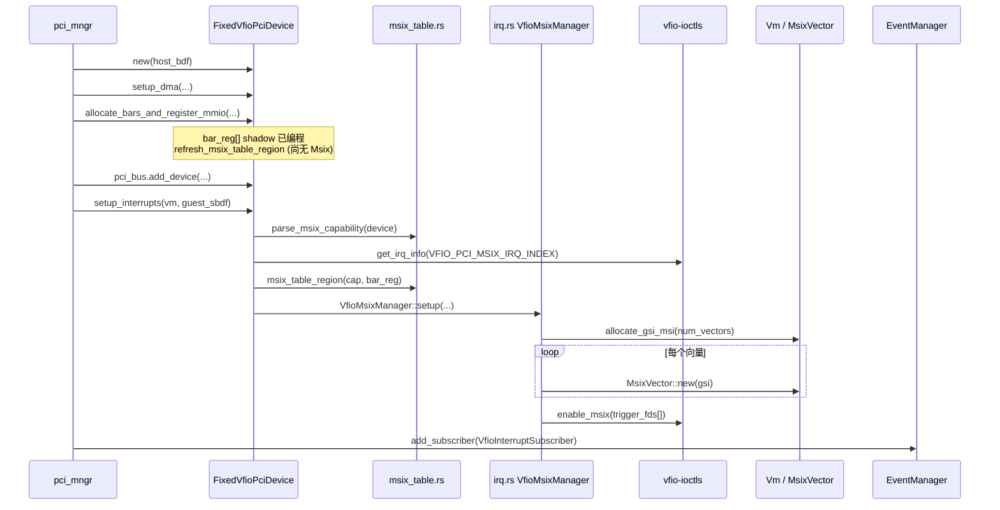
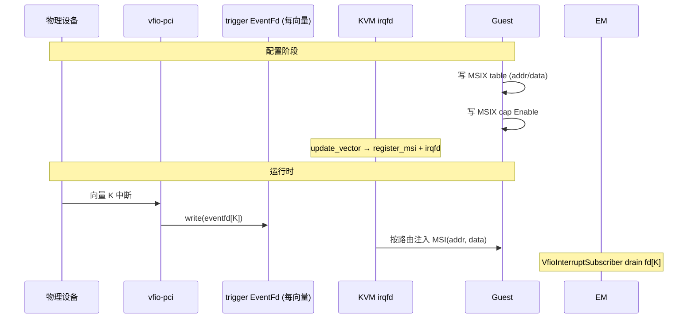

<!--
Copyright 2026 Amazon.com, Inc. or its affiliates. All Rights Reserved.
SPDX-License-Identifier: Apache-2.0
-->

## VFIO 直通设备 — MSI-X 实现说明

本文描述 **当前代码** 中 VFIO PCI 直通设备的 **MSI-X** 实现方式：模块职责、数据结构、函数调用链、guest 编程路径与中断投递闭环。

**相关文档**

| 文档 | 内容 |
|------|------|
| [../../backup_docs_vfio_usb/vfio-usb-controller-msi-implementation-zh.md](../../backup_docs_vfio_usb/vfio-usb-controller-msi-implementation-zh.md) | MSI（非 X）路径（已归档到仓库外 backup） |
| [../../backup_docs_vfio_usb/vfio-usb-controller-stage-bc-code-summary-zh.md](../../backup_docs_vfio_usb/vfio-usb-controller-stage-bc-code-summary-zh.md) | Stage B/C 总览（归档） |
| [../../backup_docs_vfio_usb/vfio-usb-stage-bc-key-logs-to-source-zh.md](../../backup_docs_vfio_usb/vfio-usb-stage-bc-key-logs-to-source-zh.md) | MSI-X 关键日志索引（归档） |

**说明**：当前 `setup_interrupts` **优先 MSI-X，失败则回退 MSI**（见 `device.rs`）。典型 USB xHCI 仅 MSI，走 MSI 分支；带 MSI-X 的设备（如部分 NPU）走本文路径。

---

## 1. 设计目标与核心思路

MSI-X 与 MSI 的关键差异：

| 项目 | MSI | MSI-X |
|------|-----|-------|
| 向量数 | 通常 1–32（2 的幂） | 可达数百（由 cap 报告） |
| 中断目标地址 | 写在 **config capability** 里 | 写在 **BAR 内 MSI-X table**（每向量 16 字节） |
| VFIO index | `VFIO_PCI_MSI_IRQ_INDEX` | `VFIO_PCI_MSIX_IRQ_INDEX` |
| Enable 控制 | Message Control bit 0 | Capability 内 Function Enable（bit 15） |

**Firecracker 必须解决的核心问题**：guest 写 BAR 里的 MSI-X table 时，若 MMIO 只转发到 VFIO 硬件，KVM **看不到** guest 编程的 `(addr, data, mask)`，无法建立 `KVM_IRQ_ROUTING_MSI`。因此采用 **策略 A（拦截 table MMIO）**：

1. guest 写 table → VMM 更新 **本地表项副本** → 同步 KVM 路由；
2. 写仍 **转发** 到 VFIO region（硬件侧也更新）；
3. guest 读 table → 从 **本地副本** 返回（不读 VFIO）。

VFIO 侧：每个向量一个 **trigger eventfd**，硬件中断时内核 write eventfd；KVM 侧：同一 fd 注册 **irqfd**，按路由表向 guest 注入 MSI 消息。

---

## 2. 模块与文件

| 文件 | 符号 | 职责 |
|------|------|------|
| `src/vmm/src/devices/pci/vfio/msix_table.rs` | `parse_msix_capability`、`MsixTableRegion`、`write_msix_table_entry` | 遍历 PCI cap 链解析 MSI-X；计算 table 在 guest 的 GPA 区间；表项读写 |
| `src/vmm/src/devices/pci/vfio/irq.rs` | `VfioMsixManager` | VFIO `SET_IRQS(MSIX)`、GSI 分配、KVM 路由同步、control/table 处理 |
| `src/vmm/src/devices/pci/vfio/interrupt.rs` | `VfioInterruptManager::Msix` | MSI / MSI-X 统一枚举 |
| `src/vmm/src/devices/pci/vfio/device.rs` | `setup_interrupts`、`read_bar`/`write_bar`、`write_config_register` | 分支选择、MMIO/config 分流、`refresh_msix_table_region` |
| `src/vmm/src/devices/pci/vfio/event_handler.rs` | `VfioInterruptSubscriber` | epoll drain 多个 trigger eventfd（MSI 1 个，MSI-X N 个） |
| `src/vmm/src/device_manager/pci_mngr.rs` | `attach_fixed_vfio_device` | attach 顺序：DMA → BAR → PCI bus → `setup_interrupts` → subscriber |
| `src/vmm/src/vstate/interrupts.rs` | `MsixVector` | 每向量：`gsi` + `event_fd` + `enable`/`disable`（irqfd） |
| `src/vmm/src/vstate/vm.rs` | `register_msi`、`set_gsi_routes` | KVM MSI 路由表（MSI 与 MSI-X 共用） |

**不复用**：`src/vmm/src/pci/msix.rs` 的 `MsixConfig` 是给 **virtio 模拟 MSI-X capability** 用的；VFIO 直通走 host 真实 cap + BAR 内 table。

---

## 3. 核心数据结构

```text
FixedVfioPciDevice
  └── irq: Option<VfioInterruptManager>
        └── Msix(VfioMsixManager)
              ├── cap: MsixCapInfo
              │     ├── cap_offset          // MSI-X capability 在 config 中的字节偏移
              │     ├── table_bir           // table 所在 BAR 编号 (0..5)
              │     ├── table_offset_in_bar // table 在 BAR 内的字节偏移
              │     └── num_vectors         // (Message Control & 0x7ff) + 1
              ├── table_region: MsixTableRegion
              │     ├── guest_base          // table 在 guest GPA 的起始
              │     └── len                 // num_vectors * 16
              ├── vectors: Vec<VfioMsixVector>
              │     └── [ per vector ]
              │           ├── index: u16     // VFIO 向量号 0..N-1
              │           ├── kvm: MsixVector   // gsi + event_fd
              │           └── entry: MsixTableEntry  // 本地 table 镜像
              ├── function_masked: bool      // capability Function Mask (bit 14)
              ├── function_enabled: bool     // capability Function Enable (bit 15)
              ├── guest_sbdf: PciSBDF
              └── vm: Arc<Vm>
```

**MSI-X table 表项布局**（`MsixTableEntry`，16 字节/向量）：

| 表项内偏移 | 字段 | 用途 |
|-----------|------|------|
| +0x0 | Message Address Low | KVM MSI 路由 `address_lo` |
| +0x4 | Message Address High | KVM MSI 路由 `address_hi` |
| +0x8 | Message Data | KVM MSI 路由 `data` |
| +0xC | Vector Control | bit 0 = Mask；1 表示该向量 masked |

**向量数上限**：`num_vectors = min(cap.num_vectors, vfio_irq.count, MAX_VFIO_MSIX_VECTORS)`，`MAX_VFIO_MSIX_VECTORS = 64`（`irq.rs`）。

---

## 4. 启动阶段（Attach）调用链

环境：`FC_VFIO_PCI_BDF=<host BDF>`，PCI 已启用。



### 4.1 `setup_interrupts` 中 MSI-X 分支

源码：`device.rs` L372–394。

```rust
if let Some(cap) = parse_msix_capability(&self.device) {
    if msix_count > 0 {
        if let Some(table_region) = msix_table_region(&cap, &self.bar_reg) {
            let msix = VfioMsixManager::setup(...)?;
            self.irq = Some(VfioInterruptManager::Msix(msix));
            return Ok(());
        }
    }
}
// 否则尝试 MSI 分支...
```

**前置条件**：

1. config 中存在 MSI-X capability（`cap_id == 0x11`）；
2. VFIO 报告 `VFIO_PCI_MSIX_IRQ_INDEX` 的 `count > 0` 且支持 `VFIO_IRQ_INFO_EVENTFD`；
3. 能用 **BAR shadow** `bar_reg[]` 算出 table 的 guest 物理地址（attach 时 BAR 已分配）。

### 4.2 `parse_msix_capability`

源码：`msix_table.rs` L78–126。

- 检查 Status 寄存器 Capabilities List 位；
- 从 offset `0x34` 遍历 capability 链表；
- 读到 MSI-X cap 时解析：
  - `num_vectors = (msg_ctl & 0x07ff) + 1`
  - `table_bir = table_raw & 0x7`
  - `table_offset_in_bar = table_raw & !0x7`

日志：`fixed-vfio: MSIX cap offset=... vectors=... table_bir=... table_off=...`

### 4.3 `msix_table_region`

源码：`msix_table.rs` L141–161。

用 shadow BAR 计算 table 在 guest 的区间：

```text
guest_base = BAR[bir] 基址（64-bit BAR 则拼 bir+bir+1）+ table_offset_in_bar
len        = num_vectors * 16
```

**为何依赖 BAR shadow**：guest 尚未 probe 时，Firecracker 在 Stage A 已把 BAR 编程到 guest MMIO 池；table 位置随 BAR 基址变化。BAR 被 guest 重编程后，`refresh_msix_table_region()` 会重新计算（`allocate_bars_and_register_mmio` / `sync_mmio_maps` 末尾调用）。

日志：`fixed-vfio: using MSIX table guest=[0x..0x..]`

### 4.4 `VfioMsixManager::setup`

源码：`irq.rs` L67–141。

| 步骤 | 动作 |
|------|------|
| 1 | `get_irq_info(VFIO_PCI_MSIX_IRQ_INDEX)` |
| 2 | `num_vectors = min(cap, vfio, 64)` |
| 3 | `allocate_gsi_msi(num_vectors)` — 每向量一个 GSI |
| 4 | 每向量 `MsixVector::new(gsi, false)` — 创建 trigger eventfd |
| 5 | `device.enable_msix(trigger_fds)` — VFIO `SET_IRQS`，硬件中断 → 对应 fd |
| 6 | 初始 `function_masked=true`, `function_enabled=false` |

**attach 时通常尚未** `sync_all_vectors` 到 guest 真实路由（guest 还没写 table / enable）；首次有效路由在 guest probe 后。

日志：

- `fixed-vfio: MSIX irq count=... using N vectors gsi pool`
- `fixed-vfio: VFIO SET_IRQS MSIX bound N trigger eventfds`

---

## 5. Guest 运行时：Config Space 写（Function Control）

路径：guest ECAM 写 → `PciConfigMmio::write` → `write_config_register`。

### 5.1 判定是否为 MSI-X control 写

`is_msix_config_write(reg_idx, offset, len)`：写区间是否与 `[cap_offset+2, cap_offset+4)` 重叠（Message Control 的 16 位，含 **Function Mask** bit 14 与 **Enable** bit 15）。

### 5.2 处理流程

源码：`device.rs` L616–642。

1. 从 **VFIO 真实 config** 读当前 control word（与 MSI 不同，MSI-X **没有**完整 cap shadow）；
2. merge guest 写入的 1/2 字节；
3. `on_msix_control_write(ctl)`：
   - `msix_control_from_write` → `(function_masked, function_enabled)`
   - **刚 enable**：`sync_all_vectors()` — 对所有向量调用 `update_vector`
   - **刚 disable**：`disable_all_vectors()` — 仅 unregister irqfd
   - **已 enable 且 mask 变化**：再次 `sync_all_vectors()`
4. 函数末尾仍 `region_write` 转发到 host config（与 MSI cap 写类似）。

日志：`fixed-vfio: MSIX control enabled=... masked=...`

---

## 6. Guest 运行时：BAR MMIO 写/读（MSI-X Table）

### 6.1 地址命中判定

`table_index_for_offset(bar_base, offset, len)`：

1. `table_region.contains(bar_base, offset, len)` — 访问完全落在 table 区间内；
2. `table_index = (bar_base + offset - guest_base) / 16` — 向量下标；
3. `entry_offset = (bar_base + offset - guest_base) % 16` — 表项内偏移。

### 6.2 写 table（`write_bar`）

源码：`device.rs` L747–767，`irq.rs` `write_table` → `update_vector`。

```text
guest 写 BAR MMIO
  → table_index_for_offset 命中
  → write_msix_table_entry(entry, entry_offset, data)  // 更新本地 MsixTableEntry
  → update_vector(index)                               // 同步 KVM
  → region_write(vfio_region, data, offset)            // 仍转发硬件
```

`write_msix_table_entry` 支持 **4 字节** 或 **8 字节** 对齐访问（PCI 常见宽度）。

日志：

- `fixed-vfio: MSIX table entry addr=... data=... masked=...`
- `fixed-vfio: BAR MMIO write (MSIX table) ...`
- `fixed-vfio: MSI route updated vec=... gsi=...`（向量未 masked 时）

### 6.3 读 table（`read_bar`）

源码：`device.rs` L699–704。

- 命中 table → `read_msix_table_entry` 从 **本地副本** 返回；
- **提前 return**，不调用 VFIO `region_read`。

guest 读到的 mask/addr 与 VMM 用于 KVM 路由的一致。

### 6.4 非 table 的 BAR 访问

未命中 table 区间 → 正常 VFIO `region_read` / `region_write`（Stage A 寄存器窗口）。

---

## 7. KVM 路由同步：`update_vector`

源码：`irq.rs` L225–257。MSI 的 `sync_route` 是单向量版；MSI-X 对每个向量调用此函数。

```text
masked = function_masked || entry.masked() || !function_enabled

if masked:
    kvm.disable(vmfd)              // unregister_irqfd

vm.register_msi(kvm, masked, MsixVectorConfig { lo, hi, data, devid })
vm.set_gsi_routes()                // KVM_SET_GSI_ROUTING

if !masked:
    kvm.enable(vmfd)               // register_irqfd(event_fd, gsi)
    log "MSI route updated vec=..."
```

**masked 为 true 时**：路由条目标记为 masked，不进入 `set_gsi_routes` 提交表，且 irqfd 已 disable。

**顺序**（与 virtio `MsixVectorGroup::update` 一致）：先 disable → register_msi → set_gsi_routes → enable，避免旧内核 panic。

---

## 8. 中断投递完整闭环



| 环节 | 负责模块 |
|------|----------|
| 硬件 → eventfd | VFIO `enable_msix`（attach 时绑定） |
| eventfd → guest MSI | KVM `register_irqfd` + `KVM_IRQ_ROUTING_MSI` |
| epoll drain | `VfioInterruptSubscriber`（不注入中断，仅读空 fd） |

MSI-X 与 MSI 共用 `MsixVector` / `register_msi`；差异是 MSI-X **N 个向量、N 个 fd**，MSI **1 个**。

---

## 9. BAR 变更与 `refresh_msix_table_region`

guest 通过 config 重编程 BAR 基址后，`sync_mmio_maps` 更新 MMIO bus。若设备已是 MSI-X 模式：

```rust
fn refresh_msix_table_region(&mut self) {
    if let Some(VfioInterruptManager::Msix(msix)) = self.irq.as_mut() {
        if let Some(region) = msix_table_region(msix.cap(), &self.bar_reg) {
            msix.update_table_region(region);
        }
    }
}
```

**注意**：当前实现 **只更新** `table_region` 的 guest 地址范围，**不会**在 BAR 移动后自动对全部向量重新 `sync_all_vectors`。guest 驱动通常在 BAR 稳定后才会写 table；若遇边界场景需结合 log 排查。

---

## 10. Teardown

`Drop for FixedVfioPciDevice` → `VfioMsixManager::teardown`：

1. `device.disable_msix()` — VFIO 解除 MSIX trigger 绑定；
2. 对每个向量 `kvm.disable` — unregister irqfd。

GSI **未** 显式归还 allocator（与 virtio 类似，进程退出释放）。

---

## 11. 关键 Debug 日志速查

| 日志 | 位置 | 含义 |
|------|------|------|
| `MSIX cap offset=... vectors=...` | `msix_table.rs` | 解析到 MSI-X capability |
| `using MSIX table guest=[...]` | `device.rs` | table 在 guest 的 GPA 区间 |
| `MSIX irq count=... using N vectors` | `irq.rs` | 实际使用的向量数 |
| `SET_IRQS MSIX bound N trigger eventfds` | `irq.rs` | VFIO 侧绑定完成 |
| `MSIX control enabled=... masked=...` | `irq.rs` | guest 写 function control |
| `MSIX table entry addr=...` | `msix_table.rs` | 表项内容变化 |
| `BAR MMIO write (MSIX table)` | `device.rs` | guest 写 table MMIO |
| `MSI route updated vec=... gsi=...` | `irq.rs` | 某向量 KVM 路由生效 |
| `irq eventfd activity vec=N` | `event_handler.rs` | 硬件中断触发第 N 向量 |

筛选示例：

```bash
grep -E 'fixed-vfio: (MSIX|MSI route updated|irq eventfd|BAR MMIO write \\(MSIX)' firecracker.log
```

---

## 12. MSI-X vs MSI（当前代码）

| 项目 | MSI-X | MSI |
|------|-------|-----|
| 源码 | `irq.rs` + `msix_table.rs` | `msi.rs` |
| VFIO index | `VFIO_PCI_MSIX_IRQ_INDEX` | `VFIO_PCI_MSI_IRQ_INDEX` |
| 向量数 | up to 64 | 1 |
| Guest 配置位置 | BAR 内 table + cap control | config capability 内 |
| VMM shadow | 每向量 `MsixTableEntry` + function enable/mask | 整个 cap `MsiConfigShadow` |
| 路由更新触发 | `write_table` / `on_msix_control_write` | `on_config_write` → `sync_route` |
| Config 写处理 | 仅 intercept **control 字** | intercept **整个 cap 区间** |
| Table MMIO | 拦截（读本地/写本地+KVM+转发） | 无 table |

`setup_interrupts`：**先 MSIX，成功即 return；否则 MSI**。

---

## 13. 已知限制（相对完整 MSI-X 模拟）

| 项目 | 当前行为 |
|------|----------|
| 向量上限 | 硬编码 `MAX_VFIO_MSIX_VECTORS = 64`，设备报告更多会被截断 |
| PBA (Pending Bit Array) | 未单独模拟；table 读走本地副本 |
| INTx / MSI 回退 | 无 MSIX 且无 MSI 时 attach 失败 `NoInterruptSupport` |
| GSI 回收 | teardown 仅 disable，不归还 allocator |
| MSIX cap 除 control 外的写 | 不更新 VMM shadow，直接转发 VFIO |
| virtio `MsixConfig` | 不使用 |

---

## 14. 函数索引（便于跳转）

```
attach_fixed_vfio_device                    pci_mngr.rs
  setup_interrupts                          device.rs:367
    parse_msix_capability                   msix_table.rs:78
    msix_table_region                       msix_table.rs:141
    VfioMsixManager::setup                  irq.rs:67

guest config write
  write_config_register                     device.rs:596
    on_msix_control_write                   irq.rs:170
      sync_all_vectors / disable_all_vectors  irq.rs:259,266

guest BAR MMIO
  write_bar / read_bar                      device.rs:698,736
    write_table / read_table                irq.rs:204,217
      update_vector                         irq.rs:225

runtime interrupt
  VfioInterruptSubscriber::process          event_handler.rs:45

teardown
  VfioMsixManager::teardown                 irq.rs:273
```

---

## 15. 最小理解 checklist

1. **MSI-X table 在 BAR 里** → 必须拦截 MMIO，不能只转发 VFIO。
2. **每个向量一个 eventfd** → VFIO trigger + KVM irqfd 共用同一 fd。
3. **KVM 路由来自本地 table 副本** → guest 写 table 触发 `update_vector`。
4. **Function Enable/Mask** → config control 写触发 `sync_all_vectors` 或 `disable_all_vectors`。
5. **table 的 guest 地址** → 由 `bar_reg[]` shadow + cap 里的 BIR/offset 算出，BAR 变后要 `refresh_msix_table_region`。
